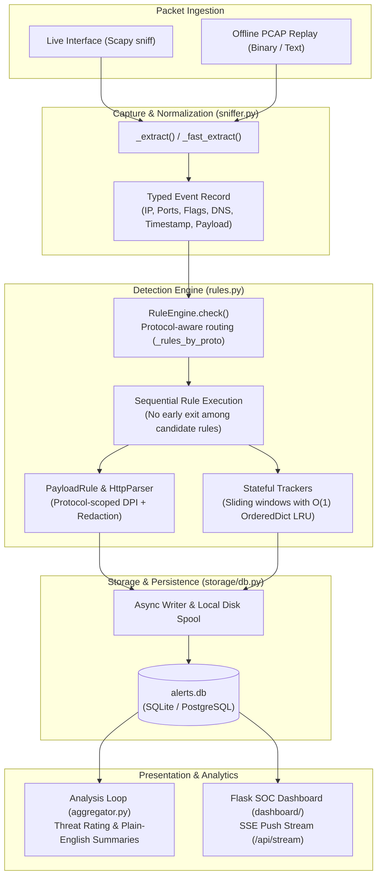

# 🛡️ NetGuard IDS

> **A Lightweight, First-Principles Network Intrusion Detection System with Plain-Language SOC Visualization**

[](ids_project/tests/)
[](https://python.org)
[](docs/DETECTION_ENGINE.md)
[](docs/DETECTION_ENGINE.md#12-payload_hit)
[](docs/ARCHITECTURE.md)
[](ids_project/dashboard/)
[](ids_project/storage/db.py)
[](LICENSE)

---

## 💡 Overview & Motivation

Modern small-office and home networks face sophisticated threats, from automated credential brute force and network scanning to web exploit injection and data exfiltration. While enterprise tools such as Suricata, Zeek, or Snort offer powerful inspection engines, their output consists of opaque technical event logs designed for specialized SOC teams.

**NetGuard IDS** is built from first principles to provide transparent, explainable network threat detection:
1. **Engineered from Scratch:** Packet capture, protocol decoding, stateful sliding-window counters, and pattern matching are written in Python without black-box engine dependencies.
2. **23 Evidence-Driven Detection Rules:** Governed by strict rule admission invariants where every rule provides distinct, justified, tested, and maintainable detection value.
3. **Application-Aware DPI (`HttpParser`):** Deep packet inspection contextualizes HTTP requests, methods, paths, headers, and form bodies to eliminate false alarms on benign protocol traffic while detecting SQLi, XSS, webshell uploads, and Log4Shell.
4. **Plain-Language Incident Narratives:** Translates low-level packet heuristics into clear, actionable sentences for everyday network administrators.
5. **Interactive 10-Workspace SOC Platform:** Responsive dark-mode dashboard featuring 10 dedicated analyst workspaces (Traffic Explorer with bidirectional 5-tuple flow tracking and PCAP slicing, Threat Hunting, Incident Cases, Isolated PCAP Analysis, 9-Format Reporting, Statistical Baselines with Median Absolute Deviation, and Rule Tuning).
6. **High-Throughput Parallel Pipeline:** Lock-free concurrent parsing pool with bounded monotonic reorder buffer auto-tuned to hardware capability (`low`, `balanced`, `throughput`), yielding 100% exact alert reconciliation against the sequential reference engine.
7. **Strict Isolation & Zero Mockups:** Every feature is backed by real persistent database models (SQLite/PostgreSQL) and active REST APIs; offline PCAP replays run inside an isolated sandbox guaranteeing zero contamination of live monitoring data.

---

## 🏛️ System Architecture



---

## 📚 Complete Documentation Suite

Detailed, developer-grade documentation is organized in the [`docs/`](docs/) directory:

| Document | Description |
|---|---|
| 📄 **[docs/ARCHITECTURE.md](docs/ARCHITECTURE.md)** | Full architectural breakdown, component interactions, packet schema, alert schema, and `HttpParser` pipeline. |
| 🚀 **[docs/INSTALLATION_AND_USAGE.md](docs/INSTALLATION_AND_USAGE.md)** | Step-by-step setup, running with or without root, live monitoring, PCAP replay, and evaluation commands. |
| ⚙️ **[docs/CONFIGURATION.md](docs/CONFIGURATION.md)** | Complete reference of all configurable thresholds, timings, paths, and environment variable overrides. |
| 🔍 **[docs/DETECTION_ENGINE.md](docs/DETECTION_ENGINE.md)** | Exhaustive technical guide to all 23 detection rules, the 18 DPI signatures, state bounding, and limitations. |
| 🧪 **[docs/TESTING_AND_DATA_SOURCES.md](docs/TESTING_AND_DATA_SOURCES.md)** | Breakdown of the 854-test suite, 42 test modules, synthetic PCAPs, and the 22-capture external benchmark corpus. |
| 📊 **[docs/EVALUATION_RESULTS.md](docs/EVALUATION_RESULTS.md)** | Scientifically careful evaluation metrics, alert reconciliation, ground-truth flow matching, and DPI hardening results. |
| 🛠️ **[docs/DEVELOPMENT_WORKFLOW.md](docs/DEVELOPMENT_WORKFLOW.md)** | Guide for contributors: adding a detection rule, LRU memory bounding, Git branch invariants, and testing gates. |
| 🔧 **[docs/TROUBLESHOOTING.md](docs/TROUBLESHOOTING.md)** | Solutions for common runtime errors, socket permission setup, PCAPNG conversion, and privacy safeguards. |
| 📋 **[docs/RELEASE_READINESS_REPORT.md](docs/RELEASE_READINESS_REPORT.md)** | Release candidate audit, architecture verification, 11-gate reporting check, and quality report. |
| 🛡️ **[docs/DASHBOARD_AND_FORENSICS_GUIDE.md](docs/DASHBOARD_AND_FORENSICS_GUIDE.md)** | SOC Dashboard manual across all 10 workspaces, Traffic Explorer, Investigation Drawer, and REST APIs. |
| ⚡ **[docs/PARALLEL_PERFORMANCE_GUIDE.md](docs/PARALLEL_PERFORMANCE_GUIDE.md)** | Parallel packet processing pipeline, auto-profile sizing, bounded reorder buffer, and reconciliation proofs. |
| 📦 **[docs/PCAP_ANALYSIS_AND_RETENTION.md](docs/PCAP_ANALYSIS_AND_RETENTION.md)** | Rotating continuous libpcap ring-buffer, dynamic flow PCAP slicing, and sandboxed offline replay. |
| 🔔 **[docs/NOTIFICATION_INTEGRATIONS.md](docs/NOTIFICATION_INTEGRATIONS.md)** | Multi-channel alert dispatch (SMTP, Telegram, Webhook with HMAC-SHA256, SMS), outbox queuing & cooldowns. |
| 🏆 **[docs/UPGRADE_RELEASE_REPORT.md](docs/UPGRADE_RELEASE_REPORT.md)** | Comprehensive certification report of the SOC Dashboard, Forensics & Parallel Performance upgrade. |
| 🔮 **[docs/AI_ML_AUTONOMOUS_DEFENSE_ROADMAP.md](docs/AI_ML_AUTONOMOUS_DEFENSE_ROADMAP.md)** | *(Future Vision)* Long-term architectural roadmap towards stateful intelligence and autonomous defense. |

---

## ⚡ Quick Start Guide

### 1. Prerequisites
- Linux (Ubuntu, Debian, Fedora, Arch, Raspberry Pi OS)
- Python 3.11+
- Optional: `wireshark-tools` (for `editcap` `.pcapng` conversion)

### 2. Clone and Setup Environment

```bash
# Clone the repository
git clone https://github.com/harshitagrwl1608/Network_Intrusion_Detection_System.git
cd Network_Intrusion_Detection_System

# Create and activate virtual environment
python3 -m venv ids_project/.venv
source ids_project/.venv/bin/activate

# Install required dependencies
pip install -r ids_project/requirements.txt
```

### 3. Run Automated Tests & Synthetic Evaluation

```bash
# Run the complete test suite (854 unit and regression tests)
python3 -m pytest ids_project/tests -q

# Run synthetic scenario evaluation (42 attack scenarios + benign check)
python3 ids_project/evaluation/run_eval.py
```

### 4. Replay a PCAP Capture

Replay any classic `.pcap` capture deterministically using `ReplayClock` without needing root privileges:

```bash
# Replay synthetic attack capture into an isolated SQLite database
python3 -m ids_project.evaluation.replay \
    --pcap ids_project/data/test_attacks.pcap \
    --db /tmp/evaluation_alerts.db

# Inspect generated alerts
sqlite3 /tmp/evaluation_alerts.db "SELECT rule_name, severity, detail FROM alerts;"
```

### 5. Start Live Monitoring & Dashboard

Live sniffing on network interfaces requires raw socket capabilities (`CAP_NET_RAW` or root):

```bash
# Option A: Run directly with sudo
cd ids_project
sudo python3 main.py

# Option B: Run without root by granting raw socket capability
sudo setcap cap_net_raw,cap_net_admin=eip $(readlink -f ids_project/.venv/bin/python3)
python3 ids_project/main.py
```

Open your browser and navigate to **`http://127.0.0.1:5000`** to access the SOC dashboard.

---

## 🔍 The 23 Detection Rules At a Glance

NetGuard maintains **23 registered detection rules**. For each incoming packet, `RuleEngine` selects protocol-compatible candidate rules via `_rules_by_proto` and executes them sequentially without early exit among the selected candidates (unknown or unclassified protocols fall back to evaluating all 23 rules). For full architectural details, see [docs/ARCHITECTURE.md](docs/ARCHITECTURE.md) and [docs/DETECTION_ENGINE.md](docs/DETECTION_ENGINE.md):

| Category | Rules | Key Capabilities |
|---|---|---|
| **Threat Intel** | `BLOCKLIST` | Sets $O(1)$ lookup against auto-refreshed C2 feeds (Feodo Tracker). |
| **Reconnaissance** | `PORT_SCAN`, `UDP_SCAN`, `TCP_STEALTH_SCAN`, `SLOW_PORT_SCAN`, `ICMP_SWEEP` | Horizontal and vertical port scans, FIN/NULL/Xmas stealth probes, low-and-slow scanning, ping sweeps. |
| **Denial of Service** | `SYN_FLOOD`, `DISTRIBUTED_SYN_FLOOD`, `UDP_FLOOD`, `ICMP_FLOOD`, `TCP_ZERO_WINDOW` | TCP SYN bursts with closed-port RST suppression, DDoS volumetric multi-source floods, QUIC-aware UDP flood thresholds, Sockstress zero-window detection. |
| **Layer 2 & Protocol** | `ARP_SPOOF`, `TCP_FLAG_ANOMALY`, `IP_FRAGMENT_ANOMALY` | Hardware MAC poisoning tracking, invalid TCP flag combinations (SYN+FIN, SYN+RST), Teardrop overlapping IP fragments, Ping of Death. |
| **Application & DPI** | `PAYLOAD_HIT`, `DNS_ANOMALY`, `BRUTE_FORCE`, `DATA_EXFIL` | Deep packet inspection with `HttpParser` context (18 signatures), Shannon entropy DGA and DNS covert tunneling, SSH/FTP/RDP authentication brute force, outbound data exfiltration. |
| **Covert Channels** | `CLEAR_HTTP_ON_TLS_PORT`, `TLS_ANOMALY`, `NON_DNS_TRAFFIC_ON_DNS_PORT`, `ICMP_TUNNEL`, `IRC_C2_BEACONING` | Plaintext HTTP on port 443, direct-IP SNI violations, backdoors on DNS port 53, high-entropy ICMP tunnels, IRC botnet beaconing. |

*For complete technical details, mathematical formulas, and threshold configurations, see [docs/DETECTION_ENGINE.md](docs/DETECTION_ENGINE.md).*

---

## 🔬 PAYLOAD_HIT Deep Packet Inspection (DPI)

The `PAYLOAD_HIT` engine evaluates packet payloads and TCP stream slices using application-aware HTTP parsing ([`ids_project/engine/http_parser.py`](ids_project/engine/http_parser.py)):

- **Application Awareness:** Dissects incoming streams into HTTP request lines, URI paths, headers, query parameters, and form bodies (`x-www-form-urlencoded` and multipart).
- **Client vs. Server Direction:** Suppresses client injection rules on server responses (`HttpDirection.RESPONSE`) to avoid false alarms from echoed queries or reflected scripts.
- **Protocol Context Scoping:** Evaluates web exploit patterns strictly on HTTP, database, or command ports, preventing spurious alerts on mail protocols (SMTP MIME boundaries).
- **Credential Scrubbing:** Automatically redacts passwords, tokens, and authorization strings in forensic alert evidence with `[REDACTED]`.
- **18 Threat Signatures:** Detects SQL Injection, XSS, Command Injection, Path Traversal, SSRF, Log4Shell (CVE-2021-44228), XXE, SSTI, Shellshock, Java/Python Deserialization, HTTP Method Tampering, Webshell Uploads, and ICS TriStation 1131 exploits.

---

## 📊 Evaluation & Verification Summary

NetGuard's detection efficacy is verified across multiple empirical tiers:

1. **Unit & Regression Suite:** **854 passed** tests across 42 modules (`ids_project/tests/`).
2. **Controlled Synthetic Scenarios:** **42 / 42** attack scenarios detected; **0 false positives** on benign traffic (`run_eval.py`).
3. **Multi-Dataset Ground-Truth Benchmark (22 PCAPs, 3.24 GiB, 37.5M packets):**
   - Replay across GeNIS, CICIoT2023, CTU-IoT-23, Wireshark sample captures, and Fox-IT Log4Shell honeypots (582 total alerts reconciled across 156 flow TPs, 137 benign FPs, 26 unscorable, 263 scenario-level, and 0 unmatched).
   - **156 Flow True Positives** verified against published 5-tuple ground-truth labels.
   - **263 scenario-level alerts** occurred in attack-labelled captures. Individual alert-to-ground-truth attribution is unavailable for these captures, so they are not counted as flow-verified true positives.
   - Detailed per-rule confusion matrices and throughput statistics recorded in [docs/EVALUATION_RESULTS.md](docs/EVALUATION_RESULTS.md).
4. **DPI Hardening Verification (6 Evaluated Captures):**
   - **Benign FP Elimination:** Reduced false-positive SQLi alerts in benign email/web browsing (`genis_benign_user_activity`) from **8 to 0 (-100% FP elimination)**.
   - **Capture-Specific Attack Verification:**
     - `ciciot_sqli`: **48 alerts** (`PAYLOAD_HIT` SQL injection).
     - `ciciot_xss`: **19 alerts** (`PAYLOAD_HIT` cross-site scripting).
     - `ciciot_upload`: **8 alerts** (`PAYLOAD_HIT` webshell upload and path traversal; spurious SQLi eliminated).
     - `ciciot_cmdinj`: Spurious SQLi removed; attack detection preserved via **`NON_DNS_TRAFFIC_ON_DNS_PORT`**.
     - `attack_foxit_log4shell`: **1 alert** (`PAYLOAD_HIT` CVE-2021-44228 JNDI/LDAP RCE).

---

## 🔒 Security, Privacy & Invariants

- **Credential Redaction:** Alert evidence automatically masks cleartext passwords, Bearer tokens, and Basic auth credentials before saving to disk.
- **Zero Secret Commits:** `.gitignore` excludes `.env`, `alerts.db`, `arp_table.json`, and raw `.pcap` files.
- **Bounded State:** All sliding-window detection rules enforce $O(1)$ memory consumption via `OrderedDict` LRU caches with periodic time-based pruning (`prune_stale`).
- **Git Branch Invariant:** Active development is maintained strictly on the `antigravity/overnight-work` branch. Direct commits or force-pushes to `main` are strictly forbidden.

---

## 🎓 Academic Context & Credits

- **Author:** Harshit Garg
- **Mentorship:** Dr. Shivi Garg
- **Institution:** J.C. Bose University of Science and Technology, YMCA
- **Threat Intelligence:** [Feodo Tracker](https://feodotracker.abuse.ch/) & [abuse.ch](https://abuse.ch/)
- **Reference Baselines:** [Suricata IDS/IPS](https://suricata.io/) & [Zeek Network Security Monitor](https://zeek.org/)

---

## 📄 License

This project is licensed under the [MIT License](LICENSE).
