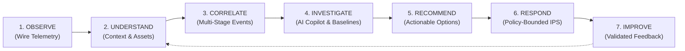
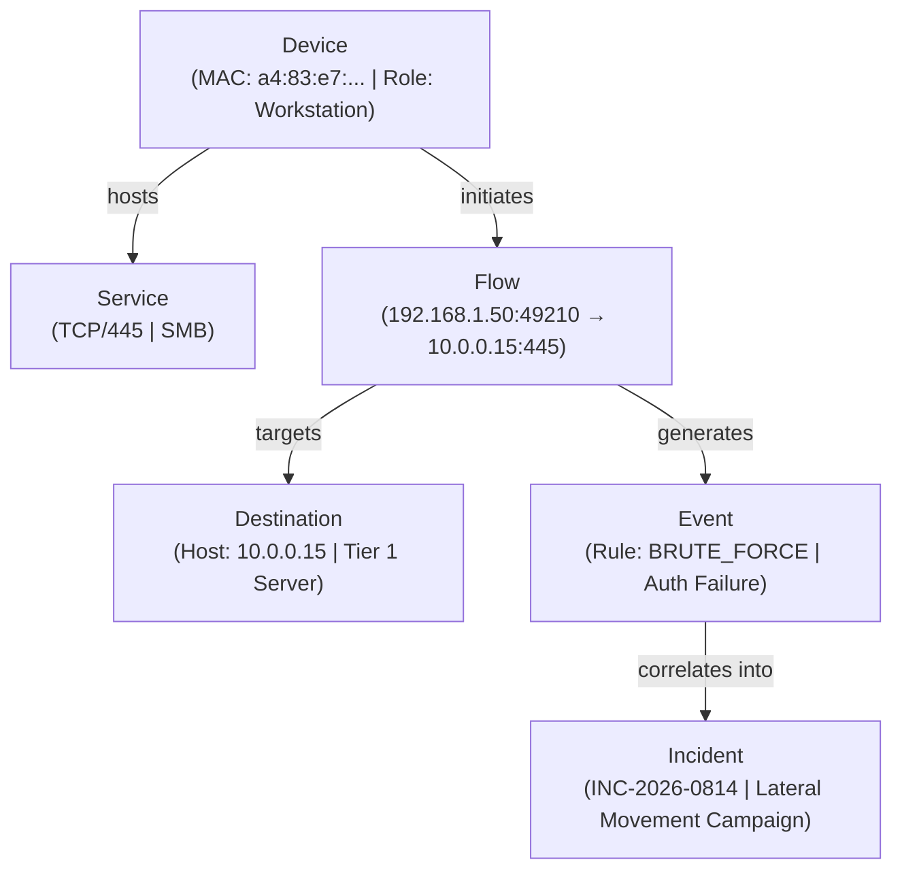
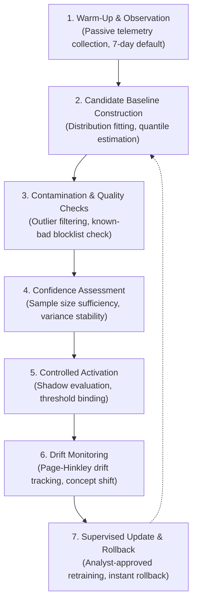
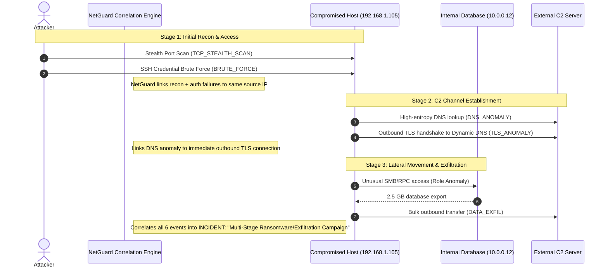
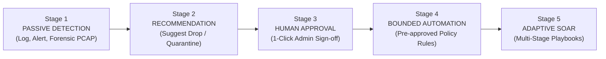
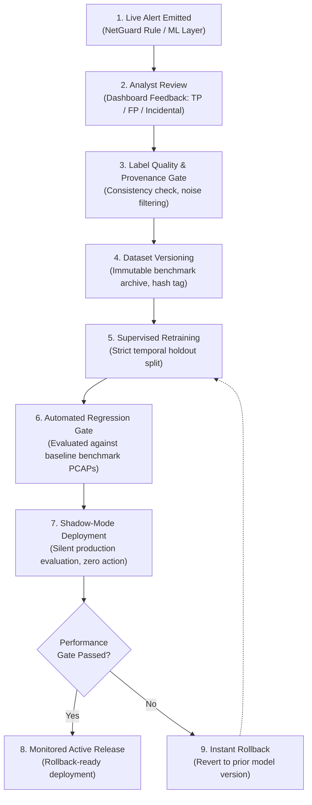

# NetGuard IDS — Long-Term AI/ML and Autonomous Defense Roadmap

**Document ID:** `NETGUARD-ROADMAP-AIML-2026`  
**Status:** Architectural Design & Future Vision  
**Target Repository:** `harshitagrwl1608/Network_Intrusion_Detection_System`  
**Branch:** `antigravity/overnight-work`  
**Last Updated:** November 2026  

---

> [!IMPORTANT]
> ### ⚠️ Status and Epistemic Disclaimer
> **This document is an architectural design specification and future research roadmap.**
> The capabilities described herein—including stateful network entity tracking, adaptive statistical baselining, machine learning anomaly detection (e.g., Isolation Forest, behavioral clustering), automated incident correlation graphs, AI-assisted security analyst copilot, and autonomous intrusion prevention—represent NetGuard's **long-term evolutionary direction**.
>
> NetGuard IDS is currently a **lightweight, deterministic, rule-based Intrusion Detection System** with 23 evidence-driven detection rules, Deep Packet Inspection (DPI), heuristic sliding-window state tracking, and a real-time Flask SOC visualization dashboard. **None of the autonomous or machine learning capabilities described in this roadmap are currently active in production code.** They are intentionally staged across disciplined phases requiring strict empirical verification before deployment.

---

## 📖 Table of Contents

1. [Vision & Guiding Philosophy](#1-vision--guiding-philosophy)
2. [Proposed Architectural Evolution](#2-proposed-architectural-evolution)
   - [2.1 Stateful Network Intelligence Layer](#21-stateful-network-intelligence-layer)
   - [2.2 Adaptive Baseline & Behaviour Modelling](#22-adaptive-baseline--behaviour-modelling)
   - [2.3 Machine Learning Detection Layer](#23-machine-learning-detection-layer)
   - [2.4 Complex Event Correlation & Behavioural Reasoning](#24-complex-event-correlation--behavioural-reasoning)
   - [2.5 AI-Assisted Security Analyst Copilot](#25-ai-assisted-security-analyst-copilot)
   - [2.6 Automated Response & IPS Evolution](#26-automated-response--ips-evolution)
3. [Future Learning & Controlled Feedback Loop](#3-future-learning--controlled-feedback-loop)
4. [Performance, Privacy & Deployment Considerations](#4-performance-privacy--deployment-considerations)
   - [4.1 Hardware Budgets & Streaming Feature Extraction](#41-hardware-budgets--streaming-feature-extraction)
   - [4.2 Privacy-by-Design & Data Minimization](#42-privacy-by-design--data-minimization)
   - [4.3 Operational Profiles (Home, Enterprise, IoT, OT/SCADA)](#43-operational-profiles-home-enterprise-iot-otscada)
5. [Phased Future Roadmap (Phases 0–7)](#5-phased-future-roadmap-phases-07)
6. [Summary of Architectural Invariants](#6-summary-of-architectural-invariants)

---

## 1. Vision & Guiding Philosophy

NetGuard IDS was conceived as a first-principles, accessible network monitoring solution designed to provide home, small-business, and edge network administrators with transparent, plain-English visibility into complex network events.

The long-term vision is to evolve NetGuard from an **isolated, packet-by-packet rule-evaluation engine** into an **intelligent, stateful, context-aware network security monitoring and autonomous defense platform**.

### 1.1 The Operational Evolution Loop

Modern enterprise networks, smart homes, and industrial control systems cannot be defended through static thresholds alone. Attackers intentionally tune their operations to bypass rigid rules (e.g., low-and-slow port scans, living-off-the-land administrative protocols, covert DNS tunneling). Conversely, aggressive static rules create alert fatigue by flagging benign network maintenance, cloud backups, and IoT telemetry.

To address this challenge, NetGuard's architecture is designed around an end-to-end operational continuum:



### 1.2 Core Strategic Objectives

1. **Maintain Contextual Knowledge:** Maintain an awareness of network entities, active services, host roles, device categories, and recurring communication graphs.
2. **Learn Environment-Specific Normalcy:** Automatically establish statistical and behavioral baselines tailored to the specific deployment environment, respecting diurnal and weekly operational rhythms.
3. **Detect Deviations Beyond Static Rules:** Surface subtle, multivariate behavioral anomalies that evade traditional static signatures without relying on uncalibrated heuristics.
4. **Discover Coordinated Attack Campaigns:** Reconstruct multi-stage, multi-host, and multi-protocol attack sequences across extended time horizons into unified security incidents.
5. **Empower Analysts with Explainable AI:** Provide interactive, plain-language incident triage, evidence retrieval, and root-cause analysis that bridges the gap between raw packet captures and non-specialist administrators.
6. **Execute Policy-Bounded Defensive Action:** Progressively evolve from passive intrusion detection (IDS) to active intrusion prevention (IPS) under strict human-in-the-loop authorization, hardcoded allowlists, and reversible mitigation actions.
7. **Continuous, Validated Self-Improvement:** Refine detection models and baselines via closed-loop analyst feedback, rigorous regression validation, and anti-poisoning safeguards.

---

## 2. Proposed Architectural Evolution

```
┌───────────────────────────────────────────────────────────────────────────────────────┐
│                           FUTURE NETGUARD ARCHITECTURE                                │
└───────────────────────────────────────────────────────────────────────────────────────┘
                                           │
                                           ▼
 ┌─────────────────────────────────────────────────────────────────────────────────────┐
 │                      1. WIRE TELEMETRY & CAPTURE LAYER                              │
 │   • High-Performance Raw Socket Ingestion (AF_PACKET / eBPF / Scapy)                │
 │   • Zero-Copy Packet Decoding (Ethernet, IPv4/IPv6, TCP, UDP, ARP, ICMP, DNS)       │
 └─────────────────────────────────────────┬───────────────────────────────────────────┘
                                           │
                                           ▼
 ┌─────────────────────────────────────────────────────────────────────────────────────┐
 │                  2. STATEFUL NETWORK INTELLIGENCE LAYER                             │
 │   • Persistent Device & Host Inventory (MAC, IP, Vendor OUI, Hostname, OS)         │
 │   • Service & Role Identification (DNS Server, Gateway, Domain Controller, IoT)     │
 │   • Topological Communication Graph (Host ↔ Host, Subnet ↔ Subnet)                  │
 │   • Memory-Bounded Sliding State Windows ($O(1)$ LRU with deterministic prune)     │
 └──────────────────────┬──────────────────────────────────────┬───────────────────────┘
                        │                                      │
                        ▼                                      ▼
 ┌─────────────────────────────────────────┐  ┌────────────────────────────────────────┐
 │   3A. DETERMINISTIC RULE ENGINE         │  │   3B. ADAPTIVE ML & ANOMALY LAYER      │
 │   • 23 Evidence-Driven Core Rules       │  │   • Multi-level Statistical Baselines  │
 │   • DPI Signatures (Multi-Pass Normal)  │  │   • Isolation Forest Outlier Detection │
 │   • Fixed Boundary Checks ($1..65535$)   │  │   • Flow-Window Entropy & Time Series  │
 │   • abuse.ch C2 Blocklist Feeds         │  │   • Graph Anomaly & Centrality Shifts  │
 └──────────────────────┬──────────────────┘  └────────────────────┬───────────────────┘
                        │                                          │
                        └──────────────────┬───────────────────────┘
                                           │ Alerts & Anomaly Signals
                                           ▼
 ┌─────────────────────────────────────────────────────────────────────────────────────┐
 │                 4. COMPLEX EVENT CORRELATION & INCIDENT ENGINE                      │
 │   • Multi-Stage Attack Hypothesis Construction (Recon → Brute Force → C2 → Exfil)   │
 │   • Graph-Based Incident Aggregation across Time Windows and Protocols              │
 │   • Immutable Forensic Evidence Preservation (Raw Packets, Flow Tuples, Alert IDs)  │
 └─────────────────────────────────────────┬───────────────────────────────────────────┘
                                           │ Structured Incidents
                                           ▼
 ┌─────────────────────────────────────────────────────────────────────────────────────┐
 │                    5. AI-ASSISTED SECURITY ANALYST COPILOT                          │
 │   • Plain-English Incident Narratives & Root-Cause Hypotheses                       │
 │   • Evidence-Grounded Investigation Guidance (Fact vs. Inference Separation)        │
 │   • Forensic Report Generation (Markdown, PDF, JSON-LD)                             │
 └─────────────────────────────────────────┬───────────────────────────────────────────┘
                                           │ Action Recommendations
                                           ▼
 ┌─────────────────────────────────────────────────────────────────────────────────────┐
 │                  6. POLICY-BOUNDED AUTONOMOUS DEFENSE (IPS)                         │
 │   • 5-Stage Progression: Detection → Recommendation → Approval → Automation → SOAR │
 │   • Hardcoded Inviolable Allowlists (Gateways, DNS, DCs, Management IPs)            │
 │   • Host Isolation & Ephemeral Drops via iptables / nftables / ufw (Time-Bounded)   │
 │   • Emergency Global Bypass & Immutable Cryptographic Audit Log                     │
 └─────────────────────────────────────────────────────────────────────────────────────┘
```

---

### 2.1 Stateful Network Intelligence Layer

Traditional lightweight intrusion detection engines inspect packets in near isolation or rely on transient, short-lived sliding windows. To achieve true situational awareness, NetGuard will introduce a **Stateful Network Intelligence Layer** that maintains persistent contextual knowledge of the monitored network environment.

#### 2.1.1 Core Entity Capabilities
1. **Persistent Device & Host Inventory:** Tracks MAC addresses, dynamic and static IP mappings, DHCP lease associations, mDNS/NetBIOS/LLMNR hostnames, and vendor OUI metadata.
2. **Service & Role Identification:** Discovers and classifies host roles (e.g., internal DNS resolver, default gateway, NAS, printer, camera, domain controller, engineering workstation) based on active ports, handshake banners, and traffic asymmetry.
3. **Host-to-Host Communication Graph:** Records historical communication pairs, edge weights (frequency, volume), directionality, and typical transport protocols.
4. **Historical Flow and Session Context:** Maintains aggregated statistical distributions for connection duration, payload bytes transferred, TCP flag sequencing, and inter-arrival timing.
5. **Per-Device & Per-Subnet Behavior Profiles:** Tracks baseline traffic volume, active hours, external autonomous system (ASN) diversity, and peer group associations.
6. **Contextual Asset Criticality & Trust Tiers:** Enables administrators to define or automatically infer asset criticality (e.g., Tier 0: Domain Controller / Gateway; Tier 1: Production Database / SCADA PLC; Tier 2: General Workstations; Tier 3: Guest WiFi / Untrusted IoT).

#### 2.1.2 Network Graph Entity Relationships

Network telemetry naturally forms a hierarchical, directed multigraph:



#### 2.1.3 Architectural & Memory Bounds
- **Bounded State Invariant:** State caches must remain strictly $O(1)$ in time complexity and bounded in memory. High-cardinality collections must utilize LRU eviction via `collections.OrderedDict` coupled with deterministic time-to-live expiration (`prune_stale(now)`).
- **Target Memory Envelope:** The entity state layer must operate within a fixed memory envelope ($\le 64\text{ MB}$ for SOHO networks up to 256 active hosts; $\le 256\text{ MB}$ for enterprise segments up to 4,096 active hosts).
- **Graceful Eviction:** When entity capacity is reached, stale, inactive, or non-critical guest entries are evicted first. Critical infrastructure nodes (gateways, servers) are locked in cache.

---

### 2.2 Adaptive Baseline & Behaviour Modelling

Static thresholds (e.g., `PORT_SCAN_THRESHOLD = 15 ports / 10s` or `DNS_ENTROPY_THRESHOLD = 4.2`) provide predictable, explainable baseline protection. However, static boundaries cannot account for environment-specific variation—such as a developer running Docker build scripts or a video streaming setup generating continuous UDP traffic.

NetGuard will implement **Adaptive Baseline and Behaviour Modelling** to dynamically learn what is normal for each environment.

#### 2.2.1 Multi-Level Normalcy Learning
- **Individual Devices:** Learns unique per-device fingerprints (e.g., an IoT thermostat only communicates with two NTP servers and one cloud API endpoint).
- **Device Categories & Roles:** Aggregates behavioral envelopes across similar devices (e.g., all VoIP phones are expected to open SIP/RTP flows to the PBX).
- **Subnets & Segments:** Establishes normal east-west vs. north-south traffic ratios per VLAN.
- **DNS Resolvers & Domains:** Tracks top-level domain distributions, query rates, and NXDOMAIN error frequencies.
- **Diurnal & Weekly Time Rhythms:** Models business-hour vs. off-hour vs. weekend baseline distributions.

#### 2.2.2 Mathematical & Modeling Approaches
1. **Streaming Welford Statistics:** Computes online running mean and variance for flow rates, packet sizes, and session durations with $O(1)$ updates and zero storage of raw historical samples:
   $$\bar{x}_k = \bar{x}_{k-1} + \frac{x_k - \bar{x}_{k-1}}{k}, \quad M_{2,k} = M_{2,k-1} + (x_k - \bar{x}_{k-1})(x_k - \bar{x}_k)$$
2. **Quantile & Percentile Estimation:** Utilizes streaming quantile estimators (e.g., t-digest or P-Square algorithm) to compute robust non-parametric percentiles ($P_{50}, P_{95}, P_{99}$) resistant to extreme outliers.
3. **Change-Point & Drift Detection:** Employs Cumulative Sum (CUSUM) and Page-Hinkley tests to detect persistent shifts in underlying network distributions while ignoring temporary benign bursts.

#### 2.2.3 Baseline Lifecycle Management

Baselines cannot be created instantaneously or trusted blindly. NetGuard defines a disciplined 7-stage lifecycle:



#### 2.2.4 Adversarial Anti-Poisoning Safeguards
- **Slow-Drip Defense:** An attacker attempting to gradually inflate thresholds by slowly increasing scanning or exfiltration volume will be countered through **trimming and median-based estimators** that discard upper-tail activity during baseline generation.
- **Known-Bad Filtering:** No flow or session associated with an active threat-intel indicator (e.g., Feodo Tracker C2 blocklist) or triggered deterministic rule can enter the baseline training pool.
- **Human Review on Major Shifts:** Significant baseline changes ($>25\%$ shift in mean or variance) trigger an administrative notification and require explicit confirmation.
- **Deterministic Override:** In high-assurance environments, automated learning can be disabled entirely in favor of static, administrator-specified boundaries.

---

### 2.3 Machine Learning Detection Layer

> [!NOTE]
> **Complement, Not Replacement:** Machine learning is not a substitute for deterministic rules. High-confidence signatures (e.g., TCP flag combinations, known malicious payloads, CVE exploit strings, port scan thresholds) will always be evaluated by deterministic rules. Machine learning is specifically applied where rule-based heuristics fail: high-dimensional correlation, subtle behavioral drift, and zero-day behavioral anomalies.

```
┌───────────────────────────────────────────────────────────────────────────────────────┐
│                    DETERMINISTIC RULES vs. MACHINE LEARNING                           │
├───────────────────────────────────────────┬───────────────────────────────────────────┤
│ Deterministic Detection Engine            │ Machine Learning Anomaly Layer            │
├───────────────────────────────────────────┼───────────────────────────────────────────┤
│ • Zero false positives on exact matches   │ • Identifies unknown / zero-day patterns  │
│ • Deterministic execution time ($O(1)$)   │ • Correlates multivariate features        │
│ • Full explainability (RFC / CVE / byte)  │ • Learns host-specific context            │
│ • Incapable of detecting novel variations │ • Vulnerable to noise and concept drift   │
│ • Rigid threshold boundaries              │ • Outputs probabilistic anomaly scores    │
└───────────────────────────────────────────┴───────────────────────────────────────────┘
```

#### 2.3.1 Candidate Methods
1. **Isolation Forest:** Efficient, tree-based anomaly isolation for multi-dimensional flow feature vectors (packet rate, byte ratio, flow duration, port entropy, inter-arrival time variance). Ideal for lightweight deployments due to $O(n \log n)$ training and $O(t \cdot d)$ inference.
2. **Robust Statistical Distance:** Mahalanobis or Minimum Covariance Determinant (MCD) distance scoring against learned multivariate Gaussian profiles of trusted services.
3. **Behavioral Clustering (HDBSCAN / k-means):** Groups network devices into behavioral clusters; flags devices that drift across cluster boundaries (e.g., a printer suddenly exhibiting workstation-like behavior).
4. **Time-Series Sequence Modeling:** Markov models or streaming autoencoders to evaluate sequential event transitions (e.g., DNS query $\rightarrow$ TLS handshake $\rightarrow$ continuous bulk transfer).
5. **Supervised Classification:** Applied **strictly and exclusively** where verified, high-quality, balanced ground-truth datasets exist (e.g., specific known botnet family C2 communication).

#### 2.3.2 Target Detection Problems
- **Low-and-Slow Reconnaissance:** Scanning single ports across multiple targets over days, evading short sliding-window thresholds.
- **Abnormal Lateral Movement:** Unusual internal authentication attempts between workstations that historically never communicate.
- **Subtle Data Staging & Exfiltration:** Low-throughput outbound data transfers occurring during non-operational hours to unfamiliar ASNs.
- **Anomalous DNS Beaconing:** Subtle periodic DNS requests with varying subdomains that bypass simple entropy or volume filters.
- **Distributed Botnet Synchrony:** Coordinated, low-intensity actions distributed across dozens of internal IoT hosts.

#### 2.3.3 Scientific Limitations & Guardrails
- **Anomaly $\neq$ Maliciousness:** Network traffic is inherently bursty. New software updates, network printers, or changed user habits generate benign anomalies. A high anomaly score must produce a **contextual alert**, not an automatic emergency block.
- **Dataset Imbalance Reality:** Real-world network traffic is $>99.9\%$ benign. Models trained on synthetic or heavily balanced academic datasets suffer severe precision degradation in live environments.
- **Temporal & Spatial Separation:** All model evaluations must enforce strict chronological holdout splits (testing on data recorded *after* training data) and host separation to prevent data leakage.
- **Uncalibrated Confidence Prohibition:** Raw model output scores must never be labeled as "Probability of Attack" unless formally calibrated via Platt scaling or isotonic regression against verified validation distributions.

---

### 2.4 Complex Event Correlation & Behavioural Reasoning

Isolated alerts produce alert fatigue. An enterprise SOC receives thousands of low-level alerts daily; without contextual aggregation, critical attacks are lost in the noise.

NetGuard will incorporate an **Incident Correlation Layer** that combines discrete alerts across time, protocols, and endpoints into coherent attack campaigns.

#### 2.4.1 Concrete Multi-Stage Progression Scenarios



#### 2.4.2 Hybrid Correlation Methodology
The correlation engine will employ a hybrid analytical approach:
1. **Deterministic Rule Graphs:** Explicit graph rules defining known MITRE ATT&CK progression paths (Reconnaissance $\rightarrow$ Initial Access $\rightarrow$ C2 $\rightarrow$ Lateral Movement $\rightarrow$ Exfiltration).
2. **Temporal Sliding Windows:** Correlates events sharing identical source/destination IP pairs, MAC addresses, or subnet ranges within configurable temporal windows ($5\text{ min} \dots 24\text{ hours}$).
3. **Graph Bipartite Traversals:** Identifies hubs (e.g., one external IP contacted by 20 internal hosts within 60 seconds).
4. **Anomaly Score Compounding:** Increases incident severity when multiple low-confidence anomalies target the same asset within a short window.

#### 2.4.3 Immutable Evidence Invariant
> [!CRITICAL]
> **AI-generated narratives and correlation graphs must NEVER overwrite or replace raw evidence.**
> Every synthesized incident must retain direct foreign-key links to:
> - Individual Alert IDs in `alerts.db`
> - Flow 5-tuples and timestamps
> - Raw packet sequence numbers and pcap frame offsets
> If the correlation engine fails or is disabled, all underlying raw alerts remain intact and fully queryable.

---

### 2.5 AI-Assisted Security Analyst Copilot

For non-specialist administrators and overworked SOC teams, raw network telemetry is difficult to interpret. NetGuard's vision includes an **AI-Assisted Security Analyst Copilot** that translates complex incidents into actionable insights.

#### 2.5.1 Planned Copilot Capabilities
1. **Plain-Language Incident Narratives:** Generates concise, non-technical explanations of complex attack chains (e.g., *"Smart TV at 192.168.1.45 attempted to connect to 120 different internal devices over port 23 (Telnet). This behavior matches Mirai-style worm propagation."*).
2. **Root-Cause Hypothesis Generation:** Evaluates forensic evidence to propose likely attack vectors, clearly noting uncertainty where telemetry is incomplete.
3. **Evidence-Grounded Querying:** Allows analysts to ask plain-English questions (e.g., *"Has this external IP ever been seen on our network before?"*) and answers by querying the local SQLite event database.
4. **Baseline Comparison:** Contextualizes alerts against historical profiles (e.g., *"This host typically transfers 12 MB/day; in the last hour it transferred 4.8 GB"*).
5. **Investigation Guidance:** Suggests concrete next steps for human defenders (e.g., check process list on target host, verify DHCP lease, inspect auth logs).
6. **Remediation Recommendations:** Formulates precise, reviewable containment commands (e.g., `iptables -A INPUT -s 198.51.100.24 -j DROP`).
7. **Automated Forensic Reporting:** Generates audit-ready incident reports in Markdown, JSON-LD, or PDF.

#### 2.5.2 Epistemic Boundaries & Guardrails
To prevent hallucination, misdirection, and silent failure, the AI Copilot must operate under strict epistemic constraints:

```
┌───────────────────────────────────────────────────────────────────────────────────────┐
│                     EPISTEMIC BOUNDARY SPECIFICATION                                  │
├───────────────────────────────────────────────────────────────────────────────────────┤
│ 1. FACT vs. INFERENCE SEPARATION:                                                     │
│    Every output must explicitly distinguish:                                          │
│    • OBSERVED FACTS: Measured packets, timestamps, byte counts, flow tuples.          │
│    • INFERRED HYPOTHESES: Probable attack intent, malware family attribution.         │
│    • RECOMMENDATIONS: Suggested investigative or defensive containment actions.       │
│                                                                                       │
│ 2. MANDATORY EVIDENCE CITATION:                                                       │
│    Every factual statement must cite its underlying evidence (e.g., `[Alert #1042]`,  │
│    `[Flow #891]`, `[PCAP Frame 4012]`). Statements without citations are rejected.    │
│                                                                                       │
│ 3. PROHIBITION OF DIRECT ENGINE CONTROL:                                              │
│    The language model is strictly read-only relative to the core detection engine.    │
│    An AI model CANNOT:                                                                │
│    • Silently modify detection rules or thresholds.                                   │
│    • Delete or suppress raw alerts from the database.                                 │
│    • Execute shell or firewall commands without explicit human approval.              │
└───────────────────────────────────────────────────────────────────────────────────────┘
```

---

### 2.6 Automated Response & IPS Evolution

Passive detection alone cannot prevent fast-moving ransomware or high-volume denial-of-service attacks. NetGuard's architecture outlines a staged progression from passive IDS to active, policy-bounded Intrusion Prevention (IPS).

#### 2.6.1 Five-Stage Progression Model



1. **Stage 1 — Passive Detection (Current State):** Capture packets, evaluate rules, write alerts to SQLite, stream events to dashboard. Zero network interference.
2. **Stage 2 — Actionable Recommendation:** Generate pre-formatted firewall rules (`iptables`, `nftables`, `ufw`) and display them in the SOC dashboard with estimated blast radius.
3. **Stage 3 — Human-Approved Response:** The dashboard presents an "Authorize Containment" button. The administrator reviews the targeted IP, rule, and evidence before authorizing execution.
4. **Stage 4 — Policy-Bounded Automation:** Autonomous execution enabled **strictly** for high-confidence, pre-authorized deterministic rules (e.g., active C2 IP matching abuse.ch blocklist with confirmed bidirectional traffic, or SYN Flood exceeding $10\times$ baseline).
5. **Stage 5 — Adaptive Response Orchestration:** Automated execution of multi-step incident playbooks (e.g., throttle rate $\rightarrow$ isolate port $\rightarrow$ notify administrator $\rightarrow$ collect forensic PCAP).

#### 2.6.2 Target System Integrations
- **Linux Kernel Firewalls:** Native execution via `iptables`, `nftables`, and `ufw`.
- **Router / Gateway APIs:** Webhook and REST API integration with OpenWrt, OPNsense, pfSense, and MikroTik RouterOS.
- **Local Endpoint Isolation:** Integration with local agents to disable network interfaces or sever active TCP connections.
- **Enterprise Notification & SOAR:** Outbound webhooks for Slack, Discord, Microsoft Teams, PagerDuty, and Syslog/CEF export to Wazuh and Elastic SIEM.

#### 2.6.3 Mandatory Inviolable Safeguards

```
┌───────────────────────────────────────────────────────────────────────────────────────┐
│                     INVIOLABLE IPS SAFETY GUARDRAILS                                  │
├───────────────────────────────────────────────────────────────────────────────────────┤
│ 1. HARDCODED INVIOLABLE ALLOWLIST:                                                    │
│    The following destinations can NEVER be blocked by automated response:             │
│    • Default network gateways and upstream router IPs                                 │
│    • Active DNS resolvers and DHCP servers                                            │
│    • Domain controllers and core identity infrastructure                              │
│    • Local loopback (`127.0.0.0/8`, `::1`) and link-local ranges                      │
│    • Administrator management subnets and console IP addresses                        │
│    • Cloud instance metadata endpoints (`169.254.169.254`)                            │
│                                                                                       │
│ 2. TIME-LIMITED QUARANTINE & AUTOMATIC EXPIRY:                                        │
│    All automated blocks are ephemeral by default (e.g., 15-minute temporary drop).    │
│    Blocks expire automatically unless explicitly renewed by persistent threat logic.  │
│                                                                                       │
│ 3. CONTAINMENT RATE LIMITING (ANTI-DOS):                                              │
│    Maximum of 5 automated containment actions per hour. Prevents an attacker from     │
│    spoofing IPs to trick NetGuard into isolating the entire internal network.         │
│                                                                                       │
│ 4. EMERGENCY KILL-SWITCH:                                                             │
│    A single physical/CLI command (`netguard-ctl bypass --emergency`) instantly flushes │
│    all dynamic firewall chains and reverts to pure passive monitoring mode.           │
│                                                                                       │
│ 5. NO UNCORROBORATED ML BLOCKING:                                                     │
│    An ML anomaly score ALONE can NEVER trigger automated blocking. Active containment │
│    requires deterministic rule corroboration or explicit human approval.              │
│                                                                                       │
│ 6. CRYPTOGRAPHIC RESPONSE AUDIT LOG:                                                  │
│    Every automated or manual response action is appended to an append-only, SHA-256   │
│    hashed audit log recording timestamp, authorizing rule, target IP, and rationale. │
└───────────────────────────────────────────────────────────────────────────────────────┘
```

---

## 3. Future Learning & Controlled Feedback Loop

A static model deployed into a changing network inevitably suffers from performance degradation. NetGuard envisions a disciplined, closed-loop improvement architecture that refines models without risking catastrophic forgetting or adversarial poisoning.



### 3.1 Closed-Loop Components
1. **Analyst Feedback Ingestion:** The SOC dashboard already provides basic True Positive (TP) / False Positive (FP) tagging. This will expand to include detailed label taxonomies:
   - `CONFIRMED_TRUE_POSITIVE`: Valid attack detected correctly.
   - `BENIGN_FALSE_POSITIVE`: Benign network traffic misidentified as malicious.
   - `BENIGN_INCIDENTAL`: True network anomaly (e.g., misconfigured broadcast), but non-malicious.
   - `POLICY_EXCEPTION`: Known authorized administrative activity (e.g., scheduled Nessus scan).
2. **Label Provenance & Anti-Poisoning Verification:** Analyst feedback cannot be treated as infallible ground truth. Human fatigue, varying skill levels, and malicious insiders can introduce label noise. NetGuard will implement **multi-analyst consensus** and **synthetic sanity tests** before admitting human feedback into retraining sets.
3. **Strict Holdout Discipline:** Training sets and evaluation holdouts must be partitioned strictly by **capture date** and **network subnet**. Models must never be trained and tested on interleaved flows from the same capture session.
4. **Automated Regression Test Suite:** Prior to deployment, every newly trained model must pass the canonical NetGuard benchmark suite (currently 22 multi-scenario ground-truth PCAPs). If a new model drops recall on existing attacks or increases false alarms on verified benign traffic, it fails the regression gate.
5. **Shadow-Mode Validation:** New models run silently in parallel with the production engine for a mandatory observation window (e.g., 7 days). They log prospective detections without surfacing alerts or taking actions, allowing analysts to audit prospective false-positive rates under real traffic conditions.

---

## 4. Performance, Privacy & Deployment Considerations

NetGuard was architected from first principles to be lightweight, efficient, and accessible. Future AI/ML and stateful extensions must preserve these core advantages.

### 4.1 Hardware Budgets & Streaming Feature Extraction

NetGuard is targeted to run on modest, cost-effective edge hardware (e.g., Raspberry Pi 4/5, low-power x86 gateway appliances, home lab servers).

| Subsystem | CPU Overhead Target | Memory Budget | Processing Model |
|---|---|---|---|
| **Capture & Normalization** | $<10\%$ single core | $\le 32\text{ MB}$ | Streaming zero-copy packet decoding |
| **Deterministic Rule Engine** | $<15\%$ single core | $\le 64\text{ MB}$ | $O(1)$ hash lookups & bounded sliding windows |
| **Stateful Entity Graph** | $<5\%$ single core | $\le 64\text{ MB}$ | LRU cache with automatic pruning |
| **ML Anomaly Inference** | $<10\%$ periodic batch | $\le 128\text{ MB}$ | Quantized ONNX / Scikit-learn, vector updates |
| **SQLite Storage & Dashboard** | $<5\%$ periodic / on-demand | $\le 64\text{ MB}$ | Indexed queries, SSE event streaming |
| **Total System Footprint** | **$<45\%$ single modern core** | **$\le 352\text{ MB}$** | **Bounded, predictable resource envelope** |

- **Streaming Feature Computation:** Features are extracted incrementally on packet arrival. Full flows are never buffered in memory; only compact summary statistics are maintained.
- **Local-First Inference:** All real-time inference runs strictly on-device using local CPU-optimized libraries (e.g., ONNX Runtime, lightweight C extensions). Core packet inspection has **zero external cloud dependencies**.
- **Graceful Engine Fallback:** If memory pressure exceeds $80\%$ of budget or the ML thread experiences latency drift, the ML layer is temporarily suspended while the deterministic rule engine continues uninterrupted packet inspection.

### 4.2 Privacy-by-Design & Data Minimization

Network packets carry confidential, personal, and regulated communications. NetGuard enforces strict data privacy principles:

1. **Zero Full-Payload Retention by Default:** NetGuard does not act as a full-packet packet-capture recorder. Payloads are inspected in volatile memory and discarded immediately unless an explicit signature match occurs.
2. **Payload Snippet Redaction:** When a `PAYLOAD_HIT` or DPI alert is generated, recorded evidence is truncated to the minimal matching snippet (maximum 128–256 bytes) and automatically scrubbed for credentials, session tokens, authorization headers, and cookies.
3. **Configurable Internal IP Masking:** For privacy-sensitive deployments, internal host IPs and MAC addresses can be pseudorandomly hashed in exported reports and external telemetry.
4. **Local Data Sovereignty:** Incident databases and baselines remain strictly within the local deployment. No telemetry, IP records, or network metadata are transmitted to external servers without explicit administrator opt-in.

### 4.3 Operational Profiles

Network environments have fundamentally different operational tolerances. NetGuard will provide four selectable operational profiles:

```
┌───────────────────────────────────────────────────────────────────────────────────────┐
│                          OPERATIONAL DEPLOYMENT PROFILES                              │
├────────────────────┬───────────────────┬──────────────────────┬───────────────────────┤
│ Profile            │ Typical Targets   │ Detection Sensitivity│ Response Policy       │
├────────────────────┼───────────────────┼──────────────────────┼───────────────────────┤
│ **Home / SOHO**    │ Flat subnet, IoT, │ High noise filtering;│ Stage 2: Actionable   │
│                    │ laptops, phones   │ Plain-English focus  │ recommendations only  │
├────────────────────┼───────────────────┼──────────────────────┼───────────────────────┤
│ **Small Business / │ Multiple VLANs,   │ Full 23-rule suite + │ Stage 3: 1-Click      │
│ Enterprise**       │ Servers, Workstns │ ML anomaly baselines │ human authorization   │
├────────────────────┼───────────────────┼──────────────────────┼───────────────────────┤
│ **IoT / Smart      │ Smart appliances, │ Strict device role & │ Stage 4: Policy-bound │
│ Home Gateway**     │ cameras, sensors  │ peer communication   │ auto-isolation        │
├────────────────────┼───────────────────┼──────────────────────┼───────────────────────┤
│ **Industrial OT /  │ SCADA, Modbus,    │ Strict deterministic │ Stage 1 ONLY: Strictly│
│ SCADA**            │ PLCs, HMIs        │ protocol baselines   │ PASSIVE (Zero block)  │
└────────────────────┴───────────────────┴──────────────────────┴───────────────────────┘
```

> [!CAUTION]
> **Safety Invariant for Industrial Control Systems (OT/SCADA):**
> In industrial and operational technology environments, unexpected communication interruption can cause physical damage, safety hazards, or plant shutdown. When configured in `OT/SCADA Profile`, **all automated response capabilities are permanently locked out**, and the system operates strictly in passive monitoring mode.

---

## 5. Phased Future Roadmap (Phases 0–7)

To ensure scientific rigor, maintainability, and software stability, the long-term roadmap is partitioned into eight milestone-driven phases. **Delivery is governed by strict acceptance criteria rather than arbitrary calendar deadlines.**

| Phase | Milestone Focus | Key Technical Deliverables | Expected Concrete Outcome |
|---|---|---|---|
| **Phase 0** | **Trustworthy Data Foundation** *(Current)* | • 23 evidence-driven detection rules<br/>• Strict 5-tuple ground-truth evaluation<br/>• Standardized 11-gate reporting architecture<br/>• 850 passing unit tests | Rigorous, reproducible evaluation baseline with zero ungrounded metric claims. |
| **Phase 1** | **Stateful Network Inventory** | • Persistent host/device cache (`OrderedDict`)<br/>• Passive OS & service fingerprinting<br/>• MAC vendor OUI resolution<br/>• Host role identification | Real-time topological inventory of devices, services, and communication pairs. |
| **Phase 2** | **Adaptive Baselining & Drift** | • Streaming Welford mean/variance tracking<br/>• Quantile-based traffic bounds ($P_{95}/P_{99}$)<br/>• 7-stage baseline lifecycle management<br/>• CUSUM/Page-Hinkley drift detection | Environment-specific normal profiles that eliminate static threshold false positives. |
| **Phase 3** | **Machine Learning Anomaly Detection** | • Flow-window statistical feature extraction<br/>• Isolation Forest multidimensional outlier model<br/>• Local ONNX/quantized inference engine<br/>• Calibrated anomaly scoring | Detection of low-and-slow port scans, abnormal DNS queries, and zero-day deviations. |
| **Phase 4** | **Complex Event Correlation** | • Multi-event incident aggregation engine<br/>• Graph-based attack chain reconstruction<br/>• Sliding-window temporal incident binding<br/>• Immutable alert-to-incident foreign keys | High-level security incidents (e.g. Brute Force $\rightarrow$ C2) replacing alert floods. |
| **Phase 5** | **AI Security Analyst Copilot** | • Local LLM / plain-English narrative engine<br/>• Fact vs. Hypothesis epistemic boundary enforcement<br/>• Interactive forensic evidence retrieval<br/>• One-click audit report generation | Non-specialist administrators receive clear incident summaries and triage steps. |
| **Phase 6** | **Human-Approved IPS Response** | • Linux `iptables` / `nftables` / `ufw` integration<br/>• Hardcoded inviolable allowlist enforcement<br/>• 1-Click dashboard containment authorization<br/>• Ephemeral blocks with automatic expiry | Controlled, reversible defensive action with complete human oversight. |
| **Phase 7** | **Policy-Bounded Autonomous Response** | • Policy-bounded automated blocking rules<br/>• Rate-limited anti-spoofing containment limits<br/>• Closed-loop analyst feedback ingestion<br/>• Automated benchmark regression gating | Self-refining, autonomous defense platform with strict fail-safe guardrails. |

---

### Detailed Phase Specifications & Acceptance Criteria

#### Phase 0: Trustworthy Data Foundation *(Current State)*
- **Dependencies:** None.
- **Exit Criteria:**
  - [x] Authoritative 23-rule engine verified with $O(1)$ LRU state management and `prune_stale(now)`.
  - [x] Multi-scenario benchmark executed across 22 PCAPs (37.5M packets, 3.24 GiB).
  - [x] Bidirectional 5-tuple flow matching with complete reconciliation of all alerts.
  - [x] Automated 11-gate programmatic validation standard (`REPORTING_STANDARD.md`).
  - [x] Complete unit test suite passing ($850/850$ tests).

#### Phase 1: Stateful Host, Device, and Service Inventory
- **Dependencies:** Phase 0 capture and normalization pipeline.
- **Exit Criteria:**
  - Dynamic host cache maintains accurate IP-to-MAC and hostname mappings across 24-hour capture.
  - Device role classifier correctly categorizes gateway, DNS resolver, and local endpoints.
  - Memory consumption of entity cache strictly bounded below $64\text{ MB}$ under 10,000 synthetic host churn tests.
  - Zero packet drop introduced into real-time capture pipeline.

#### Phase 2: Adaptive Baseline Construction & Drift Monitoring
- **Dependencies:** Phase 1 entity inventory and persistent flow history.
- **Exit Criteria:**
  - 7-stage baseline lifecycle programmatically implemented with automated warm-up and activation.
  - Streaming Welford mean and variance match batch computations within $10^{-5}$ numerical tolerance.
  - Adversarial slow-drip test demonstrates baseline stability under low-volume attack injection.
  - Administrator CLI supports manual baseline freeze, export, review, and instant rollback.

#### Phase 3: Machine Learning Anomaly Detection Layer
- **Dependencies:** Phase 2 streaming feature extraction pipeline.
- **Exit Criteria:**
  - Isolation Forest model executes inference in $<1.5\text{ ms}$ per flow window on single CPU core.
  - Evaluated on temporally separated, unseen traffic holdouts with zero data leakage.
  - Anomaly scores calibrated via isotonic regression; uncalibrated raw scores prohibited.
  - Engine automatically degrades to deterministic rules without packet loss if ML thread halts.

#### Phase 4: Complex Event Correlation & Incident Engine
- **Dependencies:** Phase 0 deterministic rules and Phase 3 anomaly signals.
- **Exit Criteria:**
  - Successfully reconstructs simulated multi-stage attacks (Recon $\rightarrow$ Auth $\rightarrow$ C2 $\rightarrow$ Exfil) into unified incidents.
  - Generates verifiable graph structures linking incident nodes to underlying raw alert IDs.
  - Reconciles 100% of underlying alerts to parent incidents or marks them as standalone events.
  - Memory footprint for correlation windows strictly bounded via LRU eviction.

#### Phase 5: AI-Assisted Security Analyst Copilot
- **Dependencies:** Phase 4 structured incidents and SQLite event repository.
- **Exit Criteria:**
  - Strictly adheres to epistemic boundary specification (Facts vs. Hypotheses vs. Recommendations).
  - 100% of factual statements cite valid, queryable database Alert IDs or flow timestamps.
  - Verified zero execution authority over engine detection rules, thresholds, or configurations.
  - Generates standardized Markdown and PDF incident reports containing complete forensic evidence.

#### Phase 6: Human-Approved IPS & Controlled Response
- **Dependencies:** Phase 4 incident engine and dashboard interface.
- **Exit Criteria:**
  - Inviolable allowlist (gateways, DNS, DCs, management IPs) passes adversarial block injection tests.
  - All firewall actions applied via dedicated NetGuard chains (`NETGUARD_INPUT`, `NETGUARD_FORWARD`) without mutating host system chains.
  - Ephemeral blocks automatically expire and de-register from firewall tables after timeout.
  - Emergency kill-switch command clears all rules and restores traffic in $<500\text{ ms}$.

#### Phase 7: Policy-Bounded Autonomous Response & Continual Learning
- **Dependencies:** Phase 5 analyst feedback interface and Phase 6 firewall backend.
- **Exit Criteria:**
  - Autonomous blocking restricted exclusively to pre-authorized, high-confidence deterministic criteria.
  - Containment rate limiter successfully prevents denial-of-service during simulated spoofing floods.
  - Retrained models pass full automated regression gate against all 22 benchmark PCAPs before release.
  - Cryptographically hashed, append-only response audit log verified tamper-evident.

---

## 6. Summary of Architectural Invariants

Throughout all planned phases, NetGuard will strictly maintain these non-negotiable engineering invariants:

1. **Deterministic Rule Primacy:** Machine learning and AI models serve strictly as complements to deterministic rules, never as ungrounded replacements.
2. **First-Principles Packet Telemetry:** NetGuard remains a network-layer inspection engine operating on live wire packets and PCAP captures.
3. **Bounded Memory & Compute:** Every state table, flow buffer, and entity cache must be bounded in $O(1)$ time and memory via deterministic LRU pruning.
4. **Epistemic Honesty:** Observed empirical measurements must never be conflated with derived metrics, inferred hypotheses, or AI-generated summaries.
5. **Human-in-the-Loop Supremacy:** Autonomous defensive actions must be bounded by strict policy, hardcoded allowlists, time expirations, and manual kill-switches. AI language models will never be granted unvalidated shell execution access.
6. **Scientific Verification:** No capability or model may be moved to production without rigorous holdout evaluation, regression testing against historical ground-truth benchmarks, and complete documentation.

---

*This document is maintained under version control in the NetGuard IDS repository under `docs/AI_ML_AUTONOMOUS_DEFENSE_ROADMAP.md`.*
