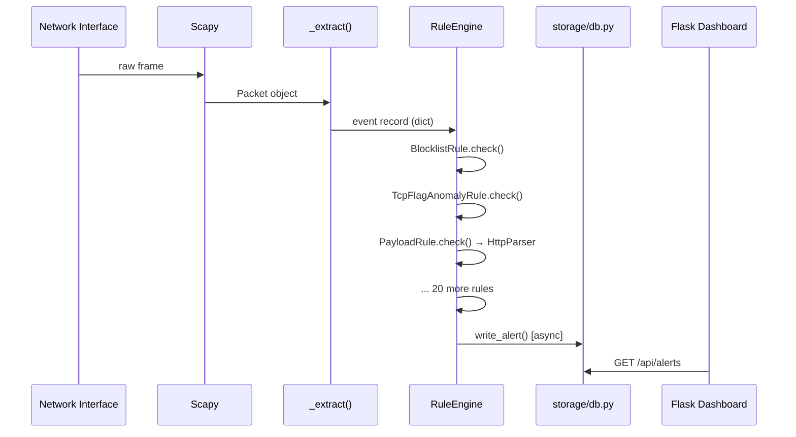

# NetGuard IDS — System Architecture

> [!NOTE]
> This document describes the **currently implemented** architecture as of the DPI hardening release (commit `31df624`).
> For the future AI/ML roadmap, see [AI_ML_AUTONOMOUS_DEFENSE_ROADMAP.md](AI_ML_AUTONOMOUS_DEFENSE_ROADMAP.md).

---

## 1. High-Level Overview

NetGuard IDS is a lightweight, **rule-based** network intrusion detection system written in Python.
It operates by inspecting individual packets as they arrive (live capture or PCAP replay), running all
23 registered detection rules against each packet, and writing resulting alerts to a SQLite database
(or PostgreSQL).

```
┌─────────────────────────────────────────────────────────────────────┐
│                        Packet Sources                               │
│  Live interface (Scapy sniff)  |  PCAP file (Scapy rdpcap / binary) │
└──────────────────┬──────────────────────────────────────────────────┘
                   │ raw packets
                   ▼
┌─────────────────────────────────────────────────────────────────────┐
│          capture/sniffer.py  —  _extract() / _fast_extract()        │
│  Normalises each packet into a typed event record (dict)            │
│  Fields: src_ip, dst_ip, src_port, dst_port, protocol, payload,     │
│          event_timestamp, tcp_flags, dns_query, ip_len, ...         │
└──────────────────┬──────────────────────────────────────────────────┘
                   │ event record (dict)
                   ▼
┌─────────────────────────────────────────────────────────────────────┐
│          engine/rules.py  —  RuleEngine.check()                     │
│  Protocol-aware candidate selection via _rules_by_proto:            │
│    - "ARP"   → [ArpSpoofRule]                                       │
│    - "TCP"   → 17 TCP-relevant rules (PortScan, SynFlood, DPI...)   │
│    - "UDP"   → 8 UDP-relevant rules (UdpScan, UdpFlood, DPI...)     │
│    - "ICMP"  → 7 ICMP-relevant rules (IcmpSweep, IcmpFlood...)      │
│    - Other   → Full 23 rules fallback                               │
│  Candidate rules execute sequentially. No early exit among           │
│  candidates — a packet may legitimately trigger multiple rules.     │
└──────────────────┬──────────────────────────────────────────────────┘
                   │ alerts (dicts)
                   ▼
┌─────────────────────────────────────────────────────────────────────┐
│          storage/db.py  —  write_alert()                            │
│  Asynchronous SQLite writer with local disk spooling.               │
│  Tables: alerts, devices                                            │
└──────────────────┬──────────────────────────────────────────────────┘
                   │
       ┌───────────┴──────────────┐
       ▼                          ▼
┌────────────┐           ┌───────────────────┐
│ alerts.db  │           │ Dashboard API      │
│ (SQLite)   │           │ dashboard/app.py   │
└────────────┘           │ (Flask, port 5000) │
                         └───────────────────┘
```

---

## 2. Module Responsibilities

| Module | Responsibility |
|---|---|
| `ids_project/main.py` | Entry point. Starts analysis loop, sniffer, and Flask dashboard as threads. |
| `ids_project/config.py` | All configuration variables — thresholds, paths, feature flags. Reads from environment or `.env`. |
| `ids_project/capture/sniffer.py` | Packet capture (`start_sniff`) and PCAP replay (`replay_pcap`). Normalises packets into typed event records. |
| `ids_project/engine/rules.py` | All 23 detection rules and `RuleEngine`. 7500+ lines. |
| `ids_project/engine/http_parser.py` | `HttpParser` — parses raw TCP payloads into HTTP messages for DPI context. Used by `PayloadRule`. |
| `ids_project/engine/blocklist.py` | Loads and updates the IP blocklist from feodotracker.abuse.ch. |
| `ids_project/storage/db.py` | SQLite schema (`init_db`), `write_alert`, `upsert_device`, `prune_old_alerts`. |
| `ids_project/analysis/aggregator.py` | Plain-language threat-level summary. Runs periodically. |
| `ids_project/dashboard/app.py` | Flask REST API for the alert dashboard. |
| `ids_project/evaluation/replay.py` | Deterministic PCAP replay engine with `ReplayClock` and `ReplayTrackingEngine`. |
| `ids_project/evaluation/run_eval.py` | Synthetic scenario evaluation: 42 attack scenarios + benign suppression check. |
| `ids_project/evaluation/reporting/` | `contract.py` (models), `builder.py` (report builder), `validator.py` (11-gate validator). |
| `ids_project/data/` | Synthetic test PCAPs (`test_attacks.pcap`, `test_benign.pcap`) and blocklist data. |

---

## 3. Live Capture Flow



---

## 4. PCAP Replay Flow (Deterministic Evaluation)

`evaluation/replay.py` provides deterministic replay for testing and benchmarking.

- **`ReplayClock`** — a logical clock that advances with each packet's timestamp from the PCAP. Ensures time-window rules behave identically regardless of when the replay runs.
- **`ReplayTrackingEngine`** — wraps `RuleEngine` with replay-time tracking of which alerts were generated and from which PCAP timestamps.
- Replay is invoked via: `python3 -m ids_project.evaluation.replay --pcap <file> --db <output.db>`

---

## 5. Packet Record Schema

Each packet is normalised to a Python `dict` by `_extract()` / `_fast_extract()`:

| Field | Type | Description |
|---|---|---|
| `type` | `str` | `"IP"` or `"ARP"` |
| `event_timestamp` | `float` | Packet capture timestamp (pkt.time). Used by all sliding-window rules for determinism during replay. |
| `processing_timestamp` | `float` | Wall-clock `time.time()` when extraction ran. |
| `src_ip` | `str \| None` | Source IP address |
| `dst_ip` | `str \| None` | Destination IP address |
| `src_mac` | `str \| None` | Source MAC address |
| `src_port` | `int \| None` | Source transport port |
| `dst_port` | `int \| None` | Destination transport port |
| `protocol` | `str` | `"TCP"`, `"UDP"`, `"ICMP"`, `"ARP"`, or numeric string |
| `syn_flag` | `bool` | True only for TCP SYN (not SYN+ACK) |
| `tcp_flags` | `str \| None` | Scapy flags string (e.g. `"S"`, `"FA"`) |
| `tcp_seq` | `int \| None` | TCP sequence number |
| `tcp_payload_seq` | `int \| None` | TCP sequence number at start of payload |
| `icmp_type` | `int \| None` | ICMP type code |
| `icmp_code` | `int \| None` | ICMP code |
| `ip_len` | `int \| None` | Total IP packet length in bytes |
| `payload` | `bytes \| None` | Transport-layer payload, capped at `PAYLOAD_MAX_BYTES` |
| `payload_len` | `int \| None` | Full captured payload length before DPI cap |
| `dns_query` | `str \| None` | DNS FQDN from first question (port 53 queries only) |
| `dns_qtype` | `int \| None` | DNS question type |
| `dns_id` | `int \| None` | DNS transaction ID |

> [!IMPORTANT]
> Rules must handle `None` gracefully for all optional fields. The engine does not filter packets
> by protocol before calling rules — every rule's `check()` receives every packet.

---

## 6. Alert Schema

Alerts are written to the `alerts` table in SQLite (`storage/db.py`):

| Column | Type | Description |
|---|---|---|
| `id` | `INTEGER` (PK) | Auto-increment alert ID |
| `timestamp` | `REAL` | Unix timestamp of the triggering packet |
| `rule_name` | `TEXT` | Rule identifier (e.g. `PORT_SCAN`, `PAYLOAD_HIT`) |
| `rule_version` | `TEXT` | Rule version string (e.g. `1.13`) |
| `src_ip` | `TEXT` | Source IP |
| `dst_ip` | `TEXT` | Destination IP |
| `src_port` | `INTEGER` | Source port |
| `dst_port` | `INTEGER` | Destination port |
| `protocol` | `TEXT` | Protocol string |
| `detail` | `TEXT` | Human-readable alert description |
| `severity` | `TEXT` | `'low'`, `'medium'`, `'high'`, `'critical'` |
| `confidence` | `TEXT` | `'heuristic'`, `'low'`, `'medium'`, `'high'` |
| `evidence_json` | `TEXT` | JSON dict with rule-specific forensic evidence |
| `window_start` | `REAL` | Start of the detection window (Unix time) |
| `window_end` | `REAL` | End of the detection window (Unix time) |
| `country` | `TEXT` | GeoIP country name (if available) |
| `country_code` | `TEXT` | GeoIP ISO country code |
| `city` | `TEXT` | GeoIP city (if available) |
| `idempotency_key` | `TEXT` | Hash key for deduplication |

---

## 7. HttpParser Pipeline (PAYLOAD_HIT DPI)

`PayloadRule` uses `engine/http_parser.py` to parse raw TCP payloads before applying DPI signatures.
This context-aware approach reduces false positives from generic pattern matching.

```
TCP payload bytes
       │
       ▼
HttpParser.parse(payload, src_port, dst_port)
       │
       ├─► HTTP REQUEST detected? → HttpDirection.REQUEST
       │     path, method, headers, body extracted
       │     allowed_signatures = all except ICS_TRISTATION
       │
       ├─► HTTP RESPONSE detected? → HttpDirection.RESPONSE
       │     status code, headers, body extracted
       │     allowed_signatures = all except ICS_TRISTATION
       │
       ├─► TLS port (443, 8443)? → HttpDirection.TLS_ENCRYPTED
       │     allowed_signatures = {LOG4SHELL, CMD_INJECTION, REVERSE_SHELL_CRADLE, CREDENTIAL_LEAK}
       │
       ├─► Database port (1433, 3306, 5432, 27017, 9200)? → HttpDirection.DATABASE
       │     allowed_signatures = {SQL_INJECTION, LOG4SHELL, CREDENTIAL_LEAK}
       │
       ├─► Command port (21, 23, 6379, 11211, 61616, 8291)? → HttpDirection.COMMAND
       │     allowed_signatures = {CMD_INJECTION, REVERSE_SHELL_CRADLE, CREDENTIAL_LEAK, LOG4SHELL}
       │
       ├─► ICS port (1502)? → HttpDirection.ICS
       │     allowed_signatures = {ICS_TRISTATION_EXPLOIT}
       │
       └─► Other / NON_HTTP → HttpDirection.NON_HTTP
             allowed_signatures = all except ICS_TRISTATION
       │
       ▼
Signature matching (only within allowed_signatures)
       │
       ▼
redact_sensitive_evidence() — mask credentials in evidence dict
       │
       ▼
Alert generated with sig_id, matched text (redacted), evidence
```

---

## 8. Execution, Concurrency & Persistence Model

NetGuard separates packet inspection from persistence to maintain high capture throughput:

### 8.1 Sequential Inspection Loop
- The sniffer or replay thread extracts normalized event records one packet at a time.
- In `RuleEngine.check()`, candidate rules are looked up in `self._rules_by_proto` based on `record.get("protocol")` or `record.get("type")` (falling back to all 23 rules if unclassified).
- Selected candidate rules are executed **sequentially** in Python bytecode:
  ```python
  for rule in target_rules:
      alert = rule.check(record)
      if alert:
          # enrich with timestamp, evidence_json, idempotency_key
          self._alert_queue.put_nowait(("alert", alert))
  ```
- No candidate rule exits early: if a packet matches both `PORT_SCAN` and `PAYLOAD_HIT`, both alerts are generated.

### 8.2 Asynchronous Persistence & Backpressure Spooling
- Alerts are handed off via a non-blocking queue (`self._alert_queue`, bounded at `ALERT_QUEUE_MAXSIZE`, default: 1,000 items).
- A dedicated background thread (`_alert_writer_loop`) drains the queue and commits batches to SQLite or PostgreSQL.
- **Disk Spool Backpressure Policy**: If the alert queue saturates under flood conditions, `RuleEngine.check()` falls back to spooling alerts directly to a local JSON Lines file on disk (`AlertSpool` writing to `<sqlite_path>.spool.jsonl`, bounded at `ALERT_SPOOL_MAX_SIZE`, default: 5,000 items).
- The alert writer automatically recovers and replays spooled alerts once database pressure subsides.
- On shutdown, `RuleEngine.shutdown()` waits for in-flight queue items to flush, drains spooled records, and logs accounting statistics (`alert_writes`, `alerts_spooled`, `alerts_dropped`).

### 8.3 Device Inventory Persistence
- Communicating devices are tracked with a 5-minute deduplication refresh window (`_device_refresh_s = 300`) and bounded memory cap (65,536 keys).
- Device updates are enqueued to a separate `_device_queue` and drained asynchronously by `_device_writer_loop`.

### 8.4 Thread Safety & State Invariants
- Each stateful rule maintains its own internal sliding-window history using `collections.OrderedDict`.
- State is bounded deterministically by max entry caps and expiration timeouts (`prune_stale(now)`).
- Mutable rule state is protected by per-rule reentrant locks (`threading.RLock` or `threading.Lock`) so the packet processing thread and garbage-collection routines never race.
- There is no shared mutable state between different detection rules.

