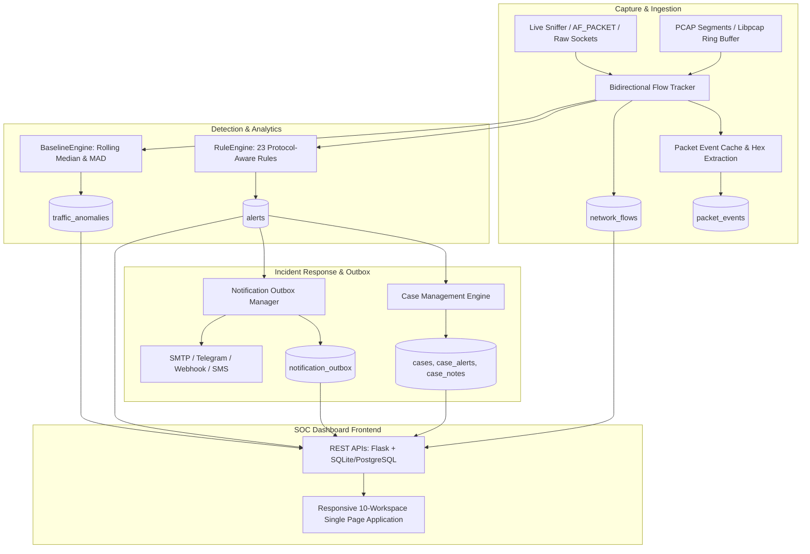

# NetGuard IDS — SOC Dashboard & Network Traffic Forensics Architecture Guide

## 1. Executive Overview

NetGuard IDS features a professional-grade Security Operations Center (SOC) dashboard, forensic investigation suite, and network traffic analytics platform. Built on lightweight, zero-dependency foundational principles, the platform transforms NetGuard from a reactive alert feed into an integrated threat detection, forensic exploration, and incident management workspace.



---

## 2. Dedicated SOC Workspaces

The NetGuard frontend (`ids_project/dashboard/templates/index.html`) is structured into 10 purpose-built analyst workspaces, selectable via the persistent sidebar navigation:

| # | Workspace Name | Primary Focus | Key Capabilities |
|---|----------------|---------------|------------------|
| 1 | **Overview** | Executive Telemetry & Radar | Real-time PPS/BPS charts, alert distribution by severity, top attacking IPs, system status. |
| 2 | **Traffic Explorer** | Deep Session Forensics | Bidirectional 5-tuple flow search, server-side pagination, duration/volume sorting, CSV export. |
| 3 | **Alerts** | Alert Triage & Response | Dynamic rule dropdown (all 23 rules), acknowledgment, resolution, detail inspection drawer. |
| 4 | **Threat Hunting** | Query Builder & Saved Searches | Ad-hoc filter construction, query persistence, pivot hunting on protocols and ports. |
| 5 | **PCAP Analysis** | Offline Packet Forensics | Drag-and-drop PCAP upload, isolated sandboxed replay, job progress polling, artifact download. |
| 6 | **Cases & Incidents** | Case Lifecycle & Collaboration | Multi-alert incident bundling, status progression, analyst notes, audit history. |
| 7 | **Reports** | Governance & Compliance | 9 automated report types in HTML, JSON, and CSV format across custom time windows. |
| 8 | **Network Devices** | Asset Inventory & ARP Integrity | LAN host discovery, IP-MAC binding history, IEEE 802 randomized MAC classification. |
| 9 | **Rule Health & Tuning** | Detection Governance | Analyst feedback loop (`true_positive`/`false_positive`), confusion matrix, zero double-counting. |
| 10 | **Settings & Telemetry** | Diagnostics & System Metrics | Hardware capability auto-tuning, notification outbox monitoring, tamper-evident audit logs. |

---

## 3. Deep Traffic Forensics & Investigation Drawer

### Bidirectional Flow Tracking
`FlowTracker` (`ids_project/forensics/flow_tracker.py`) canonicalizes bidirectional network communications using lexicographical 5-tuple ordering:
$$\text{flow\_id} = \text{SHA256}(\min(\text{IP}_A, \text{IP}_B) \mathbin{\Vert} \min(\text{P}_A, \text{P}_B) \mathbin{\Vert} \max(\text{IP}_A, \text{IP}_B) \mathbin{\Vert} \max(\text{P}_A, \text{P}_B) \mathbin{\Vert} \text{PROTO})[:16]$$

- **Direction Classification**: Differentiates `inbound` vs. `outbound` traffic relative to RFC 1918 private subnets.
- **Packet Event Buffering**: Retains the initial $N$ packet headers and hex-encoded payloads per flow for forensic dissection.
- **Micro-PCAP Slicing**: Analysts can download a synthetic libpcap slice (`/api/traffic/<flow_id>/pcap`) containing only the packets comprising a suspect session, ready for Wireshark inspection.

### Flow Detail Inspection Drawer
Clicking any flow row in the Traffic Explorer slides open the forensic drawer:
- **5-Tuple Header**: Protocol, client/server addresses, ephemeral ports, session duration, and byte volume.
- **Associated Detections**: Embedded alert cards correlated to the flow via `flow_id`.
- **Packet Hex Dump**: Raw packet disassembly displaying byte offsets, hex bytes, and ASCII translations.

---

## 4. REST API Specifications

The dashboard backend (`ids_project/dashboard/app.py`) provides authenticated REST APIs:

### Rule Inventory
- `GET /api/rules`: Returns complete metadata inventory for all 23 detection rules, including version, category, default severity, confidence, and bound protocols.

### Traffic Explorer
- `GET /api/traffic`: Search and filter network flows.
  - Query parameters: `src_ip`, `dst_ip`, `protocol`, `port`, `sort_by` (`last_seen`, `packet_count`, `byte_count`, `duration`), `order` (`asc`, `desc`), `page`, `page_size`.
- `GET /api/traffic/<flow_id>`: Detailed flow session state, correlated alerts, and packet events.
- `GET /api/traffic/<flow_id>/pcap`: Stream synthesized binary `.pcap` capture of the specific flow.
- `GET /api/traffic/export`: Download current flow search results as CSV.

### Threat Hunting & Saved Searches
- `GET /api/saved-searches`: List saved hunting queries.
- `POST /api/saved-searches`: Persist a named hunting filter (`name`, `description`, `query_params_json`).
- `DELETE /api/saved-searches/<id>`: Remove a saved query.

### Offline PCAP Analysis
- `POST /api/pcap/upload`: Upload a capture file for sandboxed background replay.
- `GET /api/pcap/jobs`: List status of offline analysis jobs.
- `GET /api/pcap/jobs/<job_id>`: Job status, packet progress, and detection findings.
- `GET /api/pcap/jobs/<job_id>/export?format=json|csv`: Export offline replay findings.

### Statistical Baselines & Anomalies
- `GET /api/baselines`: Rolling Median, MAD, and EWMA metrics across all 6 tracked network signals.
- `GET /api/anomalies`: Recent statistical anomalies flagged by the baseline engine.
- `POST /api/baselines/quarantine`: Toggle baseline model quarantine (`{"quarantine": true|false}`) to freeze learning during incidents.

### Incident Cases
- `GET /api/cases`: Query active and historical incident cases with status and priority filters.
- `POST /api/cases`: Create a new case (`title`, `description`, `severity`, `assignee`, `alert_ids`).
- `GET /api/cases/<case_id>`: Detailed case record, linked alerts, analyst notes, and timeline.
- `PATCH /api/cases/<case_id>`: Update status (`new` $\to$ `open` $\to$ `investigating` $\to$ `resolved` $\to$ `false_positive`), priority, or assignee.
- `POST /api/cases/<case_id>/alerts`: Associate additional alert IDs with the case.
- `POST /api/cases/<case_id>/notes`: Append an analyst note to the case history.

### Multi-Format Reports
- `GET /api/reports/types`: List available report templates, formats (`html`, `json`, `csv`), and whether email is configured.
- `GET /api/reports/generate?type=<type>&hours=<hours>&format=html|json|csv`: Download dynamically generated compliance or executive reports.
- `POST /api/reports/email`: Generate a report and queue it for email delivery (`type`, `format`, `hours`, `to`, `cc`, `bcc`). Returns `202` with the queued job, attachment size and SHA-256.
- `GET /api/reports/outbox`: Recent report-delivery jobs with status, retry count, errors and outbox counters.

### Detection Health & Feedback
- `POST /api/feedback/reclassify`: Reclassify an alert (`true_positive` vs. `false_positive`) with an analyst rationale, updating rule metrics without double-counting.

### System Metrics & Telemetry
- `GET /api/system/metrics`: Hardware capabilities, auto-tuned parallel profile, queue depths, and disk storage metrics.
- `GET /api/audit-log`: Query immutable administrative and analyst action logs.

---

## 5. Persistent Schema Architecture

The forensics data layer (`ids_project/storage/forensics_db.py`) runs natively on both SQLite and PostgreSQL:

```sql
-- Network Session Flow Records
CREATE TABLE IF NOT EXISTS network_flows (
    flow_id         TEXT PRIMARY KEY,
    start_time      REAL NOT NULL,
    last_seen       REAL NOT NULL,
    src_ip          TEXT NOT NULL,
    src_port        INTEGER NOT NULL,
    dst_ip          TEXT NOT NULL,
    dst_port        INTEGER NOT NULL,
    protocol        TEXT NOT NULL,
    packet_count    INTEGER DEFAULT 0,
    byte_count      INTEGER DEFAULT 0,
    direction       TEXT DEFAULT 'unknown',
    alert_count     INTEGER DEFAULT 0
);

-- Packet Event Samples for Deep Inspection
CREATE TABLE IF NOT EXISTS packet_events (
    id              INTEGER PRIMARY KEY AUTOINCREMENT,
    flow_id         TEXT NOT NULL,
    packet_index    INTEGER NOT NULL,
    timestamp       REAL NOT NULL,
    protocol        TEXT NOT NULL,
    src_ip          TEXT,
    src_port        INTEGER,
    dst_ip          TEXT,
    dst_port        INTEGER,
    packet_len      INTEGER,
    tcp_flags       TEXT,
    payload_preview TEXT,
    raw_hex         TEXT,
    FOREIGN KEY(flow_id) REFERENCES network_flows(flow_id)
);

-- Incident Management Cases
CREATE TABLE IF NOT EXISTS cases (
    case_id         TEXT PRIMARY KEY,
    title           TEXT NOT NULL,
    description     TEXT,
    severity        TEXT DEFAULT 'medium',
    status          TEXT DEFAULT 'open',
    priority        TEXT DEFAULT 'p2',
    assignee        TEXT,
    created_at      REAL NOT NULL,
    updated_at      REAL NOT NULL,
    closed_at       REAL
);
```

