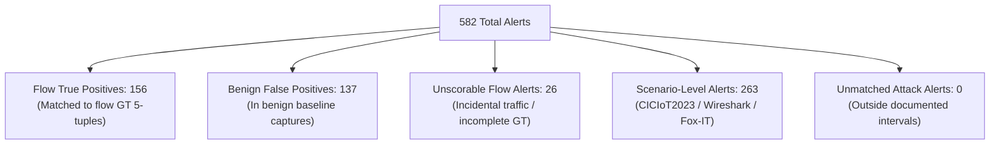

# NetGuard IDS — Evaluation Methodology & Empirical Results

> [!IMPORTANT]
> **Scientific Integrity & Scope Note**:
> This document distinguishes clearly between four different tiers of testing and evaluation:
> 1. **Unit & Regression Testing** — synthetic and isolated assertion verification (854 tests passing).
> 2. **Controlled Synthetic Scenarios** — deterministic scenario evaluation via `run_eval.py` (42 scenarios).
> 3. **Multi-Dataset Ground-Truth Benchmark** — large-scale PCAP replay across 22 network captures (3.24 GiB, 37.5 million packets).
> 4. **DPI Hardening Verification** — targeted before-and-after analysis of the `PAYLOAD_HIT` engine across 6 key captures.
>
> **Core Caveats**:
> - An **alert count** is not identical to a **confirmed true positive count**. Capture-level attack scenarios contain both attack packets and normal background/incidental traffic.
> - **Flow-level ground truth** (exact 5-tuples and timestamps) is available for GeNIS captures; CICIoT2023, Wireshark, and Fox-IT captures are evaluated at the **scenario level**.
> - Zero false positives observed across specific benign captures (e.g., Somfy doorlock or GeNIS benign runs) indicates successful suppression for those protocol profiles, but does **not** constitute proof of a 0.0% false-positive rate across arbitrary enterprise traffic.

---

## 1. Evaluation Tier 1: Unit & Regression Test Suite

The automated test suite in `ids_project/tests/` provides baseline regression protection across all engine components, detection rules, and utility modules.

- **Total Test Modules:** 42 test modules
- **Total Tests:** 854 passed (0 failed, 0 skipped, 630 subtests passed)
- **Execution Time:** ~98 seconds (Python 3.14 on Linux 6.x)
- **Command:** `python3 -m pytest ids_project/tests -q`

### Coverage by Component

| Area | Key Modules | Scope |
|---|---|---|
| **Detection Rules (23 rules)** | `test_payload_detection.py`, `test_port_scan_detection.py`, `test_tcp_flag_anomaly.py`, `test_udp_flood.py`, `test_icmp_sweep_detection.py`, `test_dns_and_arp_detection.py`, etc. | Positive attack detection, negative benign suppression, threshold boundaries, sliding window expirations. |
| **DPI & Protocol Parsing** | `test_payload_detection.py` (76 tests), `test_clear_http_tls.py`, `test_non_dns_on_dns_port.py` | HTTP request/response parsing, MIME boundary handling, SQL comment patterns, credential redaction. |
| **Rule Governance & Architecture** | `test_rule_governance_invariants.py`, `test_finite_rule_timestamps.py`, `test_memory_and_lru_bounds.py` | Enforces 23 registered rules, deterministic $O(1)$ LRU state bounds via `OrderedDict`, NaN/Inf guardrails. |
| **Storage & Persistence** | `test_alert_persistence.py`, `test_alert_evidence_schema.py`, `test_db_migration.py` | SQLite persistence, async spooling, idempotency deduplication, evidence schema compliance. |
| **Evaluation Harness** | `test_reporting_standard.py`, `test_ground_truth_benchmark.py`, `test_dataset_hash_verify.py` | Replay determinism, ground-truth 5-tuple flow matching, SHA-256 integrity verification. |

---

## 2. Evaluation Tier 2: Controlled Synthetic Scenario Evaluation (`run_eval.py`)

NetGuard includes a standalone deterministic evaluation harness ([`ids_project/evaluation/run_eval.py`](../ids_project/evaluation/run_eval.py)) that replays two synthetic capture files:
1. `ids_project/data/test_attacks.pcap`: 42 purpose-built attack sequences covering 15 rule types.
2. `ids_project/data/test_benign.pcap`: Benign baseline traffic exercising normal web, DNS, and ICMP patterns.

**Command:**
```bash
python3 ids_project/evaluation/run_eval.py
```

### Empirical Results

```
======================================================================
  NETGUARD IDS SYNTHETIC EVALUATION RESULTS
======================================================================
  Total attack alerts:    42
  Total FP_benign alerts: 0
  [OK] Zero false positives on benign traffic.
======================================================================
```

**Interpretation:**
The synthetic evaluation proves that when isolated, pristine attack packets matching specific signatures and thresholds arrive, the engine reliably emits the expected alerts without cross-talk or spurious alerts on the synthetic benign fixture.

---

## 3. Evaluation Tier 3: 22-PCAP Multi-Dataset Ground-Truth Benchmark

The comprehensive benchmark assesses NetGuard against official publisher ground truth across **37.5 million wire packets** and **3.243 GiB** of network traffic across 22 captures.

### Methodology & Alert Reconciliation

Every alert generated during benchmark replay is classified into exactly one mutually exclusive reporting class:



| Reporting Category | Alert Count | Definition / Boundary |
|---|:---:|---|
| **Flow True Positives (`TP`)** | **156** | Alerts in flow-labeled attack traffic that match documented ground-truth 5-tuples, time intervals (±2s grace), and rule mappings. |
| **Benign False Positives (`FP`)** | **137** | Alerts generated in genuine benign operational baselines (`admin`, `background`, `user`, `Somfy doorlock`). |
| **Unscorable Flow Incidental (`UNSCORABLE`)** | **26** | Incidental traffic in flow-labeled attack captures (e.g. DNS bursts during DoS), unsupported evidence, or incomplete GT rows. |
| **Scenario-Level Alerts (`SCENARIO`)** | **263** | Alerts in captures evaluated at the scenario level only (CICIoT2023 web attacks, Wireshark, Fox-IT). Scenario-level presence confirms attack detection on the designated vector, but individual alerts are NOT counted as flow-verified true positives. |
| **Unmatched Attack Alerts (`UNMATCHED`)** | **0** | Alerts in flow-labeled captures occurring outside documented ground-truth intervals. |
| **TOTAL RECONCILED ALERTS** | **582** | **Exact 100% reconciliation (156 + 137 + 26 + 263 + 0 = 582)** |

### Ground-Truth Provenance & Reproducibility Note
The 582 total alerts and their reconciliation into the 5 mutually exclusive classes derive from the full 22-PCAP ground-truth benchmark recorded at commit `17f9c03` and rescored via the strict bidirectional 5-tuple matcher in `scripts/evaluation/rescore_benchmark.py` (commit `0931aa7`).
- Flow-level ground truth is available strictly for GeNIS captures (`data/external_benchmarks/genis/0-info/0-info/genis-ground-truth.csv`).
- Captures lacking per-flow ground-truth labels (CICIoT2023, Wireshark samples, Fox-IT Log4Shell) are categorized as **Scenario-Level Alerts** (263 alerts), not flow TPs.
- The 137 benign false positives reflect detections on operational baseline captures before recent DPI and heuristic tunings (including 85 on high-entropy DNS and 44 on multi-destination host traffic in GeNIS).
- Re-executing the full 22-PCAP benchmark requires access to the 3.24 GiB capture corpus (stored on external media and converted PCAP caches). When external storage is detached, reproducibility is verified through the committed canonical result databases, JSON summaries, and unit tests (`test_ground_truth_benchmark.py`).

### Rule-by-Rule Benchmark Breakdown (All 23 Rules)

| Rule Name | Test Status | Total Alerts | TP | FP | Unscorable | Scenario | Detected Flows | Flow Recall | Alert Precision | Captures Fired In |
|---|:---:|:---:|:---:|:---:|:---:|:---:|:---:|:---:|:---:|---|
| `BLOCKLIST` | `not_exercised` | 0 | 0 | 0 | 0 | 0 | 0 | N/A | N/A | None |
| `TCP_FLAG_ANOMALY` | `not_exercised` | 0 | 0 | 0 | 0 | 0 | 0 | 0.0% | N/A | None |
| `PORT_SCAN` | `exercised_with_tp` | 69 | 9 | 44 | 16 | 0 | 9 | 45.0% | 17.0% | 9 captures |
| `UDP_SCAN` | `not_exercised` | 0 | 0 | 0 | 0 | 0 | 0 | N/A | N/A | None |
| `UDP_FLOOD` | `exercised_with_tp` | 2 | 1 | 0 | 0 | 1 | 1 | 100.0% | 100.0% | 2 captures |
| `TCP_STEALTH_SCAN` | `not_exercised` | 0 | 0 | 0 | 0 | 0 | 0 | 0.0% | N/A | None |
| `SYN_FLOOD` | `exercised_with_tp` | 18 | 11 | 0 | 6 | 1 | 3 | 100.0% | 100.0% | 5 captures |
| `DISTRIBUTED_SYN_FLOOD` | `not_exercised` | 0 | 0 | 0 | 0 | 0 | 0 | N/A | N/A | None |
| `ICMP_SWEEP` | `exercised_unscorable` | 2 | 0 | 0 | 1 | 1 | 0 | 0.0% | N/A | 2 captures |
| `ICMP_FLOOD` | `exercised_with_tp` | 1 | 1 | 0 | 0 | 0 | 1 | 100.0% | 100.0% | 1 captures |
| `ARP_SPOOF` | `exercised_unscorable` | 117 | 0 | 0 | 0 | 117 | 0 | N/A | N/A | 1 captures |
| `PAYLOAD_HIT` | `exercised_with_fp` | 87 | 0 | 8 | 1 | 78 | 0 | 0.0% | 0.0% | 9 captures |
| `DNS_ANOMALY` | `exercised_with_fp` | 119 | 0 | 85 | 0 | 34 | 0 | 0.0% | 0.0% | 8 captures |
| `BRUTE_FORCE` | `exercised_with_tp` | 146 | 125 | 0 | 0 | 21 | 4 | 100.0% | 100.0% | 4 captures |
| `SLOW_PORT_SCAN` | `exercised_with_tp` | 11 | 9 | 0 | 2 | 0 | 9 | 45.0% | 100.0% | 8 captures |
| `DATA_EXFIL` | `exercised_unscorable` | 7 | 0 | 0 | 0 | 7 | 0 | N/A | N/A | 3 captures |
| `TLS_ANOMALY` | `not_exercised` | 0 | 0 | 0 | 0 | 0 | 0 | N/A | N/A | None |
| `CLEAR_HTTP_ON_TLS_PORT` | `not_exercised` | 0 | 0 | 0 | 0 | 0 | 0 | N/A | N/A | None |
| `TCP_ZERO_WINDOW` | `not_exercised` | 0 | 0 | 0 | 0 | 0 | 0 | 0.0% | N/A | None |
| `NON_DNS_TRAFFIC_ON_DNS_PORT` | `exercised_unscorable` | 2 | 0 | 0 | 0 | 2 | 0 | N/A | N/A | 2 captures |
| `ICMP_TUNNEL` | `not_exercised` | 0 | 0 | 0 | 0 | 0 | 0 | N/A | N/A | None |
| `IP_FRAGMENT_ANOMALY` | `exercised_unscorable` | 1 | 0 | 0 | 0 | 1 | 0 | N/A | N/A | 1 captures |
| `IRC_C2_BEACONING` | `not_exercised` | 0 | 0 | 0 | 0 | 0 | 0 | N/A | N/A | None |

> [!NOTE]
> Rules with status `not_exercised` indicate that the specific attack vectors targeted by those rules were not present in the 22 benchmark PCAPs. They are tested independently via synthetic unit tests in Tier 1.

---

## 4. Evaluation Tier 4: PAYLOAD_HIT DPI Hardening Results

> [!NOTE]
> **Measurement Notice**:
> The baseline numbers below are recorded from the historical pre-hardening benchmark run (commit `0931aa7`).
> The post-hardening results were verified by running deterministic PCAP replay across the 6 affected captures following the implementation of `HttpParser` and MIME delimiter fixes (commit `31df624`).

### Before vs. After Hardening Comparison

| Capture ID | Category | PCAP Size | Baseline `PAYLOAD_HIT` Alerts | Post-Hardening `PAYLOAD_HIT` Alerts | Net Change | Verification Finding |
|---|---|---|:---:|:---:|:---:|---|
| `genis_benign_user_activity` | Benign User Traffic | 319.4 MB | **8** (all false SQLi) | **0** | **-8 (-100%)** | **False positives completely eliminated** on benign SMTP/HTTP traffic. |
| `ciciot_upload` | Attack (Webshell Upload) | 3.3 MB | **8** (3 spurious SQLi) | **8** (Webshell + Traversal) | Spurious SQLi removed | **True attack detection retained** without spurious SQLi false alarms. |
| `ciciot_cmdinj` | Attack (Cmd Injection) | 28.5 MB | **1** (spurious SQLi) | **0** (PAYLOAD) / **1** (Non-DNS) | Spurious SQLi removed | False SQLi on camera health check eliminated; attack captured via `NON_DNS_TRAFFIC_ON_DNS_PORT`. |
| `ciciot_sqli` | Attack (SQL Injection) | 9.8 MB | **46** | **48** | **+2** | **Detection improved** via multi-pass URL decoding and form body extraction. |
| `ciciot_xss` | Attack (XSS) | 12.5 MB | **19** | **19** | **0** | **All XSS detections preserved**. |
| `attack_foxit_log4shell` | Attack (Log4Shell CVE-2021-44228) | 56 KB | **1** | **1** | **0** | **JNDI exploit detected cleanly**. |

### Key Architectural Fixes Delivered

1. **Protocol Scoping:** Restricted web application signatures from firing on mail ports (25, 587, 110, 143) and database ports unless explicit HTTP requests are detected.
2. **MIME Delimiter Disambiguation:** Added negative lookbehind `(?<!-)` to SQL comment regular expressions so closing multipart boundaries (`--boundary--\r\n`) cannot trigger `SQL_INJECTION`.
3. **Response Suppression:** Suppressed client injection signatures on HTTP responses (`HttpDirection.RESPONSE`) to prevent reflection false positives.
4. **Credential Redaction:** Matched evidence substrings containing passwords or tokens are scrubbed with `[REDACTED]` prior to alert storage.

---

## 5. Evaluation Reporting Standard: Audit of the 11 Programmatic Validation Gates

The NetGuard evaluation reporting standard ([`docs/evaluation/REPORTING_STANDARD.md`](evaluation/REPORTING_STANDARD.md)) specifies 11 mandatory programmatic validation gates. To maintain complete technical integrity, the table below documents the actual implementation status of each gate within [`ids_project/evaluation/reporting/validator.py`](../ids_project/evaluation/reporting/validator.py):

| Gate # | Mandated Gate Requirement | Implementation Status | Enforcement Mechanism |
|:---:|---|:---:|---|
| **Gate 1** | **Tier Count Reconciliation** ($\sum \text{Tiers} == \text{Total Alerts}$) | **Fully Implemented & Enforced** | `_check_1_tier_reconciliation`: Fails closed with error if tier sum does not match `total_alerts`. |
| **Gate 2** | **Confusion Matrix Reconciliation** ($TP + FP + FN + TN == \text{Units}$) | **Partially Implemented (Proxy)** | Handled via Gate 1 tier accounting; strict single-unit confusion matrix reconciliation is not enforced as an isolated check because corpora span mixed units (flows in GeNIS, scenarios in CICIoT2023). |
| **Gate 3** | **Mathematical Reproducibility** (Ratio / Percentage recalculation) | **Fully Implemented & Enforced** | `_check_2_mathematical_reproducibility`: Re-computes ratios and percentages from numerators and denominators; checks for division by zero. |
| **Gate 4** | **Export Schema Parity** (Header and column count matching) | **Fully Implemented & Enforced** | `_check_7_csv_schema_and_counts`: Verifies every row in every exported CSV matches expected column count. |
| **Gate 5** | **Export Row Count & Digest Integrity** (Rows, size, SHA-256) | **Fully Implemented & Enforced** | `_check_7_csv_schema_and_counts`: Verifies row count, exact file byte size, and on-disk SHA-256 cryptographic digest. |
| **Gate 6** | **Cross-Format Agreement** (Markdown vs. JSON summary) | **Fully Implemented & Enforced** | `_check_8_json_markdown_consistency`: Verifies verdict, total alerts, tier counts, commit hash, and export files agree across Markdown and JSON. |
| **Gate 7** | **No Hardcoded Historical Figures** (Placeholder rejection) | **Fully Implemented & Enforced** | `_check_6_no_hardcoded_fallbacks`: Scans metadata for legacy constants (e.g. `397_to_5_historical_split`) and fails closed if detected. |
| **Gate 8** | **Evidence Completeness** (Ambiguous & malformed tracking) | **Implemented as Warning** | `_check_5_evidence_completeness`: Emits a non-fatal warning if ambiguous evidence tracking is absent from extra metadata. |
| **Gate 9** | **Provenance & Configuration Fingerprints** (PCAP hash, Git commit) | **Fully Implemented & Enforced** | `_check_3_provenance_fingerprints`: Requires 64-char PCAP SHA-256, Git commit hash, engine fingerprint, and positive PCAP byte size. |
| **Gate 10** | **Evidence Source Mapping** (Explicit definitions & source links) | **Implemented as Warnings** | `_check_4_metric_units_and_evidence`: Emits warnings if metrics lack definitions, ground-truth sources, or conflate Tier-A fractions with precision. |
| **Gate 11** | **Fail-Closed Execution** (Automatic INCONCLUSIVE verdict override) | **Fully Implemented & Enforced** | `validate_all`: If any error is recorded across active gates, the report verdict is overridden to `INCONCLUSIVE` and failures are logged. |

---

## 6. Performance & Throughput Observations

All throughput measurements were performed on standard commodity developer workstations (x86_64, Linux 6.x, single-threaded Python execution):

- **Synthetic Replay:** ~15,000 to 22,000 packets/second.
- **Fast Binary Replay (classic pcap):** 11,000 to 20,000 packets/second (e.g. `genis_attack_dos_icmp` processed 15,000,000 packets in 745 seconds $\approx$ 20,120 pps).
- **Full Scapy DPI Parsing (pcapng / complex HTTP):** 2,000 to 6,000 packets/second.

### Memory & State Stability

- Memory usage remains bounded during multi-gigabyte replays due to `OrderedDict` LRU caches and explicit periodic `prune_stale(now)` cycles.
- Long-running multi-hour replays (e.g. 15M packet ICMP DoS) exhibited flat resident memory profiles without memory leaks.

---

## 7. Known Limitations & Analysis Realism

1. **Encrypted Traffic Bounding:** In the absence of TLS interception or eBPF socket-level hooks, NetGuard cannot inspect encrypted HTTPS or DoH payloads. Detection on encrypted streams is restricted to handshake metadata (`TLS_ANOMALY`) and volumetric patterns (`DATA_EXFIL`).
2. **Volumetric Threshold Sensitivity:** Static thresholds (e.g. 15 ports in 10s for port scan, 100 SYNs in 10s for SYN flood) may require environmental tuning. In high-bandwidth enterprise environments, CDN prefetching or microservice meshes can generate traffic bursts that trigger volumetric rules.
3. **Layer 2 Context Dependency:** `ARP_SPOOF` assumes a stable single-subnet environment. Dynamic environments with short DHCP lease times, mobile clients, or container network interfaces will generate benign IP-to-MAC reassociations.
4. **Offline Replay vs. Live Wire:** In live capture mode, Scapy's kernel-to-user copy overhead limits sustainable wire speed without dedicated capture acceleration (such as AF_PACKET, DPDK, or PF_RING). NetGuard is designed for monitoring lightweight edge networks or offline forensic evaluation.

