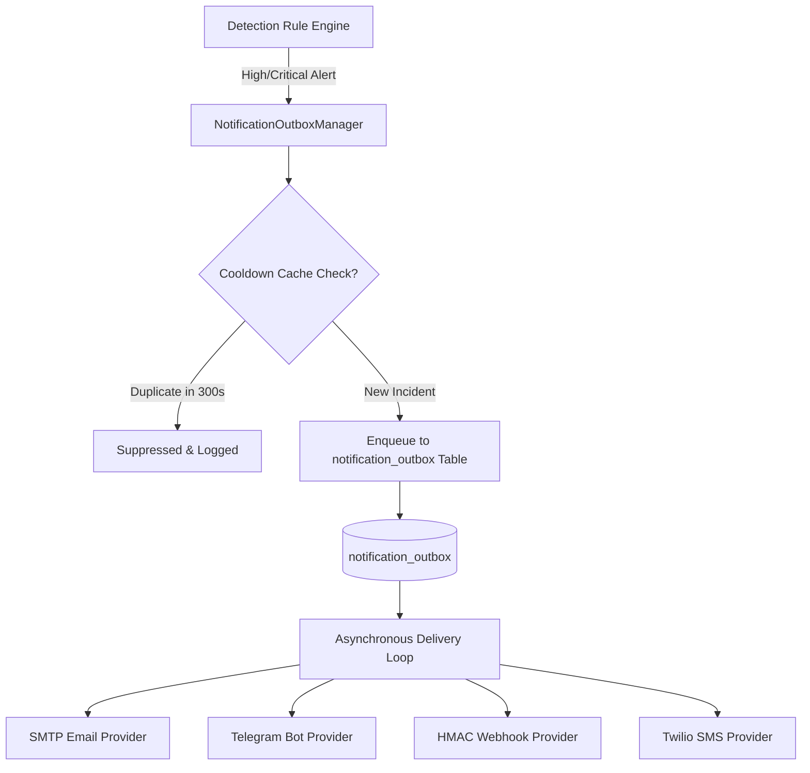

# NetGuard IDS — Multi-Channel Alert Notification Architecture

## 1. Overview

NetGuard IDS incorporates an enterprise-grade notification subsystem designed to dispatch critical security alerts to incident responders across multiple real-time communication channels (`ids_project/notifications/outbox.py`).

### Key Reliability Safeguards
- **Zero Sniffer Blocking**: All notifications are enqueued to an asynchronous SQLite/PostgreSQL `notification_outbox` table; network capture and packet inspection threads are never blocked by network I/O or downstream provider latency.
- **Smart Cooldown Deduplication**: An internal cache tracks `(rule_name, dst_ip)` pairs to prevent alert storms and spam during high-volume scans or DDoS floods (default cooldown: $300\text{ seconds}$).
- **Severity Gating**: Configurable minimum severity thresholds (`low`, `medium`, `high`, `critical`) ensure only actionable incidents trigger external paging.
- **Exponential Backoff & Retries**: Transient failures (e.g. timeout, DNS resolution error) trigger retries with exponential jitter (up to 3 attempts) before marking a job failed.



---

## 2. Supported Notification Channels

### 1. Webhook (Generic JSON / SIEM Integration)
Delivers structured alert payloads to external SIEMs, SOAR tools, Discord, or Slack webhooks.
- **HMAC-SHA256 Signature Verification**: Every request includes an `X-NetGuard-Signature` header computed using the shared secret:
  $$\text{Header} = \text{HMAC-SHA256}(\text{Secret}, \text{Payload JSON})$$
- **Payload Schema**:
  ```json
  {
    "event": "netguard_alert",
    "rule_name": "PORT_SCAN",
    "severity": "high",
    "confidence": "high",
    "src_ip": "192.168.1.105",
    "dst_ip": "192.168.1.1",
    "dst_port": 80,
    "protocol": "TCP",
    "timestamp": 1731317540.2,
    "detail": "15 distinct ports probed in 10s",
    "evidence": { ... }
  }
  ```

### 2. SMTP Email
Dispatches formatted HTML/Plaintext alerts via standard or authenticated SMTP (STARTTLS / TLS).
- Configurable recipient list, subject template, and reverse-DNS host resolution.

### 3. Telegram Bot
Sends real-time Markdown messages to security operations channels or individual chat IDs using Telegram's Bot API (`sendMessage`).

### 4. Twilio SMS
Dispatches high-urgency SMS pages for `critical` alerts directly to on-call engineers.

---

## 3. Configuration & Environment Variables

Configure notification providers by setting the following environment variables:

| Channel | Variable | Description |
|---------|----------|-------------|
| **Global** | `NETGUARD_ALERT_MIN_SEVERITY` | Minimum severity to trigger alerts (`medium`, `high`, `critical`) |
| **Global** | `NETGUARD_ALERT_COOLDOWN_S` | Deduplication window in seconds (default: `300`) |
| **Webhook** | `NETGUARD_WEBHOOK_URL` | HTTPS endpoint URL |
| **Webhook** | `NETGUARD_WEBHOOK_SECRET` | Secret key for HMAC-SHA256 payload signing |
| **Email** | `NETGUARD_SMTP_HOST` | SMTP server hostname (e.g. `smtp.example.com`) |
| **Email** | `NETGUARD_SMTP_PORT` | SMTP port (e.g. `587` or `465`) |
| **Email** | `NETGUARD_SMTP_USER` | SMTP username |
| **Email** | `NETGUARD_SMTP_PASS` | SMTP password / app password |
| **Email** | `NETGUARD_EMAIL_TO` | Target recipient email address |
| **Telegram**| `NETGUARD_TELEGRAM_BOT_TOKEN` | Bot API token from `@BotFather` |
| **Telegram**| `NETGUARD_TELEGRAM_CHAT_ID` | Group or channel Chat ID |
| **SMS** | `NETGUARD_TWILIO_SID` | Twilio Account SID |
| **SMS** | `NETGUARD_TWILIO_AUTH_TOKEN` | Twilio Auth Token |
| **SMS** | `NETGUARD_TWILIO_FROM` | Twilio provisioned phone number |
| **SMS** | `NETGUARD_TWILIO_TO` | On-call engineer mobile phone number |

---

## 4. Diagnostics & Testing Endpoints

### Test Notification Dispatch
Trigger an immediate test ping across any configured channel:
```bash
curl -X POST http://localhost:5000/api/notifications/test \
     -H "Content-Type: application/json" \
     -d '{"provider": "webhook"}'
```

### Inspect Outbox Delivery Status
Query recent outbox entries, attempt counts, and error states:
```bash
curl http://localhost:5000/api/notifications/outbox?limit=25
```
Response:
```json
[
  {
    "id": 101,
    "provider": "webhook",
    "severity": "high",
    "rule_name": "SYN_FLOOD",
    "status": "delivered",
    "retry_count": 0,
    "created_at": 1731317540.2,
    "delivered_at": 1731317540.6
  }
]
```
