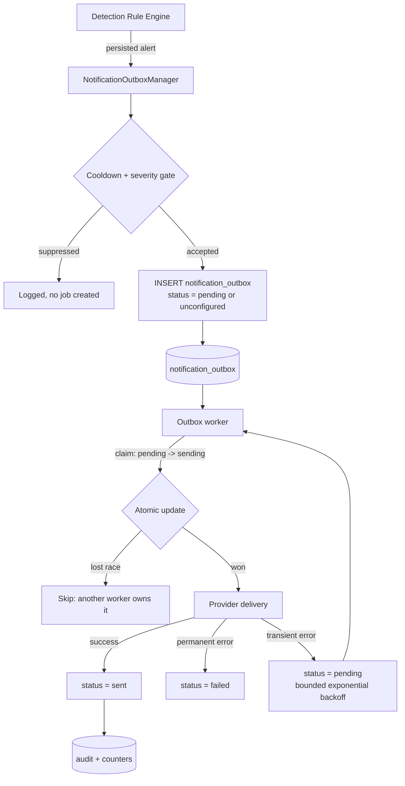

# NetGuard IDS — Alert Notification & Report Delivery

This document describes how NetGuard delivers alerts and generated reports to
external channels. Everything below reflects the code in
`ids_project/notifications/`, not an aspirational design.

---

## 1. Overview

All outbound notifications are written to a durable `notification_outbox` table
and delivered by a background worker. Packet capture and detection threads never
perform network I/O for notifications.



### Reliability safeguards

| Safeguard | Behaviour |
|---|---|
| Non-blocking | Alerts are enqueued in the detection path; delivery happens on a worker thread. |
| Cooldown | `(rule_name, dst_ip)` pairs are suppressed for `cooldown_s` (default 300 s). |
| Severity gate | Default floor is `high`; override with `NOTIFICATION_MIN_SEVERITY`. |
| Claim-based delivery | A row is atomically moved `pending` → `sending` before transmission, so two workers or a restart cannot double-send. |
| Stale-claim recovery | A `sending` row older than `STALE_CLAIM_SECONDS` (300 s) is returned to `pending`. |
| Error classification | Authentication and recipient errors are **not** retried; timeouts, disconnects and 4xx/5xx transient codes are retried. |
| Bounded retries | Default 3 attempts with exponential backoff, capped at 3600 s, with per-row jitter. |
| Bounded payloads | Rendered content is stored as compressed JSON (≤ 64 KB) on the row, not as a rendered blob. |
| Secret hygiene | Provider credentials live in encrypted system settings; `describe()` exposes only redacted diagnostics. |

---

## 2. Channels

### 2.1 SMTP email (primary channel)

Implemented in `ids_project/notifications/providers.py::EmailProvider`.

- **Transport security** is explicit: `starttls` (587/25), `ssl` (465), or
  `none` (trusted local relay only). The mode defaults from the port.
- **STARTTLS is enforced**: if the server does not advertise `STARTTLS`, the
  provider aborts instead of sending credentials in the clear.
- **No implicit sender**: `from_addr` has no fallback value. An unconfigured
  sender is a configuration error, not a silent `netguard-ids@localhost`.
- **Fail-closed authentication**: a username without a stored password aborts
  delivery with an explicit diagnostic rather than attempting an unauthenticated
  transaction (the cause of Gmail's `530 5.7.0 Authentication Required`).
- **Envelope support**: `To`, `Cc` and `Bcc`. `Bcc` is passed to the SMTP
  envelope only and is never written to a visible header.
- **Attachments**: validated, basename-only filenames, 25 MiB per-attachment cap.
- **Partial rejection**: if the relay rejects some recipients, the message is
  reported as delivered to the accepted subset and the rejected addresses are
  recorded in `last_detail`.

#### Rendering

`ids_project/notifications/email_render.py` builds one `RenderedEmail`
(`subject`, `text`, `html`) per alert or report:

- Every interpolated value is HTML-escaped; severity controls only a fixed CSS
  token.
- A plain-text alternative is always generated.
- No tracking pixels, remote images, or inline scripts are emitted.
- A dashboard link is included **only** when `NETGUARD_DASHBOARD_URL` is set to a
  validated `http(s)` URL.

### 2.2 Webhook

JSON POST with `X-NetGuard-Signature: sha256=<HMAC-SHA256(secret, body)>`.

### 2.3 Telegram

Bot API `sendMessage` to a configured chat. Unchanged by the email work.

### 2.4 Twilio SMS

`critical`-grade paging through the Twilio REST API. Unchanged by the email work.

---

## 3. Configuration

### 3.1 Dashboard (recommended)

**Dashboard → Notifications** exposes host, port, username, password, From
address, display name, To/Cc/Bcc and transport security. The form shows a warning
when a username is present without a password, and the **Send test** button
performs a real delivery attempt against the configured server.

### 3.2 Environment variables

Environment values are used when the corresponding provider field is not
configured through the dashboard.

| Channel | Variable | Meaning |
|---|---|---|
| Global | `NOTIFICATION_MIN_SEVERITY` | Alert floor: `low`, `medium`, `high`, `critical` (default `high`) |
| Global | `NETGUARD_DASHBOARD_URL` | Optional public dashboard URL embedded in emails |
| Email | `SMTP_HOST` | SMTP hostname |
| Email | `SMTP_PORT` | SMTP port (default `587`) |
| Email | `SMTP_USER` | SMTP username |
| Email | `SMTP_PASSWORD` | SMTP password or provider app password |
| Email | `SMTP_FROM` | Sender address (required; no default) |
| Email | `SMTP_FROM_NAME` | Sender display name (default `NetGuard IDS`) |
| Email | `SMTP_TO` | Default recipient(s), comma/semicolon separated |
| Email | `SMTP_CC` | Default Cc recipient(s) |
| Email | `SMTP_BCC` | Default Bcc recipient(s) |
| Reports | `REPORT_ARTIFACT_DIR` | Directory for generated report attachments |
| Reports | `NETGUARD_DASHBOARD_URL` | Base URL used in report emails |
| Webhook | `WEBHOOK_URL` / `WEBHOOK_SECRET` | Endpoint and HMAC secret |
| Telegram | `TELEGRAM_BOT_TOKEN` / `TELEGRAM_CHAT_ID` | Bot credentials |
| SMS | `TWILIO_ACCOUNT_SID` / `TWILIO_AUTH_TOKEN` / `TWILIO_FROM_NUMBER` / `TWILIO_TO` | Twilio credentials |

Recipient fields accept commas, semicolons and newlines. Addresses are
validated, de-duplicated case-insensitively, and capped at 25 per field and 50
in total. Any address containing CR/LF or other control characters is rejected,
which makes header injection impossible.

---

## 4. Report delivery ("Generate & Email")

The Reports workspace can generate a report and queue it for email delivery in
one action.

| Property | Value |
|---|---|
| Formats | `html`, `json`, `csv` |
| PDF | Not supported. A `pdf` request is treated as `html`; no file is ever given a `.pdf` extension unless it is genuinely PDF. |
| Size ceiling | 25 MiB per attachment |
| Storage | Generated file lives under the application-owned artifact directory; the database stores only a bounded reference (path, filename, MIME, size, SHA-256) |
| Path validation | Attachment paths must resolve inside the artifact directory; symlinks escaping it are rejected |
| Retention | Artifacts older than 24 h are pruned, and at most 200 are kept |
| Delivery | Asynchronous through the outbox; the HTTP request returns `202 Accepted` |
| Audit | `email_report` audit entry with format, window, recipient count, size and SHA-256 |

### Endpoints

```bash
# Queue a generated report for email delivery
curl -X POST http://localhost:5000/api/reports/email \
  -H "Content-Type: application/json" \
  -d '{"type":"daily","format":"html","hours":24,
       "to":"soc@example.com","cc":"lead@example.com"}'

# Inspect recent report jobs and outbox counters
curl http://localhost:5000/api/reports/outbox

# Available report types, formats and email availability
curl http://localhost:5000/api/reports/types
```

Error responses are explicit: `400` for an invalid report type, format, window
or recipient, `413` when the generated attachment exceeds the limit, `500` only
for unexpected failures. If the report artifact disappears before delivery
(pruned or removed), the covering email is still sent and the job is annotated
rather than silently dropped.

---

## 5. Delivery states

| Status | Meaning |
|---|---|
| `pending` | Eligible for delivery; `next_retry_at` controls when |
| `sending` | Claimed by a worker; reclaimed after 300 s if the worker dies |
| `sent` | Delivered (possibly partially, see `error_message`) |
| `failed` | Permanent failure (authentication, invalid/rejected recipient) — no retry |
| `dead` | Transient failure retries exhausted |
| `unconfigured` | Provider had no credentials at enqueue time; `requeue_unconfigured()` promotes these after configuration |

---

## 6. Diagnostics

```bash
# Provider status (configured, recipient configured, worker running, counters)
curl http://localhost:5000/api/notifications/status

# Send a test notification through a provider
curl -X POST http://localhost:5000/api/notifications/test \
  -H "Content-Type: application/json" -d '{"provider":"email"}'

# Recent outbox rows
curl "http://localhost:5000/api/notifications/outbox?limit=25"
```

A send test returns the exact transport outcome, including the SMTP error class
(`auth`, `permanent`, `transient`) so an operator can distinguish a bad password
from a temporary relay outage.

---

## 7. Troubleshooting

| Symptom | Cause | Fix |
|---|---|---|
| `530 5.7.0 Authentication Required` | Relay requires authentication and login did not happen | Set both username and password; the provider now fails closed instead of sending unauthenticated |
| `535 5.7.8 Username and Password not accepted` | Wrong password, or a normal account password was used instead of a provider app password | Generate an app-specific password (e.g. Gmail → Security → App passwords) |
| `SMTP error (transient): ...` repeated | Relay unreachable / timing out | Job retries with backoff; check egress firewall and DNS |
| `does not advertise STARTTLS; refusing to send credentials in the clear` | Port 25/587 server without STARTTLS | Contact the relay, or use port 465 (`ssl`) / a trusted local relay with `none` |
| `a username is configured but no password is stored` | Partially saved configuration | Save the password in Notification settings |
| `One or more recipient addresses are invalid` | Typo, or a control character in a pasted address | Correct the address; the API lists which entries were rejected |
| `Report is X MiB ... exceeds the 25 MiB email attachment limit` | Large window/format | Narrow the window or download the report locally |
| Job stuck in `unconfigured` | Provider had no credentials when the alert fired | Configure the provider, then call `requeue_unconfigured()` (or wait for the next configuration save) |
| Report email arrives without the attachment | Artifact pruned or removed before delivery | Re-send the report; the covering email states delivery still occurred |

---

## 8. Security notes

- Credentials are never logged. Diagnostics expose only a redacted username and
  boolean "authenticated" state.
- Email bodies are escaped; attacker-controlled alert fields cannot inject HTML
  or mail headers.
- CSV exports neutralise spreadsheet formula injection (`=`, `+`, `-`, `@`,
  tab, carriage return) by prefixing an apostrophe.
- Report attachment paths are validated against the artifact root, and file
  modes are `0600`.
- `Bcc` recipients never appear in message headers.
- Notifications never include packet payloads; attachments are reports only.
