# NetGuard IDS — PCAP Retention, Slicing & Isolated Offline Replay

## 1. Overview

Network traffic forensics requires both high-fidelity live packet capture retention and safe, isolated replay capabilities for historical investigation. NetGuard IDS implements an end-to-end PCAP lifecycle management architecture:
1. **Rotating Continuous Retention Ring-Buffer**: Segmented, microsecond-accurate raw packet storage with cryptographic hash verification and disk quota enforcement.
2. **Dynamic Micro-PCAP Slicing**: On-demand extraction of individual 5-tuple communication sessions into standalone `.pcap` files.
3. **Isolated Sandboxed Replay Engine**: Background replay of arbitrary external PCAPs with strict database and state isolation, guaranteeing zero contamination of live operational telemetry.

```mermaid
flowchart TD
    subgraph Live Capture & Retention
        NET[Network Interface] --> RBUF[PcapRetentionManager]
        RBUF -->|Rotate at 50 MB / 10 min| SEG[Segment Binary .pcap]
        SEG --> HASH[Compute SHA-256 Digest]
        HASH --> DB[(pcap_segments Table)]
        RBUF -->|Quota Exceeded| PRUNE[Prune Oldest Segments]
    end

    subgraph Forensic Session Slicing
        FLOW[Traffic Explorer / Flow ID] --> SLICE[Extract Flow Packet Events]
        SLICE --> PCAP_STREAM[Synthesize Libpcap Stream]
        PCAP_STREAM --> DL[Download Wireshark Capture]
    end

    subgraph Sandboxed Offline Analysis
        UP[User Upload: POST /api/pcap/upload] --> QUEUE[PcapJob Queue]
        QUEUE --> JOB[Background Replay Worker]
        JOB --> ISOLATED_DB[(/tmp/netguard_isolated_jobid.db)]
        JOB --> ISOLATED_ARP[Temp ARP Table]
        JOB --> PROGRESS[Poll Progress /api/pcap/jobs/jobid]
        PROGRESS --> EXP[Export Replay Findings: JSON / CSV]
    end
```



---

## 2. Continuous PCAP Retention Ring-Buffer

The retention manager (`ids_project/forensics/pcap_retention.py`) records raw packets directly into segmented libpcap files without external utility dependencies:

- **Standard Libpcap Format**: Writes 24-byte global headers (`0xa1b2c3d4`, link type 1 for Ethernet) and 16-byte packet headers.
- **Rotation Triggers**: Files rotate when either max size (e.g. $50\text{ MB}$) or max duration (e.g. $600\text{ seconds}$) is reached.
- **Cryptographic Provenance**: When a segment is closed, an SHA-256 checksum is computed and stored alongside byte size, packet count, and timestamp bounds in the `pcap_segments` database table.
- **Quota Enforcement**: Pruning automatically purges the oldest segments when total storage exceeds `max_total_bytes` (default $2\text{ GB}$).

---

## 3. Sandboxed Offline Analysis Security Boundary

A critical invariant of NetGuard IDS is **Zero Contamination**:
> An analyst replaying a historical or external malicious PCAP must never pollute the operational alerts database, corrupt live device inventories, or skew statistical baselines.

### Isolation Architecture
The `OfflinePcapAnalyzer` (`ids_project/forensics/offline_analyzer.py`) enforces isolation across four distinct layers:

| Component | Operational System | Isolated Replay Sandbox |
|-----------|--------------------|-------------------------|
| **Database** | `ids_project/data/alerts.db` | Dedicated SQLite database: `/tmp/netguard_isolated_{job_id}.db` |
| **ARP Table** | System `arp_table.json` | Isolated temporary file: `/tmp/netguard_arp_{job_id}.json` |
| **Spool Path** | Operational alert spool | Temporary spool: `/tmp/netguard_spool_{job_id}.jsonl` |
| **Event Clock** | Real-time system wall clock (`time.time()`) | Synthetic packet-header timestamps extracted from PCAP |

### Asynchronous Execution & Progress Tracking
PCAP replay jobs execute asynchronously in a background worker thread:
- **Status Progression**: `pending` $\to$ `running` $\to$ `completed` (or `failed`).
- **Real-Time Polling**: `/api/pcap/jobs/<job_id>` reports packet count, progress percentage, packets per second, and elapsed time.
- **Artifact Export**: Once finished, the analyst can export all detections discovered within that PCAP via `/api/pcap/jobs/<job_id>/export?format=json` or `csv`.
- **Automatic Cleanup**: Temporary isolated databases and spool files are pruned when jobs expire or when the retention quota is reached.

---

## 4. API Reference for PCAP Operations

### Upload & Analyze Capture
```bash
curl -X POST http://localhost:5000/api/pcap/upload \
     -F "file=@sample_attack.pcap" \
     -H "X-CSRFToken: <token>"
```
Response:
```json
{
  "job_id": "job_a1b2c3d4e5f6",
  "filename": "sample_attack.pcap",
  "status": "pending",
  "message": "PCAP upload accepted. Background analysis queued."
}
```

### Poll Job Status
```bash
curl http://localhost:5000/api/pcap/jobs/job_a1b2c3d4e5f6
```
Response:
```json
{
  "job_id": "job_a1b2c3d4e5f6",
  "status": "completed",
  "progress_pct": 100.0,
  "packets_processed": 1175,
  "packets_per_sec": 3450.2,
  "alerts_count": 42,
  "completed_at": 1731317540.2
}
```

### Download Flow PCAP Slice
```bash
curl -O http://localhost:5000/api/traffic/flow_8d94e2f10c3b/pcap
```
Streams a valid libpcap binary stream containing only the frames exchanged during that specific session.
