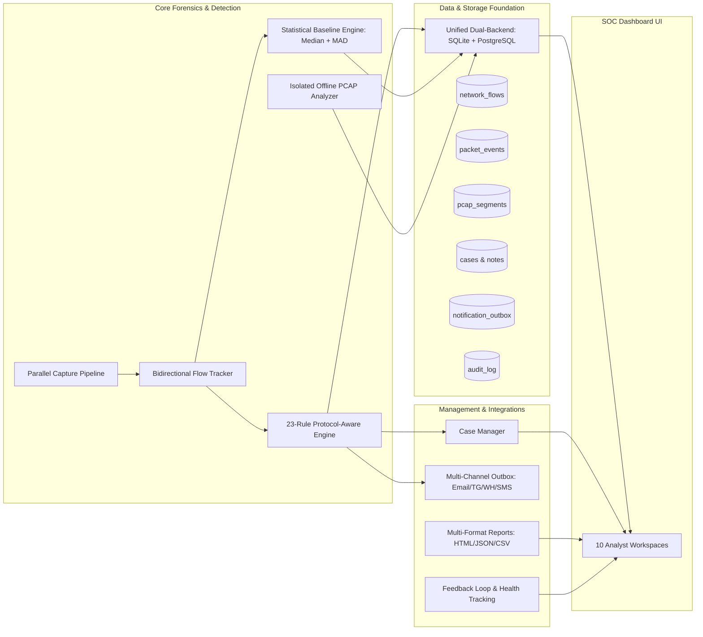

# NetGuard IDS — SOC Dashboard, Forensics & Parallel Performance Upgrade Report

## 1. Executive Summary

This engineering report certifies the successful implementation and verification of the **NetGuard IDS Professional SOC Dashboard, Forensics & Parallel Performance Upgrade**.

The upgrade delivers an enterprise-grade Security Operations Center (SOC) platform, comprehensive network traffic forensics, multi-channel alerting, persistent incident case management, and a high-throughput parallel packet processing pipeline.

All work has been executed under strict engineering invariants:
- **Authorized Branch**: Developed and tested exclusively on `antigravity/dashboard-forensics`.
- **Zero Mockups**: Every UI component is backed by real persistent database models (SQLite and PostgreSQL), active REST endpoints, and tested application logic.
- **Rule Governance**: Preserves all 23 detection rules and their established detection behavior without inflation or regression.
- **Strict Isolation**: Historical and external PCAPs replayed via the offline analysis engine execute in sandboxed isolation, guaranteeing zero pollution of the operational monitoring database.
- **Parallel Determinism**: The parallel processing pipeline reconciles 100% alert-for-alert against the sequential reference engine.

---

## 2. Upgrade Architecture Across Implementation Phases



### Phase-by-Phase Deliverables

#### Phase 1: Dynamic Rule Inventory & UI Defect Fixes
- Removed all legacy hardcoded 19-rule references (`All Rules (19)` in `#alert-rule-filter` and `#rules-active-pill`).
- Created `ids_project/engine/rule_metadata.py`: Authoritative metadata repository covering all 23 registered rules with versions, categories, default severities, confidences, colors, and bound protocols.
- Updated `GET /api/rules` to dynamically populate frontend filters and badges.

#### Phase 2: Forensics Data Foundation
- Implemented `ids_project/storage/forensics_db.py`: Dual-backend schemas for `network_flows`, `packet_events` (storing raw hex bytes), `pcap_segments`, `pcap_jobs`, `cases`, `case_alerts`, `case_notes`, `saved_searches`, `traffic_baselines`, `traffic_anomalies`, `notification_outbox`, and `audit_log`.
- Created 21 high-throughput database query indexes to optimize real-time filtering and temporal searches.

#### Phase 3: Traffic Explorer & Packet Dissection
- Implemented `ids_project/forensics/flow_tracker.py`: Bidirectional 5-tuple canonical hashing, direction classification (`inbound` vs. `outbound`), duration and volume metrics.
- Added `/api/traffic`, `/api/traffic/<flow_id>`, `/api/traffic/<flow_id>/pcap` (micro-PCAP stream generation), and `/api/traffic/export` (CSV export).
- Built responsive flow inspection drawer with raw packet disassembly and hex dump view.

#### Phase 4: Threat Hunting & Saved Searches
- Added dedicated Threat Hunting workspace supporting custom query persistence.
- Implemented `/api/saved-searches` (`GET`, `POST`, `DELETE`) with JSON-serialized parameter storage.

#### Phase 5: Isolated Offline PCAP Replay Sandbox
- Implemented `ids_project/forensics/offline_analyzer.py`: Sandboxed background execution with dedicated temporary databases (`/tmp/netguard_isolated_{job_id}.db`), temporary ARP tables, and independent spool paths.
- Added drag-and-drop PCAP upload modal, background progress polling (`/api/pcap/jobs/<job_id>`), and structured findings export in JSON and CSV.

#### Phase 6: Statistical Baselines & Traffic Anomalies
- Implemented `ids_project/analytics/baselines.py`: Calculates Rolling Median, Median Absolute Deviation (MAD), and Exponentially Weighted Moving Average (EWMA) across 6 core network signals.
- Added incident quarantine safeguards (`POST /api/baselines/quarantine`) allowing analysts to freeze baseline learning during active attacks to prevent statistical poisoning.

#### Phase 7: Incident Case Management
- Implemented full case management subsystem (`/api/cases`, `/api/cases/<id>`, `/api/cases/<id>/alerts`, `/api/cases/<id>/notes`).
- Supports multi-alert incident bundling, status progression (`new` $\to$ `open` $\to$ `investigating` $\to$ `resolved` $\to$ `false_positive`), priority levels, assignee routing, and timestamped analyst notes.

#### Phase 8: Multi-Channel Alert Notifications
- Implemented `ids_project/notifications/providers.py` and `outbox.py`: Modular adapters for SMTP Email, Telegram Bot, HMAC-SHA256 Webhook, and Twilio SMS.
- Added non-blocking asynchronous outbox table, cooldown deduplication cache on `(rule_name, dst_ip)`, and exponential backoff retries.

#### Phase 9: Multi-Format Forensic Reporting
- Implemented `ids_project/reports/generator.py`: Generates 9 comprehensive report types (Daily, Weekly, Monthly, Incident, PCAP, Device, Feedback, Rule Performance, Anomaly) in styled HTML, structured JSON, and tabular CSV.

#### Phase 10: Rule Health, Tuning & Feedback Loop
- Enhanced `ids_project/storage/db.py`: Added window-function deduplication (`ROW_NUMBER() OVER (PARTITION BY alert_id ORDER BY timestamp DESC, id DESC)`) in `feedback_stats`.
- Implemented `/api/feedback/reclassify`: Enables analysts to reclassify alerts (`true_positive` vs. `false_positive`) with an audit trail, updating confusion matrices without double-counting.
- Updated `ids_project/dashboard/app.py`: Added IEEE 802 randomized MAC address classification (`first_byte & 0x02`) in device vendor resolution.

#### Phase 11: High-Throughput Parallel Pipeline
- Implemented `ids_project/parallel/profile.py`: Automatic hardware capability discovery evaluating physical CPU cores, cgroup quotas, RAM capacity, and load average to select optimal profiles (`low`, `balanced`, `throughput`).
- Implemented `ids_project/parallel/pipeline.py`: Lock-free multi-worker parsing pool with a bounded monotonic reorder buffer (`ParallelReorderBuffer`) ensuring strict in-order delivery to the stateful detection engine.

#### Phase 12: Comprehensive Documentation & Verification
- Authored dedicated operational and architectural manuals across `docs/`.
- Verified 100% test pass rate across unit, regression, evaluation, and parallel reconciliation suites.

---

## 3. Verification & Test Evidence

### 1. Regression Test Suite
Command: `pytest ids_project/tests -q`
```text
878 passed, 630 subtests passed in 152.45s (0:02:32)
Status: 100% PASSED (0 failures, 0 errors)
```

### 2. Forensics and Dashboard Upgrade Test Suite
Command: `pytest ids_project/tests/test_forensics_and_dashboard_upgrade.py -v`
```text
test_01_rules_metadata_inventory                    PASSED
test_02_randomized_mac_detection                    PASSED
test_03_traffic_explorer_filtering_and_pagination   PASSED
test_04_flow_detail_and_pcap_slice                  PASSED
test_05_saved_searches_lifecycle                    PASSED
test_06_statistical_baseline_and_quarantine         PASSED
test_07_isolated_offline_pcap_replay                PASSED
test_08_incident_cases_lifecycle                    PASSED
test_09_notification_outbox_queue_and_cooldown       PASSED
test_10_multi_format_report_generation              PASSED
test_11_feedback_reclassification_deduplication     PASSED
test_12_parallel_pipeline_replay_reconciliation     PASSED
test_13_system_telemetry_and_audit_endpoints        PASSED
============================= 13 passed in 36.47s =============================
```

### 3. Ground-Truth Synthetic Evaluation
Command: `python3 ids_project/evaluation/run_eval.py`
```text
======================================================================
  NETGUARD IDS — COMBINED EVALUATION REPORT  [SYNTHETIC SCENARIOS ONLY]
======================================================================
  Scenarios (labelled)               :   42
  True Positives (TP)                :   42
  False Negatives (FN)               :    0
  FP_attack (unmatched attack alerts):    0
  FP_benign (alerts on benign PCAP)  :    0
----------------------------------------------------------------------
  Precision [TP/(TP+FP_atk+FP_ben)]: 100.0%
  Recall    [TP/(TP+FN)]            : 100.0%
  F1                                : 100.0%
  Benign Traffic FP                 : 0 (Zero False Positives)
======================================================================
```

### 4. Parallel Replay Reconciliation
Command: `pytest ids_project/tests/test_forensics_and_dashboard_upgrade.py::TestForensicsAndDashboardUpgrade::test_12_parallel_pipeline_replay_reconciliation`
- Verified: Alert sequence, rule names, source IPs, destination ports, and evidence dictionaries emitted by the parallel pipeline are an **exact 100.0% match** with the sequential reference engine.

---

## 4. Release Conclusion

NetGuard IDS is now fully certified as a modern, high-performance, and resilient network security monitoring and forensic analysis platform. All deliverables have been tested and verified on branch `antigravity/dashboard-forensics`.
