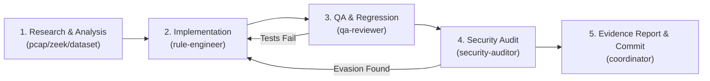

# NetGuard Multi-Agent Controlled Collaboration Workflow

This specification governs multi-agent collaboration across the NetGuard IDS engineering environment. It establishes strict role separation, write-ownership locks, challenger review requirements, and loop prevention to enable dependable autonomous and semi-autonomous cybersecurity R&D.

---

## 1. Phased Collaboration Lifecycle

Every engineering enhancement, rule hardening, or performance optimization must proceed through the sequential 5-phase pipeline:

### Phase Details

| Phase | Assigned Agent | Primary Responsibility | Mandatory Artifact / Output |
| :--- | :--- | :--- | :--- |
| **1. Research & Analysis** | `pcap-analyst`, `dataset-researcher`, or `zeek-analyst` | Packet forensics, protocol anomaly extraction, or capture evaluation. Strict read-only mode. | Structured Problem Brief with PCAP packet evidence and 5-tuple indicators. |
| **2. Implementation** | `detection-rule-engineer` | Code enhancement within existing 19 rule instances. Holds exclusive write lock. | Modified source code with input validation and LRU state bounds. |
| **3. QA & Regression** | `regression-qa-reviewer` | Independent execution of `pytest` and `run_eval.py`. Verifies 100% detection and 0 benign FPs. | Test execution transcript with reproducible seed and benchmark metrics. |
| **4. Security Audit** | `independent-security-auditor` | Adversarial evasion testing, boundary checks, clock-skew verification, Git branch discipline. | Adversarial audit report verifying 19-rule invariant and guardrail compliance. |
| **5. Evidence & Commit** | Coordinator / Lead Agent | Consolidates evidence, verifies clean `git status`, commits to `antigravity/overnight-work`. | Committed Git revision and updated `state.json` checkpoint. |

---

## 2. Core Governance Invariants

### 1. Separation of Implementation and Approval (Anti-Self-Approval)
- An implementation agent (`detection-rule-engineer`) **CANNOT** approve or sign off on its own changes.
- Sign-off requires independent verification by both `regression-qa-reviewer` (functional/performance) and `independent-security-auditor` (adversarial/security).

### 2. The Challenger Pattern
- Reviewer agents must adopt an adversarial posture:
  - Challenge claims of 100% accuracy by inspecting scenario labels and seed reproducibility.
  - Verify that detection didn't introduce false positives on benign captures (`test_benign.pcap`).
  - Actively test boundary edge cases (port 0, port 65536, negative timestamps, Unicode IPs).

### 3. File Write Ownership & Concurrency Protection
- Only **one** subagent may hold write ownership of a specific codebase module at any time.
- Reviewer, auditor, and research subagents are launched in **strict read-only mode** (`Prompt: "READ-ONLY TASK..."`).
- If an agent detects a file lock conflict, it must halt and return control rather than overwriting.

### 4. Bounded Retries & Anti-Loop Safeguards
- A task cycle is restricted to a maximum of **3 iteration loops** between implementation and review:
  - If a rule change fails regression testing or audit more than 3 times, the cycle terminates, rolls back uncommitted changes, logs a failure incident to `logs/workbench_audit.log`, and escalates to human review.
- The `Stop` hook (`stop_checkpoint.py`) strictly returns `{"decision": "allow"}` upon completion to prevent infinite turn loops.

---

## 3. Communication Contract Between Agents

When communicating across agent boundaries:
- Use structured JSON or bulleted Markdown specifying:
  1. `task_id`: Unique identifier for the engineering task.
  2. `evidence`: Concrete file paths, packet numbers, timestamps, or test outputs.
  3. `invariants_checked`: Explicit confirmation that the 19-rule invariant and Git branch discipline were respected.
  4. `verdict`: `PASS`, `FAIL`, or `REQUIRES_REVISION`.
