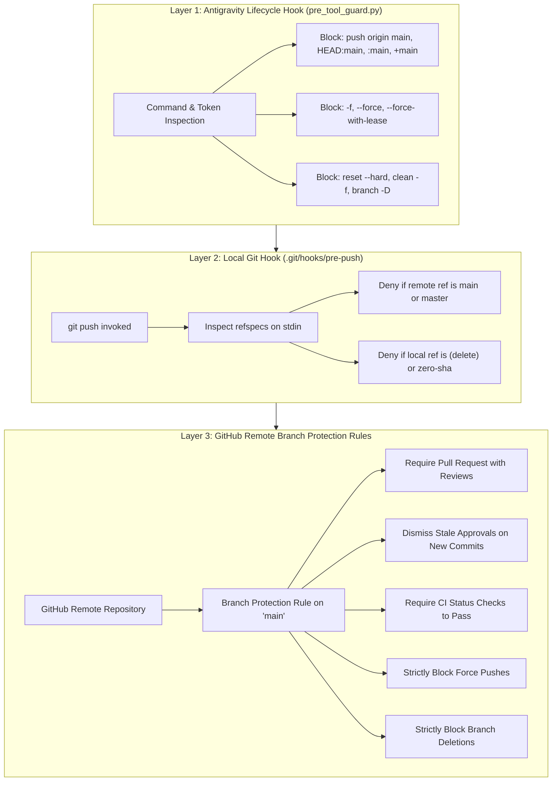

# NetGuard IDS — Layered Git Safety & Discipline Model

This document outlines the multi-layered Git safety model protecting the NetGuard IDS codebase against accidental overwrites, unauthorized direct pushes, forced pushes, and history corruption during autonomous and interactive engineering workflows.

---

## 1. Safety Layers Overview



---

## 2. Layer 1: Antigravity Lifecycle Hook (`pre_tool_guard.py`)

- **Scope**: Evaluates every `run_command` invocation before process execution.
- **Fail-Closed Semantics**: If standard input is empty, malformed, or unparseable, the hook fails closed with `decision: deny`.
- **Global Options & Wrapper Parsing**:
  - Automatically unwraps `env`, `sudo`, `nohup`, `nice`, and leading environment variable assignments (`VAR=val`).
  - Correctly extracts Git subcommands even when preceded by global options (`git -C <dir>`, `git -c <key>=<val>`, `git --git-dir=...`, `git --work-tree=...`).
- **Refspec Analysis**:
  - Rejects destination refspecs targeting `main`, `master`, `HEAD:main`, `refs/heads/main`, `+main`, `*:main`.
  - Rejects deletion syntax (`:main`, `--delete`).
  - Rejects force-push flags (`-f`, `--force`, `--force-with-lease`, `--force-if-includes`) and `+` prefix refspecs.
- **Shell & Interpreter Inspection**:
  - Recursively evaluates nested subshells (`bash -c`, `sh -c`, `eval`).
  - Inspects inline scripts passed to interpreters (`python3 -c`, `node -e`, `perl -e`) for destructive git commands.

---

## 3. Layer 2: Local Native Git Hook (`.git/hooks/pre-push`)

- **Scope**: Native client-side Git enforcement hook executed automatically whenever `git push` is called, regardless of whether it was triggered via Antigravity, terminal, or script.
- **Implementation**: `scripts/git_pre_push.py` (in `.agents/plugins/netguard-workbench/scripts/git_pre_push.py`), installed via `scripts/install_git_hooks.py`.
- **Enforcement**:
  - Inspects standard input refspec lines: `<local_ref> <local_sha1> <remote_ref> <remote_sha1>`.
  - Exits with status code 1 if `<remote_ref>` is `refs/heads/main` or `refs/heads/master`.
  - Exits with status code 1 if `<local_ref>` is `(delete)` or `<local_sha1>` is `0000000000000000000000000000000000000000` targeting protected branches.

---

## 4. Layer 3: Remote GitHub Branch Protection Rules (Manual Configuration)

To complete the defense-in-depth model, repository administrators must configure the following remote branch protection rules on GitHub (`Settings -> Branches -> Add branch protection rule`):

### Recommended Branch Protection Policy for `main`:

1. **Branch Name Pattern**: `main`
2. **Protect Matching Branches**:
   - [x] **Require a pull request before merging**:
     - [x] Require approvals: Minimum 1 review approval.
     - [x] Dismiss stale pull request approvals when new commits are pushed.
     - [x] Require review from Code Owners where applicable.
   - [x] **Require status checks to pass before merging**:
     - [x] Require branches to be up to date before merging.
     - [x] Status checks: `pytest (unit & integration tests)`, `eval (ground-truth evaluation)`.
   - [x] **Require conversation resolution before merging**.
   - [x] **Require linear history** (avoid merge commits; prefer rebase or squash).
   - [x] **Do not allow bypassing the above settings** (enforce for administrators).
   - [x] **Block force pushes** (prevent `--force` and `--force-with-lease`).
   - [x] **Block deletions** (prevent `git push origin --delete main`).

---

## 5. Authorized Development Workflow

All NetGuard engineering activities, autonomous campaigns, and testing occur exclusively on the authorized branch:
```bash
git checkout antigravity/overnight-work
git push origin antigravity/overnight-work
```

To merge changes to `main`:
1. Push branch to `origin/antigravity/overnight-work`.
2. Open a Pull Request from `antigravity/overnight-work` to `main`.
3. Verify all automated tests, regression suites, and rule governance invariants pass.
4. Obtain independent security and code review.
5. Merge via reviewed pull request.

