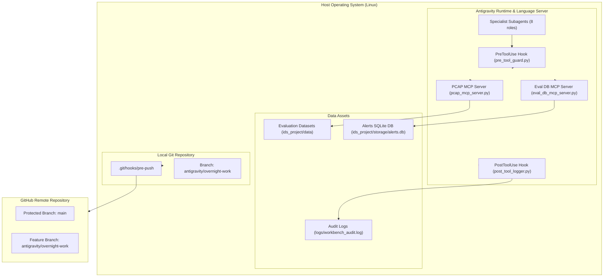

# NetGuard Engineering Workbench — Security Threat Model & Residual Risk Register

## 1. Scope & System Architecture

The **NetGuard Engineering Workbench** provides an autonomous and human-supervised engineering environment for NetGuard IDS development. The system operates within Google Antigravity, orchestrating specialist subagents, modular skills, lifecycle hooks, and local stdio Model Context Protocol (MCP) servers.

---

## 2. Threat Modeling (STRIDE Analysis)

| Threat Category | Identified Attack Vector / Vulnerability | Severity | Mitigation Implemented |
| :--- | :--- | :---: | :--- |
| **Spoofing / Bypass** | Agent executing commands with global flags (`git -C . push origin main`) or environment prefixes (`GIT_DIR=.git git push`) to bypass regex matching. | **High** | Tokenization via `shlex.shlex(punctuation_chars=True)` with leading environment variable and wrapper stripping (`env`, `sudo`, `nice`). |
| **Tampering** | Overwriting `main` branch or corrupting Git history via `git push -f`, `git reset --hard`, or `git clean -fdx`. | **High** | Layered protection: PreToolUse hook denies push to main, force flags, and resets; native `.git/hooks/pre-push` denies pushes targeting `main` at Git transport layer. |
| **Information Disclosure** | Leakage of API keys, GitHub tokens, JWTs, or passwords in tool audit logs. | **Medium** | PostToolUse audit logger writes strictly the executable token (e.g. `pytest`, `git`), omitting command arguments and payloads. Regex sanitization strips credentials, JWTs, PATs, and keys. |
| **Denial of Service** | Extremely large PCAPs (>100 MB) or malformed captures exhausting memory in Scapy `rdpcap`. | **Medium** | Path validation bounds PCAP sizes to 100 MB max; Scapy parser wrapped in defensive exception blocks; unbounded log growth mitigated via 5 MB rotation. |
| **Elevation of Privilege** | Arbitrary SQL injection in evaluation database inspector MCP server. | **High** | Parameterized SQL queries with strict identifier validation (`^[a-zA-Z0-9_]+$`) for table and column names; connection restricted to SQLite read-only URI mode (`mode=ro`). |
| **Evasion (Rule Engine)** | Circumventing detection invariants by adding dummy rules or inflating rule counts. | **Critical** | Strict 19-rule invariant enforced in `RuleEngine.rules`; verified by `rule-review` skill and automated regression test suite. |

---

## 3. Defense-in-Depth vs. OS-Level Security Boundary

> [!IMPORTANT]
> **Hook Guardrails vs. OS Sandbox**:  
> Antigravity lifecycle hooks (`pre_tool_guard.py`) operate as **engineering guardrails** to prevent accidental missteps, unprompted destructive commands, and discipline violations by LLM agents.
> 
> They do **NOT** constitute an impenetrable OS-level security boundary against determined host-level privilege escalation or deliberate adversarial bypasses (e.g., custom compiled C binaries or raw kernel syscalls). 
> 
> True security is achieved through **defense-in-depth**:
> 1. Layer 1: Antigravity PreToolUse hook (fail-closed, tokenized command inspection).
> 2. Layer 2: Native Git pre-push hook (`.git/hooks/pre-push`).
> 3. Layer 3: Remote GitHub branch protection rules enforcing PR review and CI status checks.
> 4. Layer 4: Host containerization and filesystem permissions (read-only datasets).

---

## 4. Residual Risk Register

| Risk ID | Residual Risk Description | Inherent Likelihood | Impact | Current Mitigations | Recommended Future Action |
| :--- | :--- | :---: | :---: | :--- | :--- |
| **RR-01** | **Direct Binary Execution Evasion**: An agent could theoretically write and compile a native binary (`gcc payload.c -o payload && ./payload`) that performs a Git push directly via raw sockets, bypassing shell command tokenization. | Low | High | PreToolUse denies arbitrary network sockets if configured; Git pre-push hook catches pushes at the Git level. | Run autonomous agents within unprivileged Linux network namespaces or Docker containers without push credentials. |
| **RR-02** | **Remote Branch Protection Absence**: If GitHub branch protection rules are not manually enabled on the remote repository, a force-push executed outside the workbench could affect `main`. | Medium | High | Documented manual configuration requirements in `docs/autonomy/git-security-model.md`. | Organization-level policy enforcement via GitHub Enterprise Rulesets. |
| **RR-03** | **PCAP Heap Exhaustion on 99MB Capture**: Scapy `rdpcap` expands PCAP packets by approximately 5–10× in memory; a 90 MB capture with millions of tiny packets could spike memory. | Medium | Low | Size clamped to 100 MB; memory performance audit skill recommends `tshark` streaming for large captures. | Migrate PCAP MCP server from `scapy.rdpcap` to `scapy.PcapReader` (streaming generator). |
| **RR-04** | **Unattended Mode Ambiguity**: Unrecognized inline interpreter scripts in unattended mode are rejected by default, which may block legitimate ad-hoc Python one-liners during autonomous development. | Low | Low | Safe commands (`pytest`, `python3 ids_project/evaluation/run_eval.py`) are explicitly allowlisted. | Maintain explicit allowlist of authorized script runners in `pre_tool_guard.py`. |
