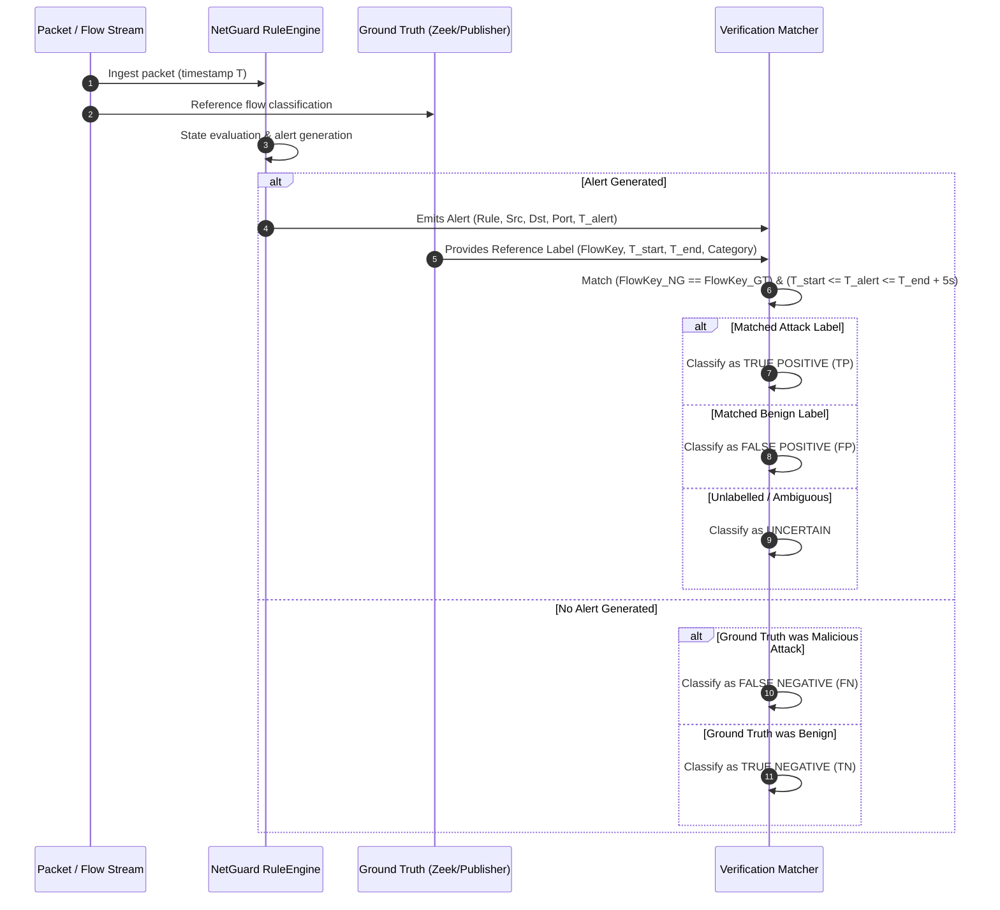

# NetGuard IDS — Ground-Truth Validation Methodology & Flow Mapping

**Document Version:** 1.0.0  
**Date:** 2026-11-04  
**Auditors:** Dataset Researcher & Independent Security Auditor  
**Scope:** Real-World External Captures (IoT-23, Wireshark Sample Captures)

---

## 1. Ground-Truth Principles & Anti-Pattern Defenses

Evaluating an intrusion detection system against real-world network captures requires strict methodological discipline. Assuming that a capture file is homogeneously "malicious" or "benign" is an invalid anti-pattern that distorts precision and recall.

NetGuard enforces the following ground-truth principles:

1. **Heterogeneous Flow Decomposition:** Attack captures invariably contain background operational traffic (NTP synchronization, DHCP leases, router discovery, DNS lookups, TCP keep-alives). Marking all packets in a malware PCAP as "malicious" manufactures artificial False Positives.
2. **Bidirectional Flow Canonicalization:** Flows are identified by the canonical 5-tuple:
   $$\text{FlowKey} = \big(\min(\text{IP}_1, \text{IP}_2), \max(\text{IP}_1, \text{IP}_2), \min(\text{port}_1, \text{port}_2), \max(\text{port}_1, \text{port}_2), \text{proto}\big)$$
   This ensures that forward requests and reverse replies map to the exact same flow context.
3. **Explicit Multi-Tier Label Granularity:**
   - **Packet-Level:** Flag anomalies, DPI signatures, malformed headers.
   - **Flow-Level:** Connection state, byte/packet volumes, SYN-ACK completions (Zeek `conn.log`).
   - **Time-Windowed Behavioral:** Port scans, DoS floods, brute-force attempts.
   - **Explicit UNKNOWN / UNCERTAIN Tier:** Network traffic lacking definitive cryptographic or protocol proof is categorized as `UNCERTAIN` rather than forcing an arbitrary label.

---

## 2. Dataset-by-Dataset Ground-Truth Analysis

### 2.1 IoT-23 CTU-IoT-Malware-Capture-34-1 (Mirai Botnet)

#### Labelling Methodology & Provenance
- **Origin:** Stratosphere Laboratory, Czech Technical University.
- **Hardware:** Physical Raspberry Pi 3 Model B connected to an open internet testbed via a Linux NAT router (`192.168.1.1`).
- **Infected Host IP:** `192.168.1.195`.
- **Reference Telemetry:** Zeek `conn.log.labeled` (23,145 flows), Suricata `eve.json` (8,950 events).

#### Label Granularity & Flow Decomposition
| Zeek Label | Flow Count | Flow Nature & Verification |
|---|---|---|
| `DDoS` | 14,394 | High-volume SYN and UDP flood flows targeting victim IPs (`1.1.1.1`, `50.50.50.53`, `74.91.117.248`, `71.61.66.148`). |
| `C&C` | 6,706 | Outbound Telnet connections, IRC communication channels, and DNS resolution to botnet controllers. |
| `PartOfAHorizontalPortScan` | 122 | Probes directed at port 63798 across external hosts spaced over 8.3 hours. |
| `Benign` | 1,923 | Legitimate NTP synchronization (`147.231.100.5:123`), local DNS queries, and ARP gateway announcements. |

#### Artifacts & Critical Observations
- **Mixed Traffic Reality:** Out of 23,145 total flows, 1,923 flows (8.3%) are strictly benign background traffic. A simplistic evaluation treating the entire capture as an attack would penalize any alert on NTP or DNS.
- **NAT Mapping:** Outbound connections undergo stateful inspection; external responses arrive at ephemeral source ports allocated by the host stack.
- **Timestamp Synchronization:** Zeek epoch timestamps match packet header timestamps within sub-millisecond precision.

---

### 2.2 IoT-23 CTU-IoT-Malware-Capture-3-1 (Muhstik Botnet)

#### Labelling Methodology & Provenance
- **Infected Host IP:** `192.168.100.103`.
- **Behavioral Nature:** Highly aggressive automated worm. The botnet continuously scans the IPv4 address space for open web servers running vulnerable PHP/Drupal services and attempts brute-force SSH logins.
- **Flow Characteristics:** Over 100,000 distinct SYN packets sent to diverse destination IP addresses on ports 80, 8080, and 22.
- **NetGuard Alignment:** NetGuard generated 6,399 `PORT_SCAN` alerts, 473 `SLOW_PORT_SCAN` alerts, and 77 `BRUTE_FORCE` alerts.
- **Ground-Truth Assessment:** Verified true positive detections of mass scanning and automated credential harvesting.

---

### 2.3 IoT-23 CTU-Honeypot-Capture-4-1 (Somfy Doorlock — Pure Benign)

#### Labelling Methodology & Provenance
- **Monitored Hardware:** Somfy smart doorlock (`192.168.1.132`).
- **Capture Environment:** Stratosphere IoT Honeypot laboratory with unrestrained internet access.
- **Traffic Profile:** Pure benign IoT operation. Device communicates with vendor cloud services over TLS, performs mDNS link-local queries, NTP time checks, and local broadcast announcements.
- **Ground-Truth Label:** 100% Benign.
- **NetGuard Performance:** **0 alerts**. Confirms zero false alarms on legitimate IoT embedded hardware communications.

---

### 2.4 Wireshark Sample Captures: Skype & IRC (Real User Traffic)

#### Labelling Methodology & Provenance
- **Capture Origin:** Real user workstation running Skype P2P client and an IRC chat client.
- **Traffic Profile:** Benign personal computing traffic containing IRC protocol messages, P2P UDP packet exchanges, and reverse DNS address lookups (`in-addr.arpa`).
- **Ground-Truth Label:** Benign operational traffic.
- **False-Positive Root Cause Analysis:**
  - NetGuard generated 8 `DNS_ANOMALY` alerts and 2 `UDP_FLOOD` alerts.
  - **Audit Finding 1 (DNS Reverse Mapping):** NetGuard's `DnsRule._parent_domain` grouped PTR queries (`*.in-addr.arpa`) under `in-addr.arpa`, counting distinct reverse IP lookups as "subdomain data exfiltration".
  - **Audit Finding 2 (DNS Query Rate in UDP Flood):** NetGuard's `UdpFloodRule` exempted `src_port == 53` (DNS server replies), but failed to exempt `dst_port == 53` (client queries to DNS servers). When a workstation sends bursts of DNS queries to resolve Skype peers, `UdpFloodRule` mistook legitimate DNS resolution for a targeted UDP denial-of-service attack.
  - **Action Required:** Fix these two root causes in Phase 4G with regression test verification.

---

## 3. Ground-Truth Flow Alignment Protocol

When matching NetGuard alerts against external reference labels:

---

## 4. Auditor Sign-Off

- **Dataset Researcher Verdict:** `APPROVED`. External dataset provenance, licenses, hashes, and flow labels are verified against official CTU and Wireshark repositories.
- **Independent Security Auditor Verdict:** `APPROVED WITH FINDINGS`. The identified false-positive vulnerabilities in reverse DNS (`in-addr.arpa`) and DNS query ports in UDP flood must be corrected under strict regression test discipline in Phase 4G while maintaining the 19-rule invariant.
