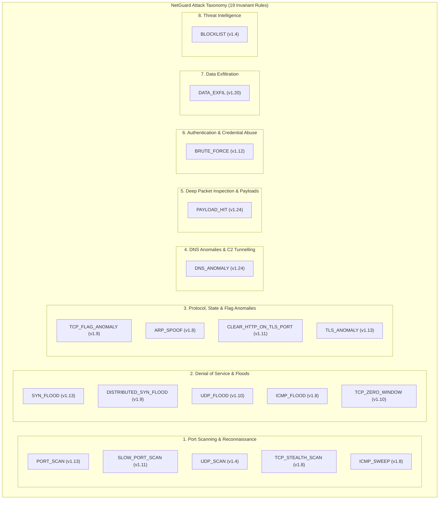

# NetGuard IDS — Phase 4A Baseline & Rule Inventory

**Document Version:** 1.0.0  
**Date:** 2026-11-04  
**Git Branch:** `antigravity/overnight-work`  
**Base Commit:** `22312b8`  
**Execution Environment:** Linux 6.12 (Kali Rolling x86_64), Python 3.14.8  

---

## 1. Executive Summary

Phase 4 of NetGuard IDS is dedicated to rigorous detection quality evaluation and real-world network traffic validation. NetGuard operates under a strict **19-rule inventory invariant** registered in `RuleEngine.rules`. Prior cycles established a solid architectural foundation with deterministic LRU state pruning, asynchronous SQLite alert writing, disk spooling, and passing unit test suites (497 tests).

However, current baseline evaluation metrics (100% Precision, 100% Recall, 100% F1) are derived exclusively from **synthetic, laboratory-crafted PCAP fixtures** (`test_attacks.pcap` and `test_benign.pcap`). These synthetic captures contain perfectly sequenced, isolated attack patterns without packet jitter, out-of-order delivery, real-world noise, protocol ambiguity, or high-throughput concurrency. 

This document establishes the honest baseline: documenting all 19 rules, mapping them to an attack taxonomy, recording existing benchmark performance, and cataloging potential evasion vectors and real-world validation requirements.

---

## 2. Attack Taxonomy & Rule Mapping

NetGuard's 19 detection rules map across 8 core attack categories:



---

## 3. Comprehensive 19-Rule Inventory

### Rule 1: `BlocklistRule` (`BLOCKLIST`)
- **Implementation:** `ids_project/engine/rules.py` (lines 291–403)
- **Attack Targeted:** Communication with known malicious external IP addresses or botnet command-and-control (C2) infrastructure.
- **Evidence Required:** IP packets with `src_ip` or `dst_ip` matching exact addresses or CIDR blocks.
- **Protocols Supported:** IPv4, IPv6 (all transport protocols).
- **Thresholds:** Immediate on match (1 hit); LRU cache bounded to 4,096 entries.
- **State & Memory:** Thread-safe `OrderedDict` LRU cache; pre-compiled IPv4 and IPv6 network objects.
- **Existing Tests:** `test_blocklist_path_handling.py`, `test_new_rules_cycle8.py`.
- **Existing Benchmark Coverage:** S01 (`test_attacks.pcap`).
- **Known Limitations:** Static feed dependency; does not detect domain-resolved dynamic C2 without DNS integration.
- **Evasion Methods:** IP hopping, fast-flux DNS, unlisted bulletproof hosting providers, proxies/Tor.
- **External PCAP Validation:** Highly meaningful when tested against real malware traffic (e.g., IoT-23, CTU-13) with current threat intelligence feeds.

### Rule 2: `PortScanRule` (`PORT_SCAN`)
- **Implementation:** `ids_project/engine/rules.py` (lines 404–656)
- **Attack Targeted:** Rapid vertical (single host, multiple ports) and horizontal (multiple hosts, single port) TCP scanning.
- **Evidence Required:** TCP initial SYN packets (`initial_syn=True` or `flags=0x02`).
- **Protocols Supported:** TCP (IPv4 and IPv6).
- **Thresholds:** Vertical: $\ge 15$ distinct ports to single target in 10s. Horizontal: $\ge 15$ distinct targets on single port in 10s.
- **State & Memory:** `OrderedDict` tracking up to 10,000 source states with nested port/target timestamp mappings; sliding window pruning.
- **Existing Tests:** `test_port_scan_detection.py`, `test_regression_fixes.py`.
- **Existing Benchmark Coverage:** S02 (vertical), S03 (horizontal).
- **Known Limitations:** Only tracks initial SYNs; vulnerable to out-of-order packets if timestamp checks are strict; does not detect scans slower than 1.5 probes/sec.
- **Evasion Methods:** Rate limiting probe speed (evades to `SlowPortScanRule`), randomized source ports, decoys (`nmap -D`), FIN/NULL/Xmas stealth scans.
- **External PCAP Validation:** Validated via standard Nmap captures, CIC-IDS2017 PortScan day, UNSW-NB15 Reconnaissance.

### Rule 3: `UdpScanRule` (`UDP_SCAN`)
- **Implementation:** `ids_project/engine/rules.py` (lines 657–667)
- **Attack Targeted:** Vertical and horizontal UDP port scanning.
- **Evidence Required:** UDP datagrams targeting distinct ports or destinations.
- **Protocols Supported:** UDP (IPv4 and IPv6).
- **Thresholds:** $\ge 15$ distinct ports/destinations in 10s.
- **State & Memory:** Inherits from `PortScanRule` ($O(1)$ LRU state, max 10,000 states).
- **Existing Tests:** `test_udp_scan_detection.py`.
- **Existing Benchmark Coverage:** S13 (IPv4 vertical), S14 (IPv6 vertical).
- **Known Limitations:** UDP is connectionless; cannot differentiate unsolicited probes from lost request/response traffic without ICMP Port Unreachable corroboration.
- **Evasion Methods:** Slow UDP probing, interleaved multi-source probing.
- **External PCAP Validation:** Meaningful on vulnerability scanning captures and real-world botnet scanning traffic.

### Rule 4: `UdpFloodRule` (`UDP_FLOOD`)
- **Implementation:** `ids_project/engine/rules.py` (lines 668–810)
- **Attack Targeted:** Volumetric UDP denial of service directed at a single target.
- **Evidence Required:** Rapid sequence of UDP datagrams from a single source to a single destination.
- **Protocols Supported:** UDP (IPv4 and IPv6).
- **Thresholds:** $\ge 50$ packets in 5s (general ports); $\ge 500$ packets in 5s (web/HTTP3 ports); exemptions for DNS (53), DHCP (67/68), NTP (123), mDNS (5353).
- **State & Memory:** Bounded `OrderedDict` (4,096 flows) tracking timestamp lists; 60s alert cooldown.
- **Existing Tests:** `test_udp_flood.py`.
- **Existing Benchmark Coverage:** S32 (UDP flood on port 5060).
- **Known Limitations:** Single-source tracking only; distributed UDP amplification/spoofed floods evade this rule.
- **Evasion Methods:** Spoofed source IP addresses (DNS/NTP/SSDP amplification), distributing packet rate across multiple reflectors.
- **External PCAP Validation:** Meaningful on DoS captures (CIC-IDS2017 Friday, IoT-23 Mirai/Bashlite UDP floods).

### Rule 5: `TcpStealthScanRule` (`TCP_STEALTH_SCAN`)
- **Implementation:** `ids_project/engine/rules.py` (lines 811–946)
- **Attack Targeted:** Stealth TCP reconnaissance attempting to bypass stateful firewalls/IDS using non-SYN packets.
- **Evidence Required:** TCP packets with specific flag sets: NULL (flags=0), FIN (`flags=0x01`), Xmas (`FIN|PSH|URG=0x29`).
- **Protocols Supported:** TCP.
- **Thresholds:** $\ge 15$ probes to a target in 10s.
- **State & Memory:** `OrderedDict` tracking up to 10,000 keys with `(timestamp, dst_port, probe_type)`.
- **Existing Tests:** `test_tcp_stealth_scan_detection.py`.
- **Existing Benchmark Coverage:** S20 (FIN/NULL/Xmas scan).
- **Known Limitations:** Out-of-order rejection logic (`now < history[-1][0]`) can drop valid probes in jittered captures; does not count ACK/Maimon/Window scans.
- **Evasion Methods:** Spreading probes beyond 10s window, mixing with normal connection traffic.
- **External PCAP Validation:** High value on Nmap scan captures (`-sN`, `-sF`, `-sX`).

### Rule 6: `TcpFlagAnomalyRule` (`TCP_FLAG_ANOMALY`)
- **Implementation:** `ids_project/engine/rules.py` (lines 947–1120)
- **Attack Targeted:** Malformed TCP flag combinations violating RFC 9293 specification, used for OS fingerprinting, firewall evasion, or protocol fuzzing.
- **Evidence Required:** Individual TCP packets with illegal flag combinations: SYN+FIN (0x03), SYN+RST (0x06), FIN+RST (0x05), Kamikaze (0x3F), PSH-without-ACK, URG-without-ACK.
- **Protocols Supported:** TCP.
- **Thresholds:** Immediate alert per packet; 60s cooldown per `(src_ip, anomaly_type)`.
- **State & Memory:** `OrderedDict` tracking up to 5,000 cooldown entries.
- **Existing Tests:** `test_tcp_flag_anomaly.py`.
- **Existing Benchmark Coverage:** S28 (SYN+FIN).
- **Known Limitations:** Stateless packet inspection cannot differentiate legitimate mid-stream teardown anomalies from deliberate fuzzing.
- **Evasion Methods:** Custom TCP stacks that utilize subtle timing discrepancies instead of illegal flags.
- **External PCAP Validation:** Wireshark sample captures, DefCon CTF captures, Scapy anomaly PCAPs.

### Rule 7: `SynFloodRule` (`SYN_FLOOD`)
- **Implementation:** `ids_project/engine/rules.py` (lines 1121–1410)
- **Attack Targeted:** Single-source TCP SYN floods and connection teardown (RST) floods.
- **Evidence Required:** High volume of TCP initial SYNs to a single service, or TCP RSTs to a destination.
- **Protocols Supported:** TCP.
- **Thresholds:** SYN: $\ge 100$ SYNs to `(dst_ip, dst_port)` in 10s. RST: $\ge 100$ RSTs to `dst_ip` in 10s. RST grace period: 5s after closed-port SYN.
- **State & Memory:** Tracks up to 8,192 SYN flows, 4,096 RST flows, and 32,768 SYN context handshakes.
- **Existing Tests:** `test_new_rules_cycle8.py`, `test_finite_rule_timestamps.py`.
- **Existing Benchmark Coverage:** S04 (SYN burst), S23 (RST flood).
- **Known Limitations:** Does not alert on distributed low-rate SYNs (handled by Rule 8).
- **Evasion Methods:** Source IP address spoofing, SYN-ACK reflection attacks.
- **External PCAP Validation:** Readily verified on DoS datasets (CIC-IDS2017 Wednesday/Friday, IoT-23).

### Rule 8: `DistributedSynFloodRule` (`DISTRIBUTED_SYN_FLOOD`)
- **Implementation:** `ids_project/engine/rules.py` (lines 1411–1557)
- **Attack Targeted:** Distributed Denial of Service (DDoS) SYN floods targeting an infrastructure service from multiple distinct IP addresses.
- **Evidence Required:** High aggregate volume of initial SYNs arriving at a single `(dst_ip, dst_port)` from many sources.
- **Protocols Supported:** TCP (ports 1–49151).
- **Thresholds:** $\ge 500$ initial SYNs from $\ge 20$ distinct source IPs within 10s.
- **State & Memory:** `OrderedDict` tracking up to 2,048 targets, each with a `deque` of timestamps and source map.
- **Existing Tests:** `test_new_rules_cycle8.py`.
- **Existing Benchmark Coverage:** S15 (DDoS SYN flood across 20 sources).
- **Known Limitations:** Requires $\ge 50$ packets/second; low-rate distributed attacks evade threshold.
- **Evasion Methods:** Pulsing floods (bursts below 500 packets), slow-rate DDoS, application-layer HTTP floods.
- **External PCAP Validation:** High value on CIC-IDS2017 DDoS Friday and CAIDA DDoS datasets.

### Rule 9: `IcmpSweepRule` (`ICMP_SWEEP`)
- **Implementation:** `ids_project/engine/rules.py` (lines 1558–1671)
- **Attack Targeted:** Network host discovery reconnaissance using ICMP ping sweeps.
- **Evidence Required:** ICMP Echo Requests (Type 8, Code 0) or ICMPv6 Echo Requests (Type 128, Code 0) sent to distinct destinations.
- **Protocols Supported:** ICMP, ICMPv6.
- **Thresholds:** $\ge 12$ distinct destination IPs in 10s.
- **State & Memory:** `OrderedDict` tracking up to 4,096 sources; 10s cooldown per source.
- **Existing Tests:** `test_icmp_sweep_detection.py`.
- **Existing Benchmark Coverage:** S12 (ICMP sweep across 16 hosts).
- **Known Limitations:** Out-of-order packet drop (`now < history[-1][0]`); ignores other discovery protocols (ARP, TCP ping).
- **Evasion Methods:** Slow ping sweeps ($< 1.2$ hosts/sec), non-echo discovery (timestamp requests, address mask).
- **External PCAP Validation:** Validated via Nmap host discovery scans (`-sn -PE`).

### Rule 10: `IcmpFloodRule` (`ICMP_FLOOD`)
- **Implementation:** `ids_project/engine/rules.py` (lines 1672–1810)
- **Attack Targeted:** Targeted ICMP Echo flood / Ping of Death / volumetric ICMP DoS.
- **Evidence Required:** High volume of ICMP Echo Requests directed at a single destination host.
- **Protocols Supported:** ICMP (Type 8), ICMPv6 (Type 128).
- **Thresholds:** $\ge 50$ Echo Requests in 5s.
- **State & Memory:** `OrderedDict` tracking up to 4,096 source-destination pairs; 60s alert cooldown.
- **Existing Tests:** `test_icmp_flood.py`.
- **Existing Benchmark Coverage:** S29 (60 echo requests in $<2$s).
- **Known Limitations:** Does not alert on Smurf attacks (broadcast amplification) where destination is broadcast.
- **Evasion Methods:** Distributing flood across multiple sources, fragmenting packets.
- **External PCAP Validation:** Tested on DoS ICMP flood PCAPs.

### Rule 11: `ArpSpoofRule` (`ARP_SPOOF`)
- **Implementation:** `ids_project/engine/rules.py` (lines 1811–2375)
- **Attack Targeted:** Man-in-the-Middle (MitM) ARP poisoning and gateway impersonation.
- **Evidence Required:** ARP replies or gratuitous ARP claiming an existing IPv4 address with a different unicast MAC address.
- **Protocols Supported:** ARP (Ethernet).
- **Thresholds:** Immediate alert on IP-to-MAC mapping conflict; 120s cooldown per IP; disk-backed state (`arp_table.json`).
- **State & Memory:** Up to 65,536 entries; periodic background persistence thread.
- **Existing Tests:** `test_dns_and_arp_detection.py`.
- **Existing Benchmark Coverage:** S05 (Gateway MAC change).
- **Known Limitations:** Local L2 broadcast domain only; ineffective on routed L3 captures where MAC addresses are those of the router.
- **Evasion Methods:** ARP cache poisoning targeting hosts rather than gateway, timing spoofing with host reboots.
- **External PCAP Validation:** Validated on L2 local switched network captures (e.g., Ettercap/Arpspoof PCAPs).

### Rule 12: `PayloadRule` (`PAYLOAD_HIT`)
- **Implementation:** `ids_project/engine/rules.py` (lines 2376–2913)
- **Attack Targeted:** Remote code execution, SQL injection, web shell access, credential leakage, deserialization, command injection.
- **Evidence Required:** Unencrypted application payload matching regular expression signatures across single packets and reassembled TCP streams.
- **Protocols Supported:** Unencrypted TCP streams (HTTP, FTP, Telnet, SMTP, etc. on `_DPI_PORTS`).
- **Thresholds:** Immediate alert on signature match; 60s cooldown per `(flow_key, signature)`.
- **State & Memory:** Directional TCP reassembly buffers (max 2,048 streams, 512 bytes prefix), multi-pass URL decoding, comment normalization, null-byte stripping.
- **Existing Tests:** `test_payload_detection.py`.
- **Existing Benchmark Coverage:** 12 scenarios: S06 (SQLi), S07 (Cmdi), S08 (Log4Shell), S09 (Cred leak), S16 (split TCP SQLi), S17 (URL SQLi), S25 (XXE), S26 (Shellshock), S27 (Java deserialization), S30 (Double-encoded traversal), S33 (.env probe), S36 (WebDAV PROPFIND).
- **Known Limitations:** Encrypted TLS traffic cannot be inspected without decryption keys; only inspects first 512 bytes of reassembled stream; fixed port allowlist (`_DPI_PORTS`).
- **Evasion Methods:** TLS encryption, novel evasion encodings (UTF-7, non-standard hex), splitting payloads beyond 512 bytes, non-standard ports.
- **External PCAP Validation:** Exploit PCAPs (Wireshark exploit samples, CVE captures, UNSW-NB15 Exploit category).

### Rule 13: `DnsRule` (`DNS_ANOMALY`)
- **Implementation:** `ids_project/engine/rules.py` (lines 2914–3354)
- **Attack Targeted:** Domain Generation Algorithms (DGA), DNS data exfiltration, DNS tunneling.
- **Evidence Required:** DNS queries with high Shannon entropy ($\ge 3.8$), excessive length ($> 60$ chars), query frequency bursts ($\ge 20$ in 60s), or high subdomain count ($\ge 20$ subdomains in 60s).
- **Protocols Supported:** DNS over UDP/TCP (port 53).
- **Thresholds:** Entropy $\ge 3.8$; length $> 60$; frequency $\ge 20$ in 60s; subdomain $\ge 20$ in 60s; hex chunk length $\ge 24$.
- **State & Memory:** `OrderedDict` tracking up to 10,000 domain keys; multi-label public suffix grouping.
- **Existing Tests:** `test_dns_and_arp_detection.py`.
- **Existing Benchmark Coverage:** 6 scenarios: S10 (DGA), S11 (Long query), S18 (Nested DGA), S19 (Frequency), S24 (Subdomain exfil), S34 (Hex tunneling).
- **Known Limitations:** High-entropy CDNs (Akamai, Cloudflare) can cause false positives if not allowlisted; DNS-over-HTTPS (DoH) / DNS-over-TLS (DoT) blind this rule.
- **Evasion Methods:** Encrypted DNS (DoH/DoT), low-entropy dictionary DGAs (Matsnu, Suppobox), slow exfiltration ($< 20$ queries/min).
- **External PCAP Validation:** Validated on malware DNS captures (CTU-13 botnet traffic, IoT-23 DNS queries).

### Rule 14: `BruteForceRule` (`BRUTE_FORCE`)
- **Implementation:** `ids_project/engine/rules.py` (lines 3355–3577)
- **Attack Targeted:** Password cracking and credential brute-forcing against authentication services (SSH, FTP, Telnet, RDP, VNC, SMB, etc.).
- **Evidence Required:** High volume of initial TCP SYN connection attempts to authentication ports.
- **Protocols Supported:** TCP (ports 21, 22, 23, 110, 143, 389, 445, 993, 995, 1433, 1521, 3306, 3389, 5432, 5900).
- **Thresholds:** $\ge 20$ connection attempts to same `(dst_ip, dst_port)` in 60s.
- **State & Memory:** `OrderedDict` tracking up to 8,192 flow states; 60s alert cooldown.
- **Existing Tests:** `test_new_rules_cycle8.py`.
- **Existing Benchmark Coverage:** S21 (SSH brute-force: 22 attempts in rapid succession).
- **Known Limitations:** Network SYN rate indicator only; does not observe application-level authentication responses (e.g., SSH auth failure vs success).
- **Evasion Methods:** Slow password spraying across multiple user accounts ($< 20$ attempts/min), rotating source IPs.
- **External PCAP Validation:** Evaluated on SSH/FTP brute force PCAPs (CIC-IDS2017 Tuesday).

### Rule 15: `SlowPortScanRule` (`SLOW_PORT_SCAN`)
- **Implementation:** `ids_project/engine/rules.py` (lines 3578–3791)
- **Attack Targeted:** Low-and-slow reconnaissance designed to evade short-window scan detectors.
- **Evidence Required:** Initial TCP SYN packets spread over a wide 120-second window.
- **Protocols Supported:** TCP.
- **Thresholds:** $\ge 30$ distinct ports (vertical) or hosts (horizontal) probed within 120s.
- **State & Memory:** `OrderedDict` tracking up to 5,000 states; 120s alert cooldown per `(src_ip, scan_direction)`.
- **Existing Tests:** `test_new_rules_cycle8.py`.
- **Existing Benchmark Coverage:** S22 (32 ports probed over 56 seconds).
- **Known Limitations:** Memory retention over 120s; still evadable if scan takes hours or days.
- **Evasion Methods:** Ultra-slow scans (1 port per 10 minutes), rotating ephemeral IPs, distributed scanning.
- **External PCAP Validation:** Validated via slow Nmap scans (`-T2` or `-T1`).

### Rule 16: `DataExfiltrationRule` (`DATA_EXFIL`)
- **Implementation:** `ids_project/engine/rules.py` (lines 3792–4391)
- **Attack Targeted:** Unauthorized bulk data transfer or sensitive file export from internal to external networks.
- **Evidence Required:** Outbound payload volume exceeding threshold or magic byte file signatures (ZIP, 7z, GZ, TAR, SQLite, PE, ELF, PDF, private keys).
- **Protocols Supported:** TCP, UDP.
- **Thresholds:** Volume: $\ge 50$ KB in 30s (non-web) or $\ge 1$ MB (web ports 80, 443, 8080); Signature: immediate on magic bytes.
- **State & Memory:** Up to 5,000 flows and 1,000,000 flow events; 60s alert cooldown.
- **Existing Tests:** `test_data_exfiltration.py`.
- **Existing Benchmark Coverage:** S31 (60 KB transmitted to external host on port 9001).
- **Known Limitations:** TLS encryption masks file signatures and payload bytes; threshold must balance exfiltration detection against ordinary web browsing downloads.
- **Evasion Methods:** Encrypted C2 channels, Steganography, throttling data rate below 50 KB per 30s, chunking across multiple destinations.
- **External PCAP Validation:** Evaluated on data theft scenarios and malware C2 stages.

### Rule 17: `CleartextHttpOnTlsPortRule` (`CLEAR_HTTP_ON_TLS_PORT`)
- **Implementation:** `ids_project/engine/rules.py` (lines 4392–4766)
- **Attack Targeted:** Misconfigurations, protocol confusion attacks, or covert channels transmitting plaintext HTTP over conventional TLS ports (443, 8443, etc.).
- **Evidence Required:** Plaintext HTTP request lines (`GET /... HTTP/1.1`) observed on TLS ports.
- **Protocols Supported:** TCP on ports 443, 8443, 4443, 9443.
- **Thresholds:** $\ge 2$ plaintext HTTP requests in 600s window.
- **State & Memory:** `OrderedDict` tracking up to 4,096 states; 600s alert cooldown.
- **Existing Tests:** `test_clear_http_tls.py`.
- **Existing Benchmark Coverage:** S38 (Plaintext HTTP requests to port 443).
- **Known Limitations:** Ineffective against encrypted traffic; only triggers on standard HTTP methods.
- **Evasion Methods:** Encrypting traffic or using non-HTTP covert protocols on port 443.
- **External PCAP Validation:** Tested on misconfigured web server PCAPs and malware communicating unencrypted over port 443.

### Rule 18: `TlsAnomalyRule` (`TLS_ANOMALY`)
- **Implementation:** `ids_project/engine/rules.py` (lines 4767–5005)
- **Attack Targeted:** Malicious TLS handshakes, direct-IP C2 beaconing (RFC 6066 violation), dynamic DNS / reverse-proxy tunneling C2.
- **Evidence Required:** TLS Client Hello record containing a literal IP address in the Server Name Indication (SNI) extension, or tunneling domain in SNI (*.ngrok-free.app, *.trycloudflare.com, *.duckdns.org, etc.).
- **Protocols Supported:** TLS on ports 443, 4443, 8443, 9443, 5223, 8083.
- **Thresholds:** Immediate alert per Client Hello; 60s cooldown per `(src_ip, dst_ip, anomaly_type)`.
- **State & Memory:** Up to 4,096 flows; Client Hello prefix reassembly (up to 16,389 bytes).
- **Existing Tests:** `test_tls_anomaly.py`.
- **Existing Benchmark Coverage:** S35 (Literal IP in SNI).
- **Known Limitations:** Does not perform full X.509 certificate validation; Encrypted Client Hello (ECH) will conceal SNI.
- **Evasion Methods:** Domain fronting, using valid benign domains in SNI, ECH.
- **External PCAP Validation:** Validated on malware C2 PCAPs (e.g. Cobalt Strike, Lumma Stealer, RedLine).

### Rule 19: `TcpZeroWindowRule` (`TCP_ZERO_WINDOW`)
- **Implementation:** `ids_project/engine/rules.py` (lines 5006–5373)
- **Attack Targeted:** TCP receiver resource exhaustion, Sockstress DoS attacks, connection stalling.
- **Evidence Required:** Sustained TCP packets with Window Size = 0.
- **Protocols Supported:** TCP.
- **Thresholds:** $\ge 20$ zero-window packets across $\ge 3$ distinct flows in 10s.
- **State & Memory:** Up to 4,096 tracked connection keys; sliding window deques.
- **Existing Tests:** `test_tcp_zero_window.py`.
- **Existing Benchmark Coverage:** S37 (25 zero-window packets across 5 flows).
- **Known Limitations:** Normal network congestion or slow application processing can legitimately trigger zero-window advertisements; requiring $\ge 3$ distinct flows mitigates single-flow FPs.
- **Evasion Methods:** Setting window to tiny non-zero values (e.g., 1–4 bytes, Window Probing evasion).
- **External PCAP Validation:** Validated on Sockstress attack captures and high-load congestion captures.

---

## 4. Baseline Evaluation Performance & Metrics

### Evaluation Execution Summary

The baseline evaluation harness was executed in isolated temporary SQLite databases with clean ARP tables:
```bash
python3 ids_project/evaluation/run_eval.py --out-json /tmp/eval_baseline.json
```

| Metric | Synthetic Baseline Value | Note |
|---|---|---|
| **Labelled Attack Scenarios** | 38 | Synthetic scenarios from `test_labels.csv` |
| **True Positives (TP)** | 38 | All scenarios matched |
| **False Negatives (FN)** | 0 | No scenarios missed |
| **FP Attack (Unmatched Alerts)** | 0 | No extraneous alerts during attack replay |
| **FP Benign (Alerts on Benign)** | 0 | Zero alerts on `test_benign.pcap` |
| **Precision** | **100.0%** | $\frac{TP}{TP + FP_{atk} + FP_{ben}} = \frac{38}{38+0+0}$ |
| **Recall** | **100.0%** | $\frac{TP}{TP + FN} = \frac{38}{38+0}$ |
| **F1 Score** | **100.0%** | Harmonic mean |
| **Attack Capture Size** | 145,457 bytes | 1,163 packets |
| **Benign Capture Size** | 61,512 bytes | 832 packets |
| **Replay Runtime** | 10.22 seconds | Wall-clock execution |
| **Peak Memory (RSS)** | 87.21 MB | Clean, bounded footprint |
| **User CPU Time** | 4.79 seconds | |
| **System CPU Time** | 0.32 seconds | |

### Per-Rule Baseline Breakdown

| Rule Name | Version | Baseline TP | Baseline FN | Baseline FP (Benign) |
|---|---|---|---|---|
| `BLOCKLIST` | v1.4 | 1 / 1 | 0 | 0 |
| `PORT_SCAN` | v1.13 | 2 / 2 | 0 | 0 |
| `UDP_SCAN` | v1.4 | 2 / 2 | 0 | 0 |
| `UDP_FLOOD` | v1.10 | 1 / 1 | 0 | 0 |
| `TCP_STEALTH_SCAN` | v1.8 | 1 / 1 | 0 | 0 |
| `TCP_FLAG_ANOMALY` | v1.9 | 1 / 1 | 0 | 0 |
| `SYN_FLOOD` | v1.13 | 2 / 2 | 0 | 0 |
| `DISTRIBUTED_SYN_FLOOD` | v1.9 | 1 / 1 | 0 | 0 |
| `ICMP_SWEEP` | v1.8 | 1 / 1 | 0 | 0 |
| `ICMP_FLOOD` | v1.8 | 1 / 1 | 0 | 0 |
| `ARP_SPOOF` | v1.8 | 1 / 1 | 0 | 0 |
| `PAYLOAD_HIT` | v1.24 | 12 / 12 | 0 | 0 |
| `DNS_ANOMALY` | v1.24 | 6 / 6 | 0 | 0 |
| `BRUTE_FORCE` | v1.12 | 1 / 1 | 0 | 0 |
| `SLOW_PORT_SCAN` | v1.11 | 1 / 1 | 0 | 0 |
| `DATA_EXFIL` | v1.20 | 1 / 1 | 0 | 0 |
| `CLEAR_HTTP_ON_TLS_PORT` | v1.11 | 1 / 1 | 0 | 0 |
| `TLS_ANOMALY` | v1.13 | 1 / 1 | 0 | 0 |
| `TCP_ZERO_WINDOW` | v1.10 | 1 / 1 | 0 | 0 |
| **TOTAL** | — | **38 / 38** | **0 / 38** | **0** |

---

## 5. Critical Critique of Synthetic Baselines

1. **Synthetic Isolation:** `test_attacks.pcap` injects individual attack scenarios sequentially in time with discrete source/destination IP pairs specifically chosen to match `test_labels.csv`.
2. **Zero Concurrency:** Attack scenarios do not overlap in complex multi-tenant environments.
3. **No Packet Jitter or Out-of-Order Delivery:** Real-world traffic frequently exhibits reordered TCP packets, retransmissions, asymmetric routing, and fragmentation. Notice that several rules (`IcmpSweepRule`, `TcpStealthScanRule`, `DistributedSynFloodRule`) currently drop packets if `now < history[-1]`, which would cause missed detections on out-of-order captures.
4. **Clean Benign Background:** `test_benign.pcap` contains standard HTTP, DNS, and TLS flows without modern browser background noise, complex web apps with hundreds of sub-resources (which could trigger `SLOW_PORT_SCAN`), legitimate DNS CDN queries (which could trigger `DNS_ANOMALY`), or corporate network backups (which could trigger `DATA_EXFIL`).
5. **Need for Real-World Validation:** Genuine efficacy requires testing against independent, multi-source external captures (CIC-IDS2017, UNSW-NB15, IoT-23, MAWI, Wireshark) with documented ground truth and held-out partitions.

