# NetGuard IDS — Independent Suricata & Zeek Comparison Report

**Document Version:** 1.0.0  
**Date:** 2026-11-04  
**Evaluated Capture:** IoT-23 `CTU-IoT-Malware-Capture-34-1` (Mirai Botnet, 126.3 MB)  
**Reference Engines:**
- **Suricata:** Version 4.x/5.x (Emerging Threats Open Ruleset)
- **Zeek:** Version 2.6.x (Stratosphere Network Security Monitoring & Flow Classifier)
- **NetGuard IDS:** Version 1.0 (19 Invariant Rule Engine)

---

## 1. Executive Summary

A critical objective of Phase 4 is independent, cross-engine verification against industry-standard network security monitoring systems. Using the publisher-provided, simultaneous telemetry from CTU-IoT-Malware-Capture-34-1, we compared NetGuard's behavioral alert engine directly against Suricata EVE JSON event logs and Zeek structured flow logs for the exact same 126.3 MB packet capture.

### Key Finding
NetGuard, Suricata, and Zeek exhibit sharply complementary detection profiles:
- **NetGuard** detected the volumetric Denial of Service (`SYN_FLOOD`, `UDP_FLOOD`) and high-volume data exfiltration/flooding that Suricata's signature engine completely missed.
- **Suricata** detected application-layer IRC chat command strings (`ET CHAT IRC ...`) and an inbound ELF binary download that NetGuard's web-focused DPI rules did not target.
- **Zeek** provided comprehensive connection-state telemetry (23,145 flows), confirming that 91.7% of the network flows were malicious DoS and C2 activity, while 8.3% were benign background communications.

---

## 2. Telemetry Comparison Matrix

| Telemetry Dimension | NetGuard IDS | Suricata (EVE JSON) | Zeek (`conn.log.labeled`) |
|---|---|---|---|
| **Total Events Processed** | 126.3 MB PCAP | 8,950 total records | 23,145 connection flows |
| **Total Alerts / Malicious**| 7 alerts (cooldown-bounded) | 2,454 alerts | 21,222 malicious flows |
| **Detection Philosophy** | Stateful threshold & behavioral heuristics | DPI regex signature matching | Protocol state tracking & behavioral flow labelling |
| **Volumetric SYN Floods** | **DETECTED** (`SYN_FLOOD` on ports 1, 53, 80) | **MISSED** (0 alerts on SYN flood) | **IDENTIFIED** (`DDoS` label on 14,394 flows) |
| **Volumetric UDP Floods** | **DETECTED** (`UDP_FLOOD` to victim hosts) | **MISSED** (0 alerts on UDP flood) | **IDENTIFIED** (`DDoS` label) |
| **High-Rate Data Egress** | **DETECTED** (`DATA_EXFIL` >50KB in 30s) | **MISSED** | **TRACKED** (`orig_ip_bytes` accounting) |
| **IRC C2 Botnet Commands** | **NOT DETECTED** (Out of DPI scope) | **DETECTED** (2,450 alerts on IRC USER/NICK/PONG) | **IDENTIFIED** (`C&C` label on 6,706 flows) |
| **Inbound Malware Binary** | **NOT DETECTED** (Inbound HTTP download) | **DETECTED** (`ET POLICY ELF download`) | **TRACKED** (HTTP transaction `conn_state: SF`) |
| **Horizontal Port Scan** | **MISSED** (Probes spread over 8.3 hrs) | **MISSED** (0 alerts) | **IDENTIFIED** (`PartOfAHorizontalPortScan` on 122 flows) |
| **Benign Traffic Handling**| **Zero False Alarms** on NTP/DHCP | Zero False Alarms on NTP/DHCP | 1,923 Benign flows correctly separated |

---

## 3. Detailed Cross-Engine Analysis

```mermaid
flowchart TD
    subgraph Capture["PCAP: CTU-IoT-Malware-Capture-34-1 (126.3 MB)"]
        direction TB
        F1["Volumetric TCP SYN Floods (Victims: Port 1, 53, 80)"]
        F2["Volumetric UDP Floods (1.1.1.1, 74.91.117.248)"]
        F3["High-Rate Egress Data Flood (>50 KB / 30s)"]
        F4["IRC Botnet C2 Communication (USER, NICK, PONG)"]
        F5["HTTP Malware Download (ELF executable over HTTP)"]
        F6["Ultra-Slow Horizontal Scan (122 probes over 8.3 hrs)"]
        F7["Background Benign Traffic (NTP, DNS, DHCP)"]
    end

    subgraph NG["NetGuard IDS"]
        NG1["SYN_FLOOD (3 alerts)"]
        NG2["UDP_FLOOD (2 alerts)"]
        NG3["DATA_EXFIL (2 alerts)"]
        NG_Miss["Missed: F4 (IRC), F5 (Inbound), F6 (Slow Scan)"]
        NG_Pass["Zero FP on F7 (Benign)"]
    end

    subgraph Suri["Suricata IDS"]
        Suri1["ET CHAT IRC commands (2,450 alerts)"]
        Suri2["ET POLICY ELF download (4 alerts)"]
        Suri_Miss["Missed: F1 (SYN flood), F2 (UDP flood), F3 (Data flood), F6 (Scan)"]
        Suri_Pass["Zero FP on F7 (Benign)"]
    end

    subgraph Zeek["Zeek NSM"]
        Z1["DDoS Flows (14,394 flows)"]
        Z2["C&C Flows (6,706 flows)"]
        Z3["Horizontal Scan Flows (122 flows)"]
        Z4["Benign Flows (1,923 flows)"]
    end

    F1 --> NG1 & Z1
    F2 --> NG2 & Z1
    F3 --> NG3 & Z1
    F4 --> Suri1 & Z2
    F5 --> Suri2 & Z2
    F6 --> Z3
    F7 --> NG_Pass & Suri_Pass & Z4
```

### 3.1 Why Suricata Missed the DoS Floods
Suricata's Emerging Threats Open ruleset focuses primarily on Deep Packet Inspection (DPI) signatures inside unencrypted application payloads. While Suricata includes flow tracking, default signature sets do not include generic rate-based TCP SYN flood thresholds without custom `threshold.config` tuning. Consequently, 14,394 attack flows comprising the core Mirai denial-of-service attack passed through Suricata without triggering a single alert.

NetGuard's behavioral rate detectors (`SynFloodRule`, `UdpFloodRule`, `DataExfiltrationRule`) immediately identified and alerted on these flooding campaigns.

### 3.2 Why NetGuard Missed the IRC Commands
NetGuard's `PayloadRule` contains 12 high-confidence exploit signatures covering remote code execution (SQL injection, OS command injection, Log4Shell, Java deserialization, XXE, Shellshock, webshells, directory traversal). NetGuard does not include generic IRC chat protocol keyword rules (`USER`, `NICK`, `PING`, `PONG`) to prevent false positives in environments where IRC or multiplayer gaming protocols are legitimate.

### 3.3 The Horizontal Port Scan Evasion Analysis
Zeek documented 122 flows labelled `PartOfAHorizontalPortScan` directed at destination port 63798.
- Analysis revealed that these 122 probes occurred across **29,888 seconds (8.3 hours)**.
- Average probe frequency: **1 probe every 245 seconds (approx. 4.1 minutes)**.
- **Why both NetGuard and Suricata missed it:**
  - NetGuard's `PortScanRule` enforces a 10-second sliding window ($\ge 15$ targets).
  - NetGuard's `SlowPortScanRule` enforces a 120-second sliding window ($\ge 30$ targets).
  - Because each probe was separated by over 240 seconds, the probe count never exceeded 1 in any 120-second window.
  - This demonstrates a classic low-and-slow horizontal reconnaissance evasion technique that successfully escapes standard sliding-window IDS defenses.

---

## 4. Verification and Corroboration Verdict

- **Corroboration Score:** **HIGH** on DoS attacks (corroborated by Zeek 14,394 `DDoS` flows).
- **False Positive Performance:** **EXCELLENT** (both NetGuard and Suricata achieved 0 false alarms on the 1,923 benign flows in this capture).
- **Architectural Validation:** Confirms the core engineering rule: Suricata and Zeek are valuable reference and corroboration baselines, but neither represents a single infallible source of ground truth.
