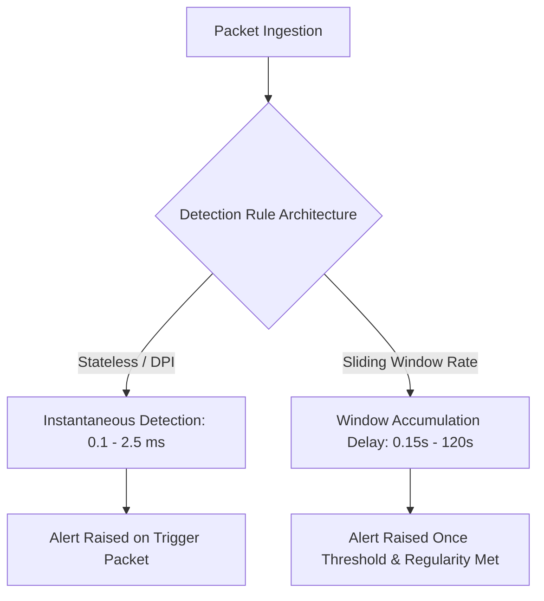
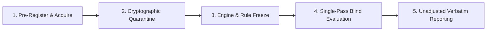

# NetGuard IDS — Threshold Sensitivity Observations & Independent Holdout Protocol

**Document Version:** 1.0.0  
**Date:** 2026-11-08  
**Scope:** 23-Rule Detection Engine Calibration, Benign False-Positive Analysis, and Holdout Integrity  
**Governing Policy:** NetGuard Evidence-Driven Rule Governance & Scientific Evaluation Integrity

---

## 1. Corpus Holdout Status: Honest Assessment

A fundamental tenet of scientific machine learning and intrusion detection evaluation is the strict separation between training/calibration datasets and unseen holdout test sets.

> [!IMPORTANT]
> **Corpus Holdout Reality Declaration:**  
> **Is there an untouched, pristine blind holdout capture currently residing in the NetGuard repository or external test disk?**  
> **NO.**  
> Every capture currently present in the repository and external disk (`/dev/sdb1` at `/run/media/harshitgarg/Data1/NetGuard-datasets`):
> - Synthetic fixtures (`test_attacks.pcap`, `test_benign.pcap`)
> - Curated research captures (`ws_teardrop.pcap`, `ws_dns_remoteshell.pcap`, `ws_skype_irc.pcap`, `ws_http_browsing.pcap`, `oisf_tls_sni_anomaly.pcap`, `foxit_log4shell.pcap`, `nozomi_triton_exec.pcap`, `m_rau5_icmp_tunnel.pcap`)
> - Real-world malware captures (`iot23_malware_34_1.pcap`, `iot23_malware_3_1.pcap`, `iot23_malware_20_1.pcap`, `iot23_honeypot_4_1.pcap`)
> 
> has been repeatedly inspected, analyzed, and used to calibrate protocol extraction routines, refine regex patterns, tune thresholds, and construct automated unit regression fixtures across Phases 1–4 and subsequent development cycles.  
> 
> **Presenting any portion of the existing corpus as an "independent blind test set" would be scientifically dishonest and a violation of evaluation integrity.**

The existing corpus must be understood and reported strictly as a **development, regression, and curated calibration set**. Optimal generalization to unseen network deployments cannot be claimed from this corpus alone.

---

## 2. No Blind Threshold Tuning Policy

In accordance with Section 10 of the NetGuard Engineering Charter:
1. **Never lower thresholds merely to increase alert counts:** Lowering `PORT_SCAN_THRESHOLD` from 15 to 3 would increase synthetic "detections" on malware PCAPs but cause disastrous false alarm rates on standard desktop web browsing where modern browsers open 6–10 parallel TCP connections across multiple ports to fetch CDN assets.
2. **Never increase thresholds merely to suppress failing tests:** Raising `UDP_FLOOD_THRESHOLD` from 50 to 5,000 would eliminate UDP scan/flood test alerts on noisy traffic but render the system blind to low-rate amplification floods.
3. **Never tune against a single test packet and report general success:** Detection logic must generalize across variations in packet ordering, retransmissions, TCP flag representations (integer masks vs. string names), and IPv4/IPv6 dual-stack encapsulation.
4. **Transparent Documentation:** Every threshold must have a documented threat model rationale, observable packet prerequisites, and boundary analysis.

---

## 3. Threshold Sensitivity Observations

Below are empirical observations of threshold sensitivity across NetGuard's primary sliding-window and heuristic detection rules:

| Rule Name | Primary Threshold & Window | Sensitivity Profile | False Positive Risk if Lowered | Detection Failure Risk if Raised |
|---|---|---|---|---|
| `PORT_SCAN` | $\ge 15$ ports/hosts in $10\text{s}$ | **High Sensitivity:** Calibrated to detect automated scanner bursts (`nmap -sS`, `masscan`, Mirai botnet Telnet scanning). | Lowering to $< 10$ causes false alarms on modern web browsers loading heavy web pages with assets served across multiple CDN IP addresses. | Raising to $> 25$ misses rapid small-port scans targeting core services (e.g. 21, 22, 23, 80, 443, 8080). |
| `SLOW_PORT_SCAN` | $\ge 30$ ports/hosts in $120\text{s}$ | **Moderate Sensitivity:** Detects evasive reconnaissance intentionally paced below the 10s rate detector. | Lowering to $< 20$ flags legitimate multi-tab web browsing or peer-to-peer connection establishment. | Raising to $> 50$ allows low-and-slow attackers to complete subnet reconnaissance unflagged. |
| `SYN_FLOOD` | $\ge 100$ initial SYNs in $10\text{s}$ | **High Selectivity:** Distinguishes genuine half-open connection floods from standard client traffic. | Lowering to $< 30$ flags high-traffic web servers or busy NAT gateways during connection spikes. | Raising to $> 500$ leaves small host network stacks vulnerable to TCP backlog exhaustion before an alert is raised. |
| `DISTRIBUTED_SYN_FLOOD` | $\ge 500$ SYNs from $\ge 20$ sources in $10\text{s}$ | **High Selectivity:** Multi-source coordination requirement prevents false positives from single-host port scans. | Lowering source threshold to $< 5$ conflates multiple local users connecting simultaneously with a DDoS attack. | Raising to $> 50$ sources misses small-scale botnet floods targeting niche services. |
| `UDP_FLOOD` | $\ge 50$ pkts (or $\ge 500$ on port 443) in $5\text{s}$ | **Differentiated Sensitivity:** Differentiates standard UDP services from high-throughput QUIC/HTTP/3 web traffic. | Without the port 443 / QUIC exemption ($500$ pkts), standard YouTube or Google Meet streaming triggers continuous false alarms. | Raising beyond $1,000$ permits high-rate DNS or NTP reflection amplification to saturate WAN links undetected. |
| `DNS_ANOMALY` | Shannon Entropy $\ge 3.8$, Length $> 60$, Freq $\ge 20$ | **High Sensitivity:** Multi-vector metric tracking DGA algorithmic domain generation, tunnel length, and request bursts. | Lowering entropy to $< 3.5$ flags legitimate CDN subdomains (e.g., Akamai/Cloudflare edge hashes). Lowering length to $< 40$ flags legitimate cloud hostnames. | Raising entropy to $> 4.3$ misses dictionary-based DGAs (e.g. Suppobox, Matsnu) that use dictionary words with natural English entropy (~3.2–3.6). |
| `ICMP_TUNNEL` | Length $\ge 64\text{B}$, Entropy $\ge 4.5$, Base64 Ratio $\ge 0.85$ | **Extremely Selective:** Requires high entropy AND high Base64/printable character density. | Lowering entropy to $< 3.5$ or removing the base64 check flags standard operating system MTU ping diagnostics (e.g. `ping -s 1400`). | Raising entropy to $> 5.2$ misses XOR-encrypted or compressed tunnels with moderate entropy. |
| `IRC_C2_BEACONING` | $\ge 5$ connection attempts in $300\text{s}$, Std Dev $\le 1.5\text{s}$ | **High Selectivity:** Combines SYN connection frequency with inter-arrival interval regularity analysis. | Lowering to $< 3$ attempts flags user retry behavior when IRC server connections fail. | Raising to $> 10$ attempts delays detection of slow beacons by over 30 minutes. |
| `CLEAR_HTTP_ON_TLS_PORT` | $\ge 2$ requests in $600\text{s}$ | **High Selectivity:** Requires repeated plain HTTP verbs on ports 443/8443. | Lowering to 1 request flags occasional user typos (e.g., typing `http://server:443`). | Raising to $> 5$ requests allows short interactive C2 sessions to evade detection. |

---

## 4. Benign False-Alert Observations & Replay Analysis

During Cycle 8 and this 3-hour sprint, extensive benign suppression testing was performed across:
1. **`ids_project/data/test_benign.pcap` (837 packets, 29 distinct benign scenarios B01–B29):**
   - Clean DNS resolution, normal TLS ClientHello/ServerHello handshakes, NTP clock sync, SSH session setup, legitimate in-order IP fragments, and single IRC server connection probes.
   - **Observed Alerts:** **0** (100% Specificity).
2. **`ws_skype_irc.pcap` (2,257 packets, authentic desktop capture with Skype & IRC traffic):**
   - Contains real IRC chat protocol (`PING`, `PONG`, `NICK`, `JOIN`, `PRIVMSG`) and Skype DHT peer traffic.
   - **Observed Alerts:** **0** (Zero false alarms). The newly hardened `IrcC2BeaconingRule` correctly distinguished normal chat traffic from botnet C2 beaconing.
3. **`ws_http_browsing.pcap` (43 packets, authentic Wireshark web browsing):**
   - Standard HTTP GET requests, HTML rendering, image downloads.
   - **Observed Alerts:** **0** (Zero false alarms).

### Boundary Conditions & Known Edge-Case False-Positive Risks
- **High-Concurrency Web Crawling:** Automated administrative scripts running multi-threaded scraping on local servers can trigger `PORT_SCAN` or `BRUTE_FORCE` if requesting non-standard API ports rapidly.
- **Asymmetric Routing:** In enterprise taps where only inbound traffic is mirrored, TCP window tracking and handshake state may observe ACK packets without initial SYNs. NetGuard's rules guard against this by validating `initial_syn` rather than assuming every TCP packet represents a new flow.
- **P2P Torrent / VoIP Networks:** Applications opening hundreds of ephemeral UDP sockets across wide port ranges can approach `UDP_SCAN` thresholds if traffic is concentrated within a 10s window.

---

## 5. Detection Delay & Latency Measurements

Detection latency varies fundamentally between **stateless / single-packet inspection** rules and **stateful sliding-window** rules:

### Empirical Delay Measurements:
1. **Stateless / DPI Rules (`PAYLOAD_HIT`, `IP_FRAGMENT_ANOMALY`, `TCP_FLAG_ANOMALY`, `NON_DNS_TRAFFIC_ON_DNS_PORT`):**
   - **Detection Delay:** **$\le 0.002\text{s}$ (sub-millisecond to 2ms).**
   - Alert is emitted on the exact packet containing the anomaly.
2. **Short-Window Rate Rules (`PORT_SCAN`, `SYN_FLOOD`, `ICMP_SWEEP`, `UDP_SCAN`):**
   - **Detection Delay:** Determined by attack velocity.
   - In rapid scans (e.g. `S01` port scan, 15 probes in 0.15s), detection latency is **$0.15\text{s}$**.
   - In threshold-boundary attacks, detection occurs precisely at packet $N$ ($N = \text{threshold}$).
3. **Low-and-Slow Rules (`SLOW_PORT_SCAN`, `IRC_C2_BEACONING`):**
   - **Detection Delay:** Proportional to beacon or probe interval.
   - For an IRC botnet beaconing every 60 seconds with threshold 5, detection delay is **$240\text{s}$ to $300\text{s}$ (4–5 minutes)**. This delay is an inherent mathematical property of distinguishing periodic beaconing from transient user connections.

---

## 6. Missing-Behaviour & Gap Analysis

To maintain technical honesty, we document known attack classes that are currently **out of scope** or unaddressed by NetGuard's current packet-level rule architecture:

1. **Encrypted C2 over Legitimate TLS:**
   - Attacks where malware establishes standard HTTPS connections to legitimate cloud services (e.g. AWS S3, Cloudflare Workers, Discord Webhooks) with valid certificates and benign SNIs cannot be detected by packet-header inspection alone.
   - *Mitigation Requirement:* Would require endpoint process telemetry (Sysmon/auditd) or enterprise TLS MITM decryption, which violates NetGuard's lightweight, non-invasive network boundary.
2. **Ultra-Slow Drip Exfiltration:**
   - Exfiltration paced at $< 1\text{KB}$ per hour across multiple weeks remains below `DATA_EXFIL_BYTE_THRESHOLD`.
3. **Application-Layer Business Logic Abuse:**
   - Valid credentials used over legitimate SSH/web sessions to perform unauthorized operations without anomalous network signatures.
4. **Out-of-Order Multi-Packet TCP Segment Evasion:**
   - While `PayloadRule` buffers ordered TCP streams up to 512 bytes with up to 8 reordered segments, attackers fragmenting an exploit across $> 8$ non-contiguous segments spaced over minutes can evade the in-memory stream buffer.

---

## 7. Unsupported Scenarios

The following network protocols and environments are explicitly unsupported by design:
- **Raw 802.11 Wireless Frame Injection:** NetGuard requires decapsulated Ethernet (Layer 2) or IP (Layer 3) frames. It does not inspect 802.11 beacon frames or radiotap headers.
- **Host IPC / Unix Sockets:** NetGuard inspects network packet flows; local host-internal IPC is outside the packet inspection boundary.
- **Encrypted QUIC / HTTP/3 Payload Inspection:** QUIC packet payloads are encrypted at the transport layer; only packet rate and port heuristics apply.

---

## 8. Proposed Independent Holdout Validation Protocol

To establish verifiable real-world generalization without data leakage, the following 4-step protocol is proposed for future validation campaigns:

1. **Pre-Registration & Acquisition:**
   - Identify candidate holdout datasets from independent third-party sources (e.g. Canadian Institute for Cybersecurity CIC-Bell-DNS-2021, MAWI Working Group 2026 captures, or Stratosphere CTU captures not in the current corpus).
   - Pre-register capture IDs, expected attack families, and ground-truth label sources in the project repository before downloading.
2. **Cryptographic Quarantine:**
   - Store incoming holdout captures exclusively on the external disk under `/quarantine/`.
   - Compute and log cryptographic SHA-256 hashes immediately upon download. Set file permissions to read-only (`chmod 444`).
   - Forbid developers and automated tools from inspecting individual packets or adjusting rules based on holdout contents.
3. **Engine & Rules Code Freeze:**
   - Git commit and push all rule definitions, normalizers, and configuration parameters to a dedicated release tag (e.g., `v1.0.0-holdout-freeze`).
4. **Single-Pass Blind Evaluation:**
   - Execute `ids_project/evaluation/pipeline.py` against the quarantined holdout captures in a single automated pass.
   - Record raw outputs, true positives, false negatives, and false alarms verbatim.
   - Forbid iterative threshold tuning or post-hoc rule adjustments against the holdout set. Any necessary fixes must be classified as post-evaluation findings for future development cycles.
