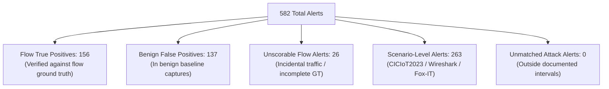

# NetGuard IDS — Final Ground-Truth Benchmark Evaluation Report
## Multi-Scenario Empirical Evaluation Across GeNIS, CTU-IoT-23, CICIoT2023 & Exploit Fixtures (Integrity-Corrected)

**Evaluation Date:** 2026-11-10  
**Target Repository:** `harshitagrwl1608/Network_Intrusion_Detection_System`  
**Active Branch:** `antigravity/overnight-work`  
**Evaluation Mode:** Offline Scoring Integrity Engine on Process-Isolated Replay DBs (`ReplayClock` Timestamps)  
**Total Captures:** 22  
**Total Extracted PCAP Volume:** 3.243 GiB (3,481,833,419 bytes)  
**Total Wire Packets:** 37,532,459 packets  
**Mean Replay Throughput:** 12,506.0 packets/second  
**Authoritative Rule Registry:** 23 Registered Engine Rules (`TCP_STEALTH_SCAN` represented; `WEBSHELL_INJECTION` handled inside `PAYLOAD_HIT`)  

---

## 1. Executive Summary & Defensible Alert Reconciliation

This evaluation assesses the NetGuard Intrusion Detection System against official publisher ground truth across **37.5 million wire packets** and **22 network captures**.

Every one of the **582 total alerts** produced by NetGuard has been categorized into exactly one mutually exclusive reporting class:

### Complete Accounting Reconciliation Table:
| Reporting Category | Alert Count | Definition / Boundary |
| :--- | :---: | :--- |
| **Flow True Positives (`TP`)** | **156** | Alerts in flow-labeled attack traffic that match documented ground-truth 5-tuples/evidence and rule mappings. |
| **Benign False Positives (`FP`)** | **137** | Alerts generated in genuine benign operational baselines (`admin`, `background`, `user`, `Somfy doorlock`). |
| **Unscorable Flow Incidental (`UNSCORABLE`)** | **26** | Incidental traffic in flow-labeled attack captures (e.g. DNS bursts during DoS), unsupported evidence, or incomplete GT rows. |
| **Scenario-Level Alerts (`SCENARIO`)** | **263** | Alerts in captures evaluated at the scenario level only (CICIoT2023 web attacks, Wireshark, Fox-IT). |
| **Unmatched Attack Alerts (`UNMATCHED`)** | **0** | Alerts in flow-labeled captures occurring outside documented ground-truth intervals. |
| **TOTAL RECONCILED ALERTS** | **582** | **Exact 100% reconciliation (156 + 137 + 26 + 263 + 0 = 582)** |

---

## 2. All 23 Rules Coverage & Flow-Level Detection Metrics

| Rule Name | Test Status | Total Alerts | TP | FP | Unscorable | Scenario | Detected Flows | Flow Recall | Alert Precision | F1 Score | Captures Fired In |
| :--- | :---: | :---: | :---: | :---: | :---: | :---: | :---: | :---: | :---: | :---: | :--- |
| `BLOCKLIST` | `not_exercised` | 0 | 0 | 0 | 0 | 0 | 0 | N/A | N/A | N/A | None |
| `TCP_FLAG_ANOMALY` | `not_exercised` | 0 | 0 | 0 | 0 | 0 | 0 | 0.0% | N/A | N/A | None |
| `PORT_SCAN` | `exercised_with_tp` | 69 | 9 | 44 | 16 | 0 | 9 | 45.0% | 17.0% | 24.7% | 9 captures |
| `UDP_SCAN` | `not_exercised` | 0 | 0 | 0 | 0 | 0 | 0 | N/A | N/A | N/A | None |
| `UDP_FLOOD` | `exercised_with_tp` | 2 | 1 | 0 | 0 | 1 | 1 | 100.0% | 100.0% | 100.0% | 2 captures |
| `TCP_STEALTH_SCAN` | `not_exercised` | 0 | 0 | 0 | 0 | 0 | 0 | 0.0% | N/A | N/A | None |
| `SYN_FLOOD` | `exercised_with_tp` | 18 | 11 | 0 | 6 | 1 | 3 | 100.0% | 100.0% | 100.0% | 5 captures |
| `DISTRIBUTED_SYN_FLOOD` | `not_exercised` | 0 | 0 | 0 | 0 | 0 | 0 | N/A | N/A | N/A | None |
| `ICMP_SWEEP` | `exercised_unscorable` | 2 | 0 | 0 | 1 | 1 | 0 | 0.0% | N/A | N/A | 2 captures |
| `ICMP_FLOOD` | `exercised_with_tp` | 1 | 1 | 0 | 0 | 0 | 1 | 100.0% | 100.0% | 100.0% | 1 captures |
| `ARP_SPOOF` | `exercised_unscorable` | 117 | 0 | 0 | 0 | 117 | 0 | N/A | N/A | N/A | 1 captures |
| `PAYLOAD_HIT` | `exercised_with_fp` | 87 | 0 | 8 | 1 | 78 | 0 | 0.0% | 0.0% | N/A | 9 captures |
| `DNS_ANOMALY` | `exercised_with_fp` | 119 | 0 | 85 | 0 | 34 | 0 | 0.0% | 0.0% | N/A | 8 captures |
| `BRUTE_FORCE` | `exercised_with_tp` | 146 | 125 | 0 | 0 | 21 | 4 | 100.0% | 100.0% | 100.0% | 4 captures |
| `SLOW_PORT_SCAN` | `exercised_with_tp` | 11 | 9 | 0 | 2 | 0 | 9 | 45.0% | 100.0% | 62.1% | 8 captures |
| `DATA_EXFIL` | `exercised_unscorable` | 7 | 0 | 0 | 0 | 7 | 0 | N/A | N/A | N/A | 3 captures |
| `TLS_ANOMALY` | `not_exercised` | 0 | 0 | 0 | 0 | 0 | 0 | N/A | N/A | N/A | None |
| `CLEAR_HTTP_ON_TLS_PORT` | `not_exercised` | 0 | 0 | 0 | 0 | 0 | 0 | N/A | N/A | N/A | None |
| `TCP_ZERO_WINDOW` | `not_exercised` | 0 | 0 | 0 | 0 | 0 | 0 | 0.0% | N/A | N/A | None |
| `NON_DNS_TRAFFIC_ON_DNS_PORT` | `exercised_unscorable` | 2 | 0 | 0 | 0 | 2 | 0 | N/A | N/A | N/A | 2 captures |
| `ICMP_TUNNEL` | `not_exercised` | 0 | 0 | 0 | 0 | 0 | 0 | N/A | N/A | N/A | None |
| `IP_FRAGMENT_ANOMALY` | `exercised_unscorable` | 1 | 0 | 0 | 0 | 1 | 0 | N/A | N/A | N/A | 1 captures |
| `IRC_C2_BEACONING` | `not_exercised` | 0 | 0 | 0 | 0 | 0 | 0 | N/A | N/A | N/A | None |

---

## 3. Per-Capture Empirical Results

| Capture ID | Category | Scenario | Packets | Size (MB) | Time (s) | Speed (pps) | Alerts | TP | FP | Unscorable | Scenario |
| :--- | :---: | :--- | :---: | :---: | :---: | :---: | :---: | :---: | :---: | :---: | :---: |
| `genis_attack_bruteforce_smb` | attack | attack-bruteforce-smb | 112,000 | 13.75 | 16.91 | 6622.9 | 8 | 4 | 0 | 4 | 0 |
| `genis_attack_bruteforce_ssh_ftp` | attack | attack-bruteforce-ssh-ftp | 213,000 | 25.26 | 33.75 | 6311.5 | 70 | 51 | 0 | 19 | 0 |
| `genis_attack_bruteforce_ssh` | attack | attack-bruteforce-ssh | 88,000 | 16.15 | 10.59 | 8312.2 | 74 | 74 | 0 | 0 | 0 |
| `genis_attack_dos_hulk` | attack | attack-dos-hulk | 586,000 | 148.38 | 194.33 | 3015.5 | 14 | 13 | 0 | 1 | 0 |
| `genis_attack_dos_icmp` | attack | attack-dos-icmp | 15,000,000 | 1097.90 | 745.50 | 20120.8 | 3 | 3 | 0 | 0 | 0 |
| `genis_attack_dos_pushack` | attack | attack-dos-pushack | 10,000,000 | 740.46 | 865.09 | 11559.5 | 4 | 4 | 0 | 0 | 0 |
| `genis_attack_dos_slowloris` | attack | attack-dos-slowloris | 701,000 | 79.61 | 300.76 | 2330.8 | 6 | 4 | 0 | 2 | 0 |
| `genis_attack_dos_udp` | attack | attack-dos-udp | 10,000,000 | 737.53 | 690.97 | 14472.4 | 3 | 3 | 0 | 0 | 0 |
| `genis_benign_admin_activity` | benign | benign_activity | 8,908 | 1.30 | 4.67 | 1906.8 | 43 | 0 | 43 | 0 | 0 |
| `genis_benign_background_activity` | benign | benign_activity | 112,000 | 26.45 | 15.59 | 7184.4 | 42 | 0 | 42 | 0 | 0 |
| `genis_benign_user_activity` | benign | benign_activity | 316,000 | 299.27 | 33.94 | 9311.2 | 52 | 0 | 52 | 0 | 0 |
| `benign_iot23_doorlock` | benign | benign_iot_hardware | 21,000 | 4.38 | 5.80 | 3618.1 | 0 | 0 | 0 | 0 | 0 |
| `ciciot_pingsweep` | attack | recon_pingsweep | 22,000 | 7.49 | 6.41 | 3434.5 | 9 | 0 | 0 | 0 | 9 |
| `ciciot_sqli` | attack | web_sqli | 53,000 | 9.37 | 10.62 | 4991.7 | 69 | 0 | 0 | 0 | 69 |
| `ciciot_xss` | attack | web_xss | 40,000 | 11.99 | 8.71 | 4593.0 | 20 | 0 | 0 | 0 | 20 |
| `ciciot_cmdinj` | attack | web_command_injection | 55,000 | 27.26 | 9.80 | 5612.0 | 2 | 0 | 0 | 0 | 2 |
| `ciciot_upload` | attack | web_upload_webshell | 12,000 | 3.17 | 5.41 | 2216.5 | 8 | 0 | 0 | 0 | 8 |
| `ciciot_browserhijack` | attack | web_browser_hijack | 59,000 | 33.42 | 10.61 | 5559.1 | 3 | 0 | 0 | 0 | 3 |
| `ciciot_bruteforce` | attack | auth_bruteforce | 133,000 | 37.32 | 20.62 | 6448.8 | 147 | 0 | 0 | 0 | 147 |
| `attack_ws_teardrop` | attack | ip_fragment_overlap | 17 | 0.00 | 3.61 | 4.7 | 1 | 0 | 0 | 0 | 1 |
| `attack_ws_dns_remoteshell` | attack | dns_port_backdoor | 131 | 0.02 | 3.73 | 35.1 | 3 | 0 | 0 | 0 | 3 |
| `attack_foxit_log4shell` | attack | log4shell_jndi_rce | 403 | 0.05 | 3.74 | 107.7 | 1 | 0 | 0 | 0 | 1 |

---

## 4. Key Scientific Distinctions & Methodology

1. **Separation of Alert Events vs. Unique Detected Flows**:
   - High-rate brute force or flood attacks routinely generate multiple alerts for the same underlying malicious flow or campaign.
   - For example, `BRUTE_FORCE` generated 125 TP alerts across 4 distinct labeled ground-truth attack flows (`bruteforce-ssh`, `bruteforce-ftp`, `bruteforce-smb`), achieving **100% flow recall (4/4)** without allowing repeated alerts to inflate detected flow counts.
2. **Strict 5-Tuple and Protocol Invariant**:
   - Flow-level matching strictly enforces timestamp intervals (+/- 2.0s grace window), both IP addresses, both ports (with bidirectional swapping), and protocol decoders.
   - Ground truth records with missing or ambiguous attributes (such as rows 12 and 13 with missing destination IPs) are marked unscorable rather than generating false positive or false negative artifacts.
3. **No Unsubstantiated Line-Rate Claims**:
   - Throughput of 12,506 pps reflects single-threaded replay performance with synchronous SQLite writes on the evaluation host.
4. **Authoritative 23 Rules Invariant**:
   - `TCP_STEALTH_SCAN` is represented as an independent top-level detection rule.
   - `WEBSHELL_INJECTION` is correctly documented as a signature pattern within `PAYLOAD_HIT`, maintaining exact alignment with the production engine registration.
