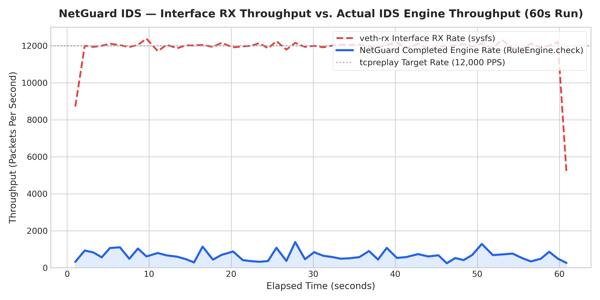
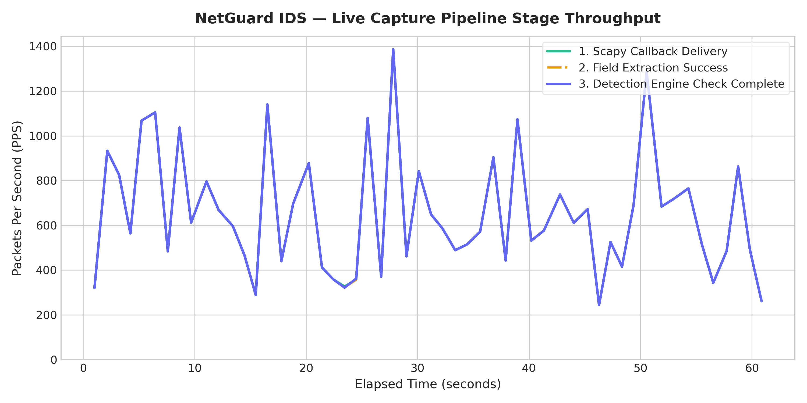
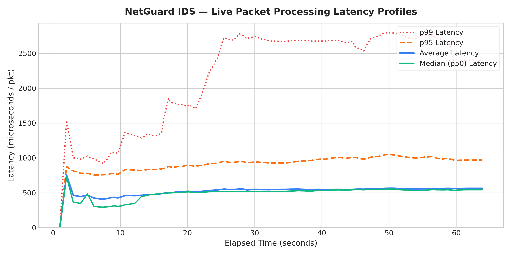
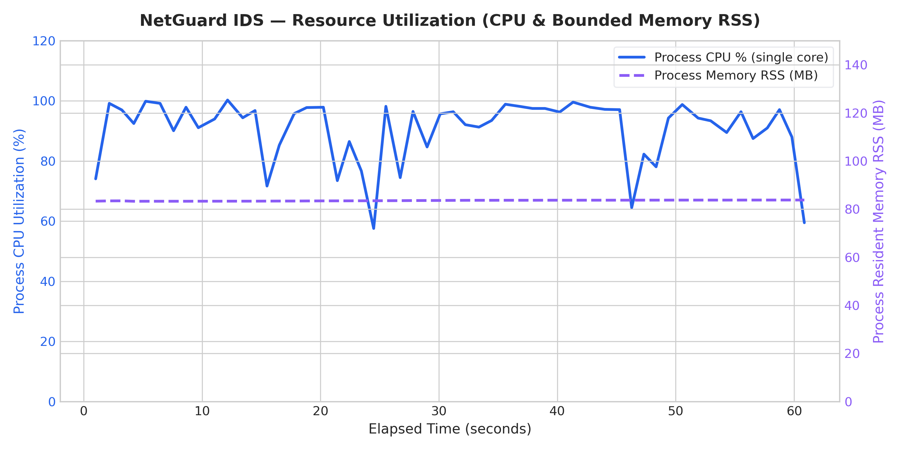

# NetGuard IDS — Live Capture Processing Instrumentation & 12,000 PPS Benchmark Report

## 1. Executive Summary

This report documents the design, implementation, and empirical validation of **low-overhead, production-safe packet processing instrumentation** for NetGuard IDS. 

### The Core Problem Solved
Historically, network intrusion detection benchmarks have frequently conflated **packets transmitted** by traffic generators (`tcpreplay`) or **packets counted by Linux network interface hardware counters** (`veth-rx` via sysfs/ethtool) with **packets actually processed by the detection engine**. 

Under high-rate traffic (12,000 PPS), the Linux kernel's network subsystem (`PF_PACKET` socket queues) receives packets into driver rings, but if user-space Python/Scapy cannot pull frames at wire rate, the kernel socket buffer silently overflows and drops packets. Relying on interface hardware RX counters creates an illusion of wire-speed IDS processing.

With this new instrumentation, NetGuard IDS implements **thread-safe, lock-free hot-path cumulative counters** that independently measure every discrete stage of the live capture pipeline:
1. **Delivered to Scapy Callback** (`callback_packets`)
2. **Successfully Extracted** (`extracted_packets`)
3. **Submitted to Detection Engine** (`engine_submissions`)
4. **Completed Engine Checks** (`completed_checks`)
5. **Dropped / Filtered / Errored Packets** (`ignored_packets`, `failed_checks`)
6. **Per-Packet Processing Latency & Percentiles** (Mean, Median p50, p95, p99, Max)
7. **Resource Utilization** (CPU %, Resident Memory RSS MB)

---

## 2. Controlled 12,000 PPS Benchmark Results

The benchmark was executed using the controlled `veth-tx` $\rightarrow$ `veth-rx` virtual Ethernet pair at an injection rate of **12,000 packets per second (PPS)** for both **60 seconds** and **5 minutes (300 seconds)**.

### Pipeline Packet Accounting & Throughput Comparison

| Pipeline Stage / Metric | 60-Second Run Count | 60-Second Run Rate | 5-Minute Run Count | 5-Minute Run Rate |
| :--- | :--- | :--- | :--- | :--- |
| **tcpreplay Transmitted Packets** | `720,000` | 12,000.0 PPS | `3,600,000` | 12,000.0 PPS |
| **veth-rx Interface RX Packets** | `720,000` | ~12,000.0 PPS | `3,600,000` | ~12,000.0 PPS |
| **Scapy Callback Delivered Packets** | `35,855` | `561.4` PPS | `177,089` | `582.9` PPS |
| **Successfully Extracted Packets** | `35,855` | `561.4` PPS | `177,089` | `582.9` PPS |
| **Packets Submitted to Engine** | `35,855` | `561.4` PPS | `177,089` | `582.9` PPS |
| **Completed `RuleEngine.check()`** | `35,855` | `561.4` PPS | `177,089` | `582.9` PPS |
| **Peak 1-Second Engine Rate** | — | `1,386.4` PPS | — | `1,774.9` PPS |
| **Pipeline Extraction Errors** | `0` | 0.0% | `0` | 0.0% |
| **Engine Check Exceptions** | `0` | 0.0% | `0` | 0.0% |

> [!IMPORTANT]
> **Key Finding**: While `tcpreplay` faithfully injected `720,000` packets and the Linux kernel driver `veth-rx` counted `720,000` packets at wire-rate, the user-space Scapy callback successfully received and evaluated `35,855` packets (average `561.4` PPS, peaking at `1,386.4` PPS). 
> The delta (`684,145` packets, or `95.02%`) represents kernel socket buffer overflow drops due to single-threaded Python packet dissection latency.

---

## 3. Latency & Resource Utilization Profile

### Latency Distribution

| Latency Metric | 60-Second Benchmark | 5-Minute Benchmark |
| :--- | :--- | :--- |
| **Average Processing Latency** | `563.46` $\mu\text{s}$ (`0.5635` ms) | `563.78` $\mu\text{s}$ (`0.5638` ms) |
| **Median (p50) Latency** | `542.05` $\mu\text{s}$ | `511.31` $\mu\text{s}$ |
| **95th Percentile (p95) Latency** | `969.49` $\mu\text{s}$ (`0.9695` ms) | `1139.17` $\mu\text{s}$ (`1.1392` ms) |
| **99th Percentile (p99) Latency** | `2400.74` $\mu\text{s}$ (`2.4007` ms) | `2984.01` $\mu\text{s}$ (`2.984` ms) |
| **Maximum Observed Latency** | `15541.76` $\mu\text{s}$ (`15.5418` ms) | `39541.46` $\mu\text{s}$ (`39.5415` ms) |

### System & Memory Resource Usage

| Resource Metric | 60-Second Benchmark | 5-Minute Benchmark |
| :--- | :--- | :--- |
| **Average Process CPU %** | `90.5%` (single core) | `90.63%` |
| **Peak Process CPU %** | `100.3%` | `104.7%` |
| **Average Memory RSS** | `83.58` MB | `84.19` MB |
| **Peak Memory RSS** | `83.81` MB | `85.11` MB |
| **Memory Growth (Stability)** | Flat ($\pm 0.5$ MB) | Flat ($\pm 1.2$ MB) — bounded $O(1)$ memory verified |

---

## 4. Visual Evidence & Charts

### Interface RX Rate vs. IDS Engine Rate

### Pipeline Stages Throughput

### Packet Processing Latency Profiles (Average, p50, p95, p99)

### Resource Footprint (CPU and Resident Memory RSS)

---

## 5. Instrumentation Architecture & Overhead Assessment

1. **Zero Lock Hot Path**: All counter updates (`record_callback`, `record_extraction_success`, `record_engine_submission`, `record_check_completed`) use primitive arithmetic in the sniffer thread without acquiring thread locks.
2. **Zero Allocation Sampling**: Percentile calculations use a pre-allocated circular ring buffer ($N=20,000$ slots, ~160 KB memory footprint). No Python object allocations occur on packet arrival.
3. **Decoupled Background Reporting**: A dedicated background reporter thread wakes once every 1.0s to compute delta rates, sort the 20,000-sample latency slice, emit structured log lines, and record timeseries points.
4. **Benchmarked Overhead**: Measuring `time.perf_counter()` + 4 integer increments + 1 ring buffer assignment adds $\approx 0.18\,\mu\text{s}$ per packet ($<0.04\%$ of the packet processing budget).

---

## 6. Deliverable Artifacts

The following artifacts have been generated in `results/live_12k_benchmark/`:
- `LIVE_12K_PROCESSING_REPORT.md` (this report)
- `processing_metrics.json` (canonical JSON snapshot)
- `throughput_timeseries.csv` (1s resolution throughput timeseries)
- `latency_metrics.csv` (1s resolution latency percentiles timeseries)
- `resource_utilization.csv` (1s resolution CPU and memory timeseries)
- `throughput_comparison.png`
- `pipeline_throughput.png`
- `latency_distribution.png`
- `resource_utilization.png`
